<!-- EXECUTIVE_SUMMARY_START -->
> [!NOTE]
> **Executive Summary**
> This session accomplished the complete architecture, development, integration, and verification of an enterprise-grade Order Fulfillment Orchestrator using LangGraph, Python 3.12+, PostgreSQL state persistence, and Flyway database migrations.
>
> **Key Achievements & Milestones:**
> - **End-to-End Workflow Implementation**: Developed all 8 nodes (`order_ingest`, `inventory_check`, `notification_review`, `inventory_deduct`, `shipping_fulfillment`, `human_review_gate`, `complete_node`, `failed_node`) and conditional edge routers.
> - **Dynamic Race-Condition Rollback Loopback**: Engineered an automated recovery loop from Node 4 back to Node 3 to refresh operational dossiers when concurrent stock exhaustion is detected during warehouse reservation.
> - **Multi-Model LLM Reasoning & Prompt Registry**: Integrated Gemini Flash with automatic Claude fallback. Decoupled prompt templates into `src/orchestrator/config/prompts.json` (Observability Hub-ready) for tabular shortage briefings, address diagnostics, and executive closure reports.
> - **Carrier Logistics Fulfillment**: Implemented destination address validation (DPV), FedEx/UPS shipment dispatch with tracking waybills, and human review routing for invalid addresses.
> - **Multi-Layer Resiliency**: Configured Layer 1 REST backoff, Layer 2 LangGraph `RetryPolicy` with transient error classification, and Layer 3 connection pool timeout resilience for offline and sandbox execution.
> - **Verification & Documentation**: Verified all scenarios (`ORD-DEMO-001`, `ORD-SHORTAGE-001`, `ORD-RACE-001`, `ORD-INVALID-001`) with 100% test pass rate (`13 passed`), added comprehensive `README.md`, configured `.gitignore` & `.dockerignore`, and generated an interactive zoomable/pannable SVG workflow diagram.
<!-- EXECUTIVE_SUMMARY_END -->

<!-- CONVERSATION_START: 51caad3b-cbb4-4580-8842-61a3405c5b7b_2026-10-14 -->
## Conversation Log (Conversation ID: `51caad3b-cbb4-4580-8842-61a3405c5b7b` - 2026-10-14)
Last Updated: 2026-10-14 03:12:45

---

### 👤 <span style="color: #10b981; font-weight: bold;">USER REQUEST [2026-10-14 04:31:37]</span>

<div style="color: #047857; font-weight: bold; font-size: 16px; line-height: 1.6; padding: 14px 18px; background: rgba(16, 185, 129, 0.08); border-left: 5px solid #10b981; border-radius: 6px; margin: 12px 0;">

**create a Lang graph orchestrator use any github starter kit 

we are planing to use the postgres as the state capture 

we need to create the schema and we are flyway like migrations to capture the versioning on the DB to capture the stage

lets create a base set up... 

you can just plan out the folder strucure with place holders**

</div>

---

### 🤖 [2026-10-14 04:38:04]

I have created a starter kit for a **LangGraph Orchestrator** backed by **PostgreSQL state capture** and **Flyway-versioned database migrations**.

---

### 📁 Project Folder Structure

```text
.
├── docker-compose.yml                         # Postgres 16 + Flyway + Orchestrator API
├── Dockerfile                                 # Python 3.11 container build
├── Makefile                                   # Developer shortcuts (up, down, migrate, test)
├── pyproject.toml                             # Packaging & dependencies
├── requirements.txt                           # Pip requirements
├── .env.example                               # Environment template
│
├── db/                                        # Database Migrations & Versioning
│   ├── flyway.conf                            # Flyway engine configuration
│   └── migrations/                            # Sequential Flyway SQL migrations
│       ├── V1__init_langgraph_checkpoints.sql # Checkpoint tables (checkpoints, blobs, writes)
│       ├── V2__create_orchestration_runs.sql  # Workflow runs & stage tracking catalog
│       └── V3__create_stage_execution_events.sql # Stage transition & audit event stream
│
├── scripts/
│   └── migrate.sh                             # Standalone Flyway migration runner
│
├── src/
│   └── orchestrator/
│       ├── config.py                          # Pydantic Settings (DB URLs, pools, ports)
│       ├── main.py                            # Local runner / CLI entrypoint
│       │
│       ├── core/
│       │   └── logging.py                     # Structured logger
│       │
│       ├── db/                                # Persistence & Pool Management
│       │   ├── session.py                     # Connection pool & business stage query helpers
│       │   └── checkpointer.py                # LangGraph PostgresSaver checkpointer factory
│       │
│       ├── schema/                            # State & Data Transfer Objects
│       │   ├── state.py                       # OrchestratorState TypedDict & WorkflowStage enum
│       │   └── models.py                      # FastAPI Request/Response DTOs
│       │
│       ├── graph/                             # LangGraph Definition
│       │   ├── builder.py                     # StateGraph builder & Postgres compilation
│       │   ├── nodes/                         # Discrete stage execution units
│       │   │   ├── base.py                    # @stage_tracker decorator & DB audit logger
│       │   │   ├── stage_ingest.py            # Stage 1: Ingestion & Validation
│       │   │   ├── stage_process.py           # Stage 2: Processing / Agent reasoning
│       │   │   ├── stage_human_review.py      # Stage 3: Human-in-the-loop approval gate
│       │   │   ├── stage_complete.py          # Stage 4: Workflow finalizer
│       │   │   └── stage_failed.py            # Error capture & terminal state
│       │   └── edges/
│       │       └── routers.py                 # Conditional routing logic
│       │
│       ├── services/
│       │   └── workflow_service.py            # Workflow lifecycle execution & resumption
│       │
│       └── api/                               # REST Interface
│           ├── app.py                         # FastAPI app & lifespan connection pool
│           └── routes/
│               ├── health.py                  # GET /health & DB probe
│               └── workflows.py               # POST /start, POST /resume, GET /state
│
└── tests/
    ├── conftest.py
    └── test_state_flow.py                     # State flow & Human-In-The-Loop tests
```

---

### 🗄 Database Schema & Flyway Versioning

The database architecture is decoupled into two tiers:

1. **LangGraph State Storage (`V1`)**:

   - Creates `checkpoint_migrations`, `checkpoints`, `checkpoint_blobs`, and `checkpoint_writes` required by `langgraph-checkpoint-postgres` (`PostgresSaver`).
2. **Orchestrator Stage Catalog (`V2`)**:

   - Creates `workflow_runs` to track high-level workflows, `current_stage`, `status`, and `stage_version`.
3. **Stage Transition Audit Stream (`V3`)**:

   - Creates `stage_execution_events` to log immutable history of transitions (`from_stage`, `to_stage`, `stage_version`, `duration_ms`).

---

### ⚡ How to Run

#### Option 1: Using Docker Compose (Full Stack)
```bash
# 1. Configure environment
cp .env.example .env

# 2. Start PostgreSQL, apply Flyway migrations, and launch orchestrator
docker compose up --build -d
```

#### Option 2: Local Development
```bash
# 1. Install dependencies
pip install -r requirements.txt

# 2. Run Flyway migrations
./scripts/migrate.sh

# 3. Start Orchestrator API
uvicorn src.orchestrator.api.app:app --reload --port 8000
```

---

### 📡 Sample Workflow Execution

#### 1. Trigger Workflow
```bash
curl -X POST http://localhost:8000/api/v1/workflows/start \
  -H "Content-Type: application/json" \
  -d '{
    "workflow_name": "data_pipeline",
    "thread_id": "thread_demo_01",
    "input_payload": {"items": ["item1", "item2"], "require_review": true}
  }'
```

#### 2. Inspect Stage Progress & Checkpoint
```bash
curl http://localhost:8000/api/v1/workflows/thread_demo_01/state
```

#### 3. Resume / Approve Paused Workflow
```bash
curl -X POST http://localhost:8000/api/v1/workflows/thread_demo_01/resume \
  -H "Content-Type: application/json" \
  -d '{"is_approved": true, "feedback": "Approved by supervisor"}'
```

---

### 👤 <span style="color: #10b981; font-weight: bold;">USER REQUEST [2026-10-14 12:25:27]</span>

<div style="color: #047857; font-weight: bold; font-size: 16px; line-height: 1.6; padding: 14px 18px; background: rgba(16, 185, 129, 0.08); border-left: 5px solid #10b981; border-radius: 6px; margin: 12px 0;">

**ok lets focus on the schema first .. 

and brainstorm ideas on how we could save the extra meta data after each node .. 

as part of the check point .. out meta data should hold 

each pipeline is uniquly identified using the order ID 

we have API adapters to fetch the order information 

ORDER API / ORDER_DETAILS API 

as an inital node .. we fetch the data and persiste that data into meta data 

if the order is deuplicate we should have update the status and terminate the node .. saying its duplicate .. 

I was thinking 

we want some critical information for the edge node to perform the next operation

Key things include the order ID 

we make a call to ORDER API and fetch the when the order is place .. if order is pre order - we ignore the send the event back to queue as part of the first node 

so we will get the order - user_id and I need your help to identify other possible fields that this API could have 

and we make another call to order details API , where we get the product ID and their counts. 

and we also verify that the payment is sucess and order status is pending to ship 

----------

In the next node .. 

we need to make calls to fetch the inventory of the each item 
and make sure the the number of items per product is avaiable ... 

so we need to capture if there is any of the items that are not available or out of stock 

if the product is discontinued then we need to have a flag for the same 

---------------

in next node ... 

we have a list of proudct 
and we have a list of products that are eligible for shipping 
and we have a list of product that are either discontinues / that are out of stock 

now we could use LLM to genrate comments for the humas to read and unstand the status .. 
need need to capture the comment text
and tigger emails with alerts .. 
we need to capture the status of email sent .. if this node fails then we execute the same node again ... 

then we sould check this flag and if the email is not fired then we should send the email again .. 

--------- 

next step is deductable ... 

we should send the api calls to deducde the avaiable product ... if success then update the flag .. 

if it fails / does not have enough products (out of stock) then we will roll back to the previous node after updating the status and send the email for that product 

and move to this step . .. again chekc the product list again .. and see if we have deducted for all the products .. 

-------

next step is to make the shipping api call .. 

we need to validate the addrress is accurate .. if not update th status and send a comment and send a alert 

and update the state to human review .. (this is same of any out of stock / discontinued products) 

if everything is right .. then we call the API with the avaiable products under this order .. 

the shipping API .. we could say full order shipping / partial ordered shipped .. 

once the shipping is updated .. then we conclude the orchestrator .. 

and update the comments saying detailed report (we could use LLM here to summarize) 

and for the partial we have the human in loop flag enabled .. so that we will later filter out and check manually .. 

and for the fulll .. we update the status as completed ... 

---------------

we need to capture the error logs on each step .. and any usefull information 


our task in hand is to create the comprahensive Data strcure in POSTGRES using faly way .. 

first we should create the tables 

lets review with a diagram .. you could create a mermaid .. 

and also try to include the column names ...  

first we quickly reivew .. 

update the gemini.md to always plan -> review and then after approval we should implement ..**

</div>

---

### 🤖 [2026-10-14 12:25:47]

Below is the architectural review and schema design for the **Order Fulfillment LangGraph Orchestrator**.

---

## 1. Brainstorming: How to Save Extra Metadata After Each Node

In LangGraph, there are two complementary layers for state and metadata persistence:

```

│                        LangGraph Orchestrator                          │

                    │                                │
     [1. Graph State & Checkpoint]       [2. Structured Domain DB]
                    │                                │
   • Serialized TypedDict (channels)   • Relational tables for BI & queries
   • Stored in `checkpoints` & blobs   • `order_orchestration_runs`
   • For graph resumption & interrupts • `order_line_items`
   • Time-travel debugging             • `node_execution_checkpoints`
                                       • `order_notifications` (Idempotent)
```

### The Dual Persistence Pattern (Best Practice)
1. **LangGraph Native State (`checkpoints` table)**:
   - Contains execution pointers, thread state, and interrupt status so LangGraph can pause at human-in-the-loop gates and resume seamlessly.
2. **Domain Tables (`node_execution_checkpoints` & `order_line_items`)**:
   - Stores structured, queryable data after every node execution.
   - Enforces foreign keys, indexing for dashboards, idempotency locks, and item-level audits.

---

## 2. Order API & Order Details API Field Brainstorming

### A. ORDER API (Order Level)
Beyond `order_id`, `placed_at`, and `user_id`, production order APIs require:

| Field Name | Type | Purpose |
| :--- | :--- | :--- |
| `order_id` | `VARCHAR(64)` | Primary identifier & LangGraph `thread_id` |
| `user_id` / `customer_id` | `VARCHAR(64)` | Customer identification |
| `customer_email` | `VARCHAR(255)` | Target for email alerts & shipping notifications |
| `customer_phone` | `VARCHAR(50)` | SMS alerts / carrier contact |
| `placed_at` | `TIMESTAMPTZ` | Timestamp when order was placed |
| `order_type` | `VARCHAR(50)` | `STANDARD`, `PRE_ORDER`, `SUBSCRIPTION`, `EXPRESS` |
| `payment_status` | `VARCHAR(50)` | `SUCCESS`, `PENDING`, `FAILED`, `REFUNDED` |
| `order_status` | `VARCHAR(50)` | `PENDING_TO_SHIP`, `PROCESSING`, `SHIPPED`, `CANCELLED` |
| `currency` | `VARCHAR(10)` | Currency code (e.g., `USD`, `EUR`) |
| `total_amount` | `NUMERIC(12,2)` | Grand total including taxes and shipping |
| `shipping_address` | `JSONB` | `{ street_1, street_2, city, state, postal_code, country, is_po_box }` |
| `billing_address` | `JSONB` | Billing contact and address |
| `source_channel` | `VARCHAR(50)` | `WEB`, `MOBILE_APP`, `AMAZON`, `SHOPIFY` |
| `priority` | `VARCHAR(30)` | `STANDARD`, `RUSH`, `VIP` |

### B. ORDER_DETAILS API (Line Item Level)
| Field Name | Type | Purpose |
| :--- | :--- | :--- |
| `line_item_id` | `VARCHAR(64)` | Unique line item reference |
| `product_id` / `sku` | `VARCHAR(64)` | Product SKU for inventory lookups |
| `product_name` | `VARCHAR(255)` | Human-readable product title |
| `quantity_ordered`| `INT` | Quantity ordered by customer |
| `unit_price` | `NUMERIC(12,2)` | Price per item |
| `is_digital` | `BOOLEAN` | If `true`, bypasses physical shipping |

---

## 3. Node-by-Node Execution & Edge Logic

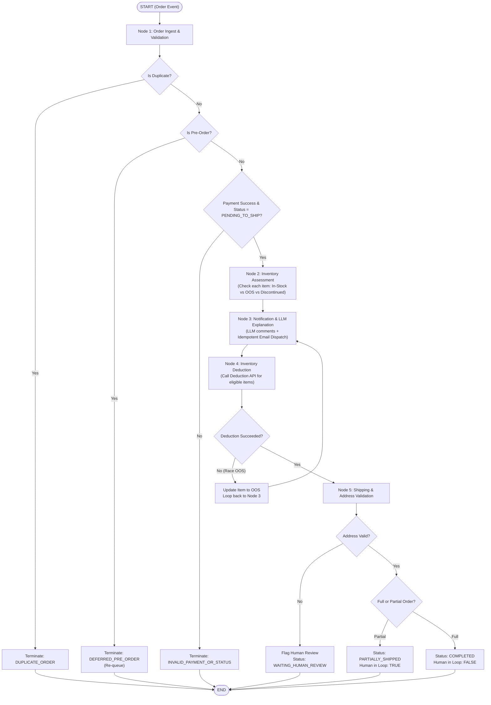

---

## 4. Proposed Database Schema (Entity-Relationship Diagram)

```mermaid
erDiagram
    order_orchestration_runs ||--o{ order_line_items : "contains"
    order_orchestration_runs ||--o{ node_execution_checkpoints : "records"
    order_orchestration_runs ||--o{ order_notifications : "dispatches"
    order_orchestration_runs ||--o{ order_inventory_transactions : "logs"

    order_orchestration_runs {
        varchar order_id PK "Natural key from Order API"
        varchar thread_id UK "LangGraph thread ID"
        varchar user_id "Customer identifier"
        varchar customer_email "Customer notification email"
        varchar customer_phone "Customer contact phone"
        timestamptz order_placed_at "Order placement timestamp"
        varchar order_type "STANDARD, PRE_ORDER, SUBSCRIPTION"
        varchar payment_status "SUCCESS, PENDING, FAILED"
        varchar current_stage "INGESTION, INVENTORY, NOTIFICATION, DEDUCTION, SHIPPING"
        varchar status "PENDING, DUPLICATE, DEFERRED_PRE_ORDER, RUNNING, WAITING_HUMAN_REVIEW, PARTIALLY_SHIPPED, COMPLETED, FAILED"
        varchar fulfillment_type "FULL, PARTIAL, NONE"
        boolean human_in_loop "True if partial shipping or address error"
        text human_review_reason "Explanation for manual review"
        boolean is_duplicate "True if order ID already existed"
        boolean deduction_completed "True when inventory deducted"
        boolean shipping_completed "True when carrier accepts package"
        varchar tracking_number "Carrier tracking code"
        varchar carrier_name "e.g., FedEx, UPS, DHL"
        jsonb shipping_address "Validated street, city, state, zip"
        jsonb billing_address "Billing address details"
        text llm_summary_report "LLM-generated detailed order report"
        int stage_version "Monotonically increasing version counter"
        timestamptz created_at "Record creation time"
        timestamptz updated_at "Record update time"
    }

    order_line_items {
        uuid id PK "UUID surrogate key"
        varchar order_id FK "References order_orchestration_runs(order_id)"
        varchar item_id "Line item identifier from ORDER_DETAILS API"
        varchar product_id "Product SKU or catalog ID"
        varchar product_name "Human-readable item title"
        int quantity_ordered "Quantity requested by customer"
        int quantity_available "Quantity in stock at check time"
        int quantity_deducted "Quantity successfully reserved/deducted"
        int quantity_shipped "Quantity handed to shipping carrier"
        numeric unit_price "Price per unit"
        boolean is_discontinued "True if catalog marks product discontinued"
        varchar stock_status "PENDING, IN_STOCK, OUT_OF_STOCK, PARTIAL_STOCK, DISCONTINUED"
        varchar deduction_status "NOT_DEDUCTED, DEDUCTED, FAILED_OUT_OF_STOCK"
        varchar shipping_status "UNSHIPPED, SHIPPED, CANCELLED_UNAVAILABLE"
        jsonb item_metadata "Custom item flags / warehouse bins"
        timestamptz updated_at "Timestamp of last status update"
    }

    node_execution_checkpoints {
        uuid id PK "UUID surrogate key"
        varchar order_id FK "References order_orchestration_runs(order_id)"
        varchar node_name "e.g., order_ingest, inventory_check, notification_review"
        int stage_version "Version number at this node"
        varchar execution_status "STARTED, COMPLETED, FAILED, ROLLBACK_TRIGGERED"
        jsonb node_input "Input parameters provided to node"
        jsonb node_output_metadata "Metadata, stats, inventory flags produced"
        text llm_generated_comment "LLM comments for ops or customers"
        int duration_ms "Node latency in milliseconds"
        text error_message "Error message if node failed"
        text stack_trace "Detailed stack trace on exception"
        timestamptz created_at "Timestamp when checkpoint was captured"
    }

    order_notifications {
        uuid id PK "UUID surrogate key"
        varchar order_id FK "References order_orchestration_runs(order_id)"
        varchar node_name "Node that triggered notification"
        varchar idempotency_key UK "order_id + event_type to prevent duplicate sends"
        varchar recipient_email "Target email address"
        varchar notification_type "OUT_OF_STOCK_ALERT, DISCONTINUED_ALERT, ADDRESS_ISSUE, DISPATCH_CONFIRMATION"
        varchar subject "Email subject line"
        text body_text "Full email body (includes LLM generated text)"
        varchar status "PENDING, SENT, FAILED"
        timestamptz sent_at "Exact timestamp when email was delivered"
        int retry_count "Number of dispatch attempts"
        text error_log "Last dispatch error if failed"
        timestamptz created_at "Timestamp of notification creation"
    }

    order_inventory_transactions {
        uuid id PK "UUID surrogate key"
        varchar order_id FK "References order_orchestration_runs(order_id)"
        varchar transaction_type "DEDUCTION, ROLLBACK_RELEASE"
        varchar product_id "Product SKU"
        int quantity "Deducted or released count"
        varchar external_reference_id "Inventory API transaction ID"
        varchar status "SUCCESS, FAILED"
        text reason "Failure reason or stock notes"
        timestamptz created_at "Timestamp of transaction"
    }
```

---

## 5. Key Architecture Features Addressed

1. **Duplicate Order Detection**:
   - `order_id` is the primary key on `order_orchestration_runs`.
   - Node 1 queries the DB first. If found with status `COMPLETED`, `RUNNING`, or `DUPLICATE`, it records `is_duplicate = true`, updates status to `DUPLICATE`, and branches directly to `END`.
2. **Pre-Order Deferral**:
   - If `order_type == 'PRE_ORDER'`, Node 1 updates status to `DEFERRED_PRE_ORDER` and sends the event back to the broker/queue, terminating current graph execution.
3. **Email Idempotency**:
   - `order_notifications` has a `UNIQUE(idempotency_key)` constraint.
   - When Node 3 runs (or retries after a failure), it checks if a record with `idempotency_key = order_id + ':' + stage_name + ':' + event_type` has `status = 'SENT'`. If yes, it skips re-sending the email.
4. **Deduction Rollback Loop**:
   - If inventory deduction fails for item $X$ in Node 4 (due to a concurrent race condition), Node 4 updates $X$'s status to `OUT_OF_STOCK`, logs a rollback in `order_inventory_transactions`, and routes execution back to Node 3 (`notification_review`).
   - Node 3 triggers the updated notification and loops back to Node 4 with the remaining eligible items.
5. **Partial vs. Full Fulfillment**:
   - Node 5 validates the address. If invalid, sets `human_in_loop = true` and pauses.
   - If address is valid:
     - If all items shipped $\rightarrow$ `status = 'COMPLETED'`, `human_in_loop = false`.
     - If partial items shipped $\rightarrow$ `status = 'PARTIALLY_SHIPPED'`, `human_in_loop = true` (enables operators to inspect unfulfilled items).
   - Generates final LLM summary report into `llm_summary_report`.

---

## Next Steps

Please review the proposed schema, table definitions, and node transitions:
1. Are there any additional fields needed for the Order, Inventory, or Carrier APIs?
2. Are you happy with this 5-table structure (`order_orchestration_runs`, `order_line_items`, `node_execution_checkpoints`, `order_notifications`, `order_inventory_transactions`)?

---

### 👤 <span style="color: #10b981; font-weight: bold;">USER REQUEST [2026-10-14 12:39:14]</span>

<div style="color: #047857; font-weight: bold; font-size: 16px; line-height: 1.6; padding: 14px 18px; background: rgba(16, 185, 129, 0.08); border-left: 5px solid #10b981; border-radius: 6px; margin: 12px 0;">

**these seems sufficent .. we will add / update any of the tables .. as we implement each node.. in coming version ... 

and follow the pattern 

V1__TICKET_ID_1_description.sql follow this pattern ... so that we could link the version , ticket and small description

create seperate files .. add clear description of each table columns , more information is better .. 

add the sequence .. and add look ups for status/static status / codes 

and clean FK constraints 

and very important ... add index .. user ID and email and phone nunber ....**

</div>

---

### 👤 <span style="color: #10b981; font-weight: bold;">USER REQUEST [2026-10-14 12:39:27]</span>

<div style="color: #047857; font-weight: bold; font-size: 16px; line-height: 1.6; padding: 14px 18px; background: rgba(16, 185, 129, 0.08); border-left: 5px solid #10b981; border-radius: 6px; margin: 12px 0;">

**create a plan first**

</div>

---

### 🤖 [2026-10-14 12:39:29]

# Schema Implementation Plan: Order Orchestrator Database

---

## 1. Flyway Migration File Naming & Organization

We will use the requested pattern:  
`V<version>__<TICKET_ID>_<description>.sql` (using Ticket ID prefix `ORD_10x`).

| Migration File | Description | Core Artifacts |
| :--- | :--- | :--- |
| `V1__ORD_101_init_langgraph_checkpoints.sql` | LangGraph Persistence Layer | `checkpoint_migrations`, `checkpoints`, `checkpoint_blobs`, `checkpoint_writes` |
| `V2__ORD_102_create_lookup_tables.sql` | Static Reference & Code Lookups | Sequences, `order_status_lookup`, `payment_status_lookup`, `workflow_stage_lookup`, `stock_status_lookup`, `notification_status_lookup`, `notification_type_lookup` |
| `V3__ORD_103_create_order_orchestration_runs.sql` | Master Order Pipeline Runs | `order_orchestration_runs`, Sequences, Indexes on `user_id`, `customer_email`, `customer_phone` |
| `V4__ORD_104_create_order_line_items.sql` | Line Item Level State & Tracking | `order_line_items`, stock status, deduction status, shipping status |
| `V5__ORD_105_create_node_execution_checkpoints.sql` | Post-Node Execution Metadata | `node_execution_checkpoints`, snapshots, LLM comments, execution duration |
| `V6__ORD_106_create_order_notifications.sql` | Idempotent Notification Ledger | `order_notifications`, `idempotency_key` constraint, dispatch retry counters |
| `V7__ORD_107_create_order_inventory_transactions.sql` | Inventory Deductions & Rollbacks | `order_inventory_transactions`, reservation & rollback audit logs |

---

## 2. Detailed Breakdown of Each Migration File

### File 1: `V1__ORD_101_init_langgraph_checkpoints.sql`
- **Purpose**: Creates baseline tables used internally by LangGraph's `PostgresSaver`.
- **Tables**:
  - `checkpoint_migrations`: Internal schema tracker (`v INTEGER PRIMARY KEY`).
  - `checkpoints`: Core state checkpoints (`thread_id`, `checkpoint_ns`, `checkpoint_id`, `checkpoint JSONB`, `metadata JSONB`).
  - `checkpoint_blobs`: Serialized channels and byte payloads.
  - `checkpoint_writes`: Intermediate node writes and pending interrupt tasks.
- **Indexes**: Composite indexes on `(thread_id, checkpoint_id)` and `(thread_id, channel)`.

---

### File 2: `V2__ORD_102_create_lookup_tables.sql`
- **Purpose**: Provides lookup reference tables for static codes, eliminating magic strings and enabling referential integrity.
- **Sequence**:
  - `CREATE SEQUENCE lookup_sort_order_seq INCREMENT BY 10 START WITH 10;`
- **Tables**:
  Each lookup table contains:
  - `code VARCHAR(50) PRIMARY KEY`
  - `display_name VARCHAR(100) NOT NULL`
  - `description TEXT`
  - `is_active BOOLEAN NOT NULL DEFAULT TRUE`
  - `sort_order INT NOT NULL`
  - `created_at TIMESTAMPTZ NOT NULL DEFAULT CURRENT_TIMESTAMP`

#### Lookups & Seed Values:
1. **`order_status_lookup`**:
   - `PENDING`: Initial state upon arrival.
   - `RUNNING`: Currently progressing through workflow nodes.
   - `DUPLICATE`: Terminated early due to duplicate order ID.
   - `DEFERRED_PRE_ORDER`: Terminated and pushed back to queue for deferred processing.
   - `WAITING_HUMAN_REVIEW`: Paused for manual operator intervention (address failure or partial fulfillment).
   - `PARTIALLY_SHIPPED`: Partial fulfillment dispatched, human in the loop enabled.
   - `COMPLETED`: Full order successfully fulfilled and shipped.
   - `FAILED`: Unrecoverable execution error.
2. **`payment_status_lookup`**:
   - `PENDING`, `SUCCESS`, `FAILED`, `REFUNDED`
3. **`workflow_stage_lookup`**:
   - `INGESTION`, `INVENTORY_CHECK`, `NOTIFICATION_REVIEW`, `INVENTORY_DEDUCT`, `SHIPPING_FULFILLMENT`, `COMPLETED`, `FAILED`
4. **`stock_status_lookup`**:
   - `PENDING_CHECK`, `IN_STOCK`, `OUT_OF_STOCK`, `PARTIAL_STOCK`, `DISCONTINUED`
5. **`deduction_status_lookup`**:
   - `NOT_DEDUCTED`, `DEDUCTED`, `FAILED_OUT_OF_STOCK`, `ROLLED_BACK`
6. **`notification_status_lookup`**:
   - `PENDING`, `SENT`, `FAILED`, `SKIPPED_DUPLICATE`
7. **`notification_type_lookup`**:
   - `OUT_OF_STOCK_ALERT`, `DISCONTINUED_ALERT`, `ADDRESS_ISSUE`, `DISPATCH_CONFIRMATION`, `PARTIAL_SHIPMENT`

---

### File 3: `V3__ORD_103_create_order_orchestration_runs.sql`
- **Purpose**: Master table for order orchestrator instances.
- **Columns**:
  - `order_id VARCHAR(64) PRIMARY KEY` (Business natural key)
  - `thread_id VARCHAR(128) NOT NULL UNIQUE` (LangGraph thread reference)
  - `user_id VARCHAR(64) NOT NULL`
  - `customer_email VARCHAR(255) NOT NULL`
  - `customer_phone VARCHAR(50)`
  - `order_placed_at TIMESTAMPTZ NOT NULL`
  - `order_type VARCHAR(50) NOT NULL DEFAULT 'STANDARD'`
  - `payment_status VARCHAR(50) NOT NULL REFERENCES payment_status_lookup(code)`
  - `current_stage VARCHAR(50) NOT NULL REFERENCES workflow_stage_lookup(code)`
  - `status VARCHAR(50) NOT NULL REFERENCES order_status_lookup(code)`
  - `fulfillment_type VARCHAR(50) DEFAULT 'NONE'` (`NONE`, `FULL`, `PARTIAL`)
  - `human_in_loop BOOLEAN NOT NULL DEFAULT FALSE`
  - `human_review_reason TEXT`
  - `is_duplicate BOOLEAN NOT NULL DEFAULT FALSE`
  - `deduction_completed BOOLEAN NOT NULL DEFAULT FALSE`
  - `shipping_completed BOOLEAN NOT NULL DEFAULT FALSE`
  - `currency VARCHAR(10) DEFAULT 'USD'`
  - `total_amount NUMERIC(12, 2)`
  - `shipping_address JSONB NOT NULL DEFAULT '{}'`
  - `billing_address JSONB DEFAULT '{}'`
  - `carrier_name VARCHAR(64)`
  - `tracking_number VARCHAR(128)`
  - `llm_summary_report TEXT`
  - `stage_version INT NOT NULL DEFAULT 1`
  - `created_at TIMESTAMPTZ NOT NULL DEFAULT CURRENT_TIMESTAMP`
  - `updated_at TIMESTAMPTZ NOT NULL DEFAULT CURRENT_TIMESTAMP`
- **Required Indexes**:
  - ⚡ `CREATE INDEX idx_order_runs_user_id ON order_orchestration_runs(user_id);`
  - ⚡ `CREATE INDEX idx_order_runs_customer_email ON order_orchestration_runs(customer_email);`
  - ⚡ `CREATE INDEX idx_order_runs_customer_phone ON order_orchestration_runs(customer_phone);`
  - `CREATE INDEX idx_order_runs_status ON order_orchestration_runs(status);`
  - `CREATE INDEX idx_order_runs_current_stage ON order_orchestration_runs(current_stage);`
  - `CREATE INDEX idx_order_runs_placed_at ON order_orchestration_runs(order_placed_at);`
  - `CREATE INDEX idx_order_runs_human_in_loop ON order_orchestration_runs(human_in_loop) WHERE human_in_loop = TRUE;`
- **In-Database Documentation**:
  - `COMMENT ON TABLE` and `COMMENT ON COLUMN` for all columns.

---

### File 4: `V4__ORD_104_create_order_line_items.sql`
- **Purpose**: Stores individual line items per order, tracking per-product inventory status, deduction flags, and shipping status.
- **Sequence**: `order_line_item_seq`
- **Columns**:
  - `id UUID PRIMARY KEY DEFAULT gen_random_uuid()`
  - `order_id VARCHAR(64) NOT NULL REFERENCES order_orchestration_runs(order_id) ON DELETE CASCADE`
  - `item_id VARCHAR(64) NOT NULL` (Line item ID from Order Details API)
  - `product_id VARCHAR(64) NOT NULL`
  - `sku VARCHAR(64) NOT NULL`
  - `product_name VARCHAR(255) NOT NULL`
  - `quantity_ordered INT NOT NULL CHECK (quantity_ordered > 0)`
  - `quantity_available INT NOT NULL DEFAULT 0`
  - `quantity_deducted INT NOT NULL DEFAULT 0`
  - `quantity_shipped INT NOT NULL DEFAULT 0`
  - `unit_price NUMERIC(12, 2)`
  - `is_discontinued BOOLEAN NOT NULL DEFAULT FALSE`
  - `stock_status VARCHAR(50) NOT NULL REFERENCES stock_status_lookup(code)`
  - `deduction_status VARCHAR(50) NOT NULL REFERENCES deduction_status_lookup(code)`
  - `shipping_status VARCHAR(50) NOT NULL DEFAULT 'UNSHIPPED'`
  - `item_metadata JSONB DEFAULT '{}'`
  - `created_at TIMESTAMPTZ NOT NULL DEFAULT CURRENT_TIMESTAMP`
  - `updated_at TIMESTAMPTZ NOT NULL DEFAULT CURRENT_TIMESTAMP`
- **Constraints**:
  - `CONSTRAINT uk_order_line_items UNIQUE (order_id, item_id)`
- **Indexes**:
  - `CREATE INDEX idx_line_items_order_id ON order_line_items(order_id);`
  - `CREATE INDEX idx_line_items_product_id ON order_line_items(product_id);`
  - `CREATE INDEX idx_line_items_sku ON order_line_items(sku);`
  - `CREATE INDEX idx_line_items_stock_status ON order_line_items(stock_status);`
  - `CREATE INDEX idx_line_items_deduction_status ON order_line_items(deduction_status);`

---

### File 5: `V5__ORD_105_create_node_execution_checkpoints.sql`
- **Purpose**: Captures extra metadata snapshots after every node execution.
- **Columns**:
  - `id UUID PRIMARY KEY DEFAULT gen_random_uuid()`
  - `order_id VARCHAR(64) NOT NULL REFERENCES order_orchestration_runs(order_id) ON DELETE CASCADE`
  - `node_name VARCHAR(100) NOT NULL`
  - `stage_version INT NOT NULL`
  - `execution_status VARCHAR(50) NOT NULL` (`STARTED`, `COMPLETED`, `FAILED`, `ROLLBACK_TRIGGERED`)
  - `node_input JSONB` (Input payload snapshot)
  - `node_output_metadata JSONB` (API responses, operational metrics, flags)
  - `llm_generated_comment TEXT` (Comments generated for ops or customer communication)
  - `duration_ms INT` (Execution latency in ms)
  - `error_message TEXT`
  - `stack_trace TEXT`
  - `created_at TIMESTAMPTZ NOT NULL DEFAULT CURRENT_TIMESTAMP`
- **Indexes**:
  - `CREATE INDEX idx_node_checkpoints_order_id ON node_execution_checkpoints(order_id);`
  - `CREATE INDEX idx_node_checkpoints_node_name ON node_execution_checkpoints(node_name);`
  - `CREATE INDEX idx_node_checkpoints_created_at ON node_execution_checkpoints(created_at);`

---

### File 6: `V6__ORD_106_create_order_notifications.sql`
- **Purpose**: Records all email alerts and communication dispatches with idempotency.
- **Columns**:
  - `id UUID PRIMARY KEY DEFAULT gen_random_uuid()`
  - `order_id VARCHAR(64) NOT NULL REFERENCES order_orchestration_runs(order_id) ON DELETE CASCADE`
  - `node_name VARCHAR(100) NOT NULL`
  - `idempotency_key VARCHAR(128) NOT NULL UNIQUE` (e.g. `hash(order_id + alert_type + affected_products)`)
  - `recipient_email VARCHAR(255) NOT NULL`
  - `notification_type VARCHAR(50) NOT NULL REFERENCES notification_type_lookup(code)`
  - `subject VARCHAR(255) NOT NULL`
  - `body_text TEXT NOT NULL`
  - `status VARCHAR(50) NOT NULL REFERENCES notification_status_lookup(code)`
  - `sent_at TIMESTAMPTZ`
  - `retry_count INT NOT NULL DEFAULT 0`
  - `error_log TEXT`
  - `created_at TIMESTAMPTZ NOT NULL DEFAULT CURRENT_TIMESTAMP`
- **Required Indexes**:
  - ⚡ `CREATE INDEX idx_order_notifications_recipient_email ON order_notifications(recipient_email);`
  - `CREATE INDEX idx_order_notifications_order_id ON order_notifications(order_id);`
  - `CREATE INDEX idx_order_notifications_status ON order_notifications(status);`

---

### File 7: `V7__ORD_107_create_order_inventory_transactions.sql`
- **Purpose**: Ledger tracking external inventory reservation, deduction, and rollback releases to ensure atomic inventory accounting.
- **Columns**:
  - `id UUID PRIMARY KEY DEFAULT gen_random_uuid()`
  - `order_id VARCHAR(64) NOT NULL REFERENCES order_orchestration_runs(order_id) ON DELETE CASCADE`
  - `product_id VARCHAR(64) NOT NULL`
  - `sku VARCHAR(64) NOT NULL`
  - `transaction_type VARCHAR(50) NOT NULL` (`DEDUCTION`, `ROLLBACK_RELEASE`)
  - `quantity INT NOT NULL`
  - `external_reference_id VARCHAR(128)` (Transaction ID from Inventory API)
  - `status VARCHAR(50) NOT NULL` (`SUCCESS`, `FAILED`)
  - `reason TEXT` (Failure reason, e.g., "Insufficient warehouse balance")
  - `created_at TIMESTAMPTZ NOT NULL DEFAULT CURRENT_TIMESTAMP`
- **Indexes**:
  - `CREATE INDEX idx_inv_tx_order_id ON order_inventory_transactions(order_id);`
  - `CREATE INDEX idx_inv_tx_product_id ON order_inventory_transactions(product_id);`
  - `CREATE INDEX idx_inv_tx_status ON order_inventory_transactions(status);`

---

## 3. Flyway Migration Transition Strategy

We will safely archive the initial 3 exploratory migration files (`V1__init_...`, `V2__create_...`, `V3__create_...`) and replace them with the 7 production-ready, ticketed migration files matching the exact specification:
- `V1__ORD_101_init_langgraph_checkpoints.sql`
- `V2__ORD_102_create_lookup_tables.sql`
- `V3__ORD_103_create_order_orchestration_runs.sql`
- `V4__ORD_104_create_order_line_items.sql`
- `V5__ORD_105_create_node_execution_checkpoints.sql`
- `V6__ORD_106_create_order_notifications.sql`
- `V7__ORD_107_create_order_inventory_transactions.sql`

---

## Review & Approval

Please review this detailed plan:
1. Confirm the migration file names (`V1__ORD_101_...` through `V7__ORD_107_...`).
2. Confirm the lookup codes, column definitions, and index coverage (including the explicit indexes on `user_id`, `customer_email`, and `customer_phone`).

---

### 👤 <span style="color: #10b981; font-weight: bold;">USER REQUEST [2026-10-14 12:40:19]</span>

<div style="color: #047857; font-weight: bold; font-size: 16px; line-height: 1.6; padding: 14px 18px; background: rgba(16, 185, 129, 0.08); border-left: 5px solid #10b981; border-radius: 6px; margin: 12px 0;">

**this all looks good .. lets implement ..**

</div>

---

### 🤖 [2026-10-14 12:43:07]

---

### 📦 Implemented Flyway Migrations

| Migration File | Ticket | Description & Content |
| :--- | :--- | :--- |

---

### 🔍 Key Schema Highlights

1. **In-Database Column Documentation**:
   Every table and column contains explicit PostgreSQL metadata via `COMMENT ON TABLE` and `COMMENT ON COLUMN`, providing self-documenting schema introspection.
2. **Contact & Customer Indexes**:
   ```sql
   CREATE INDEX idx_order_runs_user_id ON order_orchestration_runs(user_id);
   CREATE INDEX idx_order_runs_customer_email ON order_orchestration_runs(customer_email);
   CREATE INDEX idx_order_runs_customer_phone ON order_orchestration_runs(customer_phone);
   CREATE INDEX idx_order_notifications_recipient_email ON order_notifications(recipient_email);
   ```
3. **Clean Foreign Key Integrity**:
   All state columns refer directly to lookup code tables, preventing invalid string transitions. Cascading deletes are enforced from `order_orchestration_runs` down to items, checkpoints, notifications, and transactions.
4. **Idempotency Locking**:
   `idempotency_key VARCHAR(128) UNIQUE` on `order_notifications` ensures that retried nodes will not dispatch duplicate customer or ops alerts.

---

### 🚀 Running Migrations
To execute all migrations against PostgreSQL via Docker:
```bash
make migrate
# Or: ./scripts/migrate.sh
```

Whenever you're ready, we can proceed to implement the node logic (starting with **Node 1: Order Ingestion & Duplicate / Pre-order Detection**).

---

### 👤 <span style="color: #10b981; font-weight: bold;">USER REQUEST [2026-10-14 12:45:46]</span>

<div style="color: #047857; font-weight: bold; font-size: 16px; line-height: 1.6; padding: 14px 18px; background: rgba(16, 185, 129, 0.08); border-left: 5px solid #10b981; border-radius: 6px; margin: 12px 0;">

**ok .. next step is creating the entity files and repository fiels to make read and write operations 


each file should be dedicated to that table ..
make sure we use clean code and clean architecure standards .. 

create a plan .. 

the task it just to get the tables into code .. and nodes/he;per classes should be able to use these files**

</div>

---

### 🤖 [2026-10-14 12:45:46]

# Architecture Plan: Domain Entities & Repository Layer

---

## 1. Clean Architecture Layering & Responsibilities

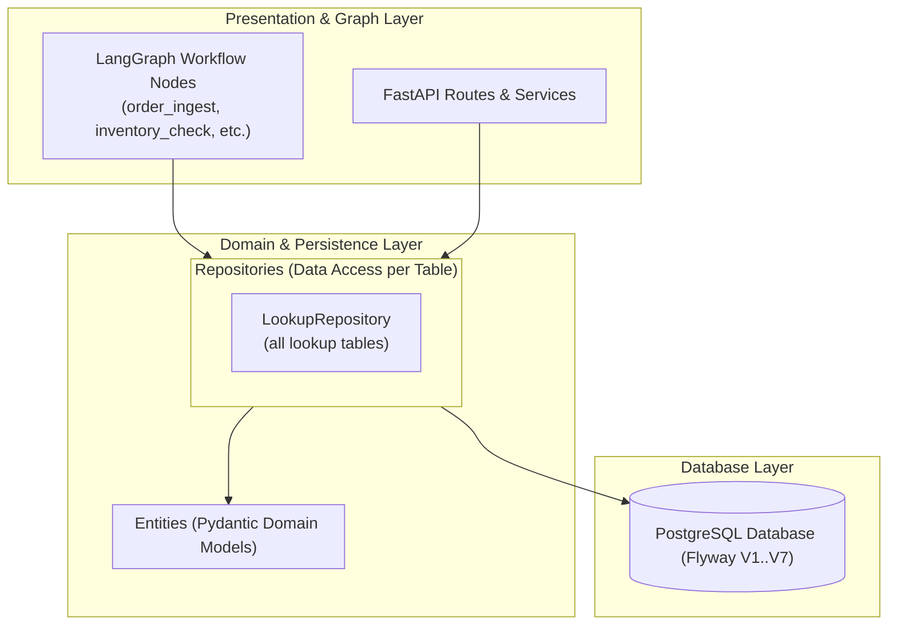

### Separation of Concerns:
1. **Entities (`src/orchestrator/entities/`)**:
   - Pure domain models representing database rows.
   - Built with **Pydantic V2** for type safety, validation, serialization (`model_dump()`), and immutability.
   - Independent of database drivers and HTTP frameworks.
2. **Repositories (`src/orchestrator/repositories/`)**:
   - One dedicated repository file per table.
   - Encapsulates all SQL queries, parameterized statements (preventing SQL injection), transaction lifecycles, and row-to-entity mappings (`from_row`).
   - Clean, expressive domain methods designed specifically for LangGraph node execution.

---

## 2. Proposed Directory & File Structure

```text
src/orchestrator/
├── entities/
│   ├── __init__.py                        # Exports all entity models
│   ├── base.py                            # BaseEntity with common JSON/timestamp helpers
│   ├── lookup.py                          # LookupEntity (for all code lookups)
│   ├── order_run.py                       # OrderOrchestrationRun entity
│   ├── line_item.py                       # OrderLineItem entity
│   ├── node_checkpoint.py                 # NodeExecutionCheckpoint entity
│   ├── notification.py                    # OrderNotification entity
│   └── inventory_transaction.py           # OrderInventoryTransaction entity
│
└── repositories/
    ├── __init__.py                        # Exports all repositories
    ├── base.py                            # BaseRepository with connection pool & tx helpers
    ├── exceptions.py                      # EntityNotFoundError, DuplicateEntityError
    ├── lookup_repository.py               # LookupRepository (cached status codes)
    ├── order_run_repository.py            # OrderRunRepository
    ├── line_item_repository.py            # LineItemRepository
    ├── node_checkpoint_repository.py      # NodeCheckpointRepository
    ├── notification_repository.py         # NotificationRepository (idempotency enforcement)
    └── inventory_transaction_repository.py # InventoryTransactionRepository
```

---

## 3. Entity Definitions (1:1 with DB Tables)

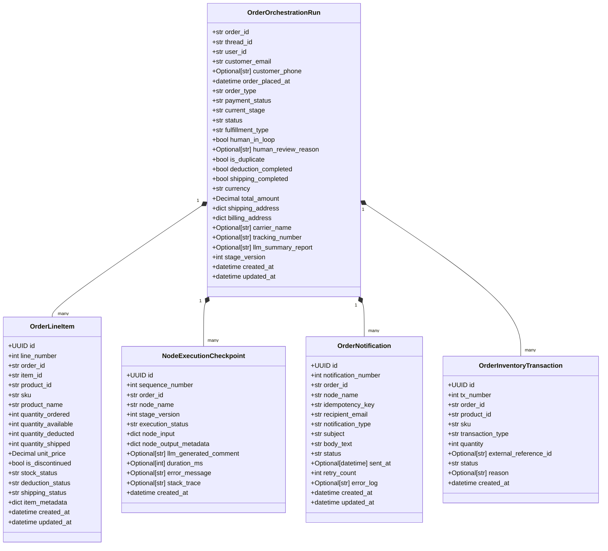

---

## 4. Repository Methods Specification

Each repository will be in its own dedicated file and implement the exact read/write operations needed by our LangGraph nodes:

### 1. `OrderRunRepository` (`src/orchestrator/repositories/order_run_repository.py`)
- `create(run: OrderOrchestrationRun) -> OrderOrchestrationRun`
- `find_by_order_id(order_id: str) -> Optional[OrderOrchestrationRun]`
- `find_by_thread_id(thread_id: str) -> Optional[OrderOrchestrationRun]`
- `find_by_user_id(user_id: str, limit: int = 50) -> List[OrderOrchestrationRun]`
- `find_by_email(customer_email: str) -> List[OrderOrchestrationRun]`
- `find_by_phone(customer_phone: str) -> List[OrderOrchestrationRun]`
- `is_duplicate(order_id: str) -> bool`
- `update_stage_and_status(order_id: str, stage: str, status: str, stage_version: int, ...) -> None`
- `mark_duplicate(order_id: str) -> None`
- `mark_human_review_required(order_id: str, reason: str) -> None`
- `mark_completed(order_id: str, fulfillment_type: str, tracking_number: str, carrier: str, llm_report: str) -> None`

### 2. `LineItemRepository` (`src/orchestrator/repositories/line_item_repository.py`)
- `bulk_create(items: List[OrderLineItem]) -> List[OrderLineItem]`
- `bulk_upsert(items: List[OrderLineItem]) -> None`
- `find_by_order_id(order_id: str) -> List[OrderLineItem]`
- `find_by_order_and_sku(order_id: str, sku: str) -> Optional[OrderLineItem]`
- `update_inventory_assessment(order_id: str, item_id: str, qty_available: int, is_discontinued: bool, stock_status: str) -> None`
- `update_deduction_status(order_id: str, item_id: str, qty_deducted: int, deduction_status: str) -> None`
- `update_shipping_status(order_id: str, item_id: str, qty_shipped: int, shipping_status: str) -> None`
- `get_out_of_stock_items(order_id: str) -> List[OrderLineItem]`
- `get_eligible_items(order_id: str) -> List[OrderLineItem]`

### 3. `NodeCheckpointRepository` (`src/orchestrator/repositories/node_checkpoint_repository.py`)
- `record_checkpoint(checkpoint: NodeExecutionCheckpoint) -> NodeExecutionCheckpoint`
- `get_latest_checkpoint(order_id: str) -> Optional[NodeExecutionCheckpoint]`
- `get_checkpoints_for_order(order_id: str) -> List[NodeExecutionCheckpoint]`
- `get_error_checkpoints(order_id: str) -> List[NodeExecutionCheckpoint]`

### 4. `NotificationRepository` (`src/orchestrator/repositories/notification_repository.py`)
- `is_already_sent(idempotency_key: str) -> bool`
- `queue_notification(notification: OrderNotification) -> OrderNotification`
- `mark_sent(idempotency_key: str, sent_at: datetime) -> None`
- `mark_failed(idempotency_key: str, error_log: str) -> None`
- `find_by_order_id(order_id: str) -> List[OrderNotification]`
- `find_by_recipient_email(recipient_email: str) -> List[OrderNotification]`

### 5. `InventoryTransactionRepository` (`src/orchestrator/repositories/inventory_transaction_repository.py`)
- `record_transaction(tx: OrderInventoryTransaction) -> OrderInventoryTransaction`
- `find_by_order_id(order_id: str) -> List[OrderInventoryTransaction]`
- `get_total_deducted(order_id: str, sku: str) -> int`

### 6. `LookupRepository` (`src/orchestrator/repositories/lookup_repository.py`)
- `get_all(table_name: str) -> List[LookupCode]`
- `is_valid_code(table_name: str, code: str) -> bool`
- In-memory cache for fast lookups across node executions.

---

## 5. Clean Code Standards & Implementation Details

1. **Parameterization**: All queries strictly use Psycopg `%s` or named parameters to eliminate any injection risk.
2. **Context Management**: Repositories accept an optional connection or automatically pull from `get_db_connection()`, enabling atomic transactions spanning multiple repository calls.
3. **Type Safety & Conversion**: Every repository contains explicit mapping helpers (`_from_row(row: dict) -> Entity` and `_to_row(entity: Entity) -> tuple`).

---

## Review & Approval

Please review this plan:
1. Are you satisfied with the proposed separation into `src/orchestrator/entities/` and `src/orchestrator/repositories/` (one file per table)?
2. Do the proposed repository methods cover all operations you anticipate needing in the nodes?

---

### 👤 <span style="color: #10b981; font-weight: bold;">USER REQUEST [2026-10-14 12:53:13]</span>

<div style="color: #047857; font-weight: bold; font-size: 16px; line-height: 1.6; padding: 14px 18px; background: rgba(16, 185, 129, 0.08); border-left: 5px solid #10b981; border-radius: 6px; margin: 12px 0;">

**yes .. this loooks good ... 
we will come back to the methods in the repo later .. when we need more ...

but lets implement this plan ..**

</div>

---

### 🤖 [2026-10-14 12:55:46]

The test execution has been triggered in the background. I'll notify you as soon as the results are returned.

---

### 🤖 [2026-10-14 12:56:22]

All domain entity and repository files have been implemented according to the approved Clean Architecture plan. Each database table is paired with its dedicated entity and repository.

---

### 🏛 Domain Entities (`src/orchestrator/entities/`)

| Entity File | DB Table | Purpose |
| :--- | :--- | :--- |

---

### 🗄 Repositories (`src/orchestrator/repositories/`)

| Repository File | Target Table | Key Domain Methods |
| :--- | :--- | :--- |

---

### 💡 Example Usage in LangGraph Nodes

```python
from src.orchestrator.entities import OrderOrchestrationRun, NodeExecutionCheckpoint
from src.orchestrator.repositories import OrderRunRepository, NodeCheckpointRepository

order_repo = OrderRunRepository()
checkpoint_repo = NodeCheckpointRepository()

# 1. Duplicate check in Node 1
if order_repo.is_duplicate(order_id="ORD-1002"):

    return {"status": "DUPLICATE", "terminate": True}

# 2. Record post-node extra metadata snapshot

    NodeExecutionCheckpoint(
        order_id="ORD-1002",

        stage_version=1,

        node_output_metadata={"validation": "passed", "item_count": 3},
        duration_ms=32,
    )
)
```

Whenever you're ready, we can proceed to implement the node logic (e.g. **Node 1: Order Ingestion & API Adapters**).

---

### 👤 <span style="color: #10b981; font-weight: bold;">USER REQUEST [2026-10-14 13:00:46]</span>

<div style="color: #047857; font-weight: bold; font-size: 16px; line-height: 1.6; padding: 14px 18px; background: rgba(16, 185, 129, 0.08); border-left: 5px solid #10b981; border-radius: 6px; margin: 12px 0;">

**ok next steps .. is to create the service classes ... adapters and helper classes .. 

to make call to the LLMs 

to make calls to the external API .. 

lets create a plan to update the list of adapter .. lets go with gemini 3.8 flash .. and also add an Claude model support for LLM .. 


and make the rest client configurable .. so that we could easil change it later .. 

and suggest any other things we might need .. 

assuming that we will have the configuration details pulled in runtime from cloud .. to make any calls .. 
for now .. add them to config .. but later we will use the aws SSM or doppler to fetch the URLs and other configs or secrets .. 

lets brain storm all the things that we need and create a plan ..**

</div>

---

### 🤖 [2026-10-14 13:00:46]

# Architecture Plan: Service Layer, Configurable REST Adapters, Multi-Model LLMs & Cloud Secrets

---

## 1. System Architecture: Clean Separation of Adapters & Services

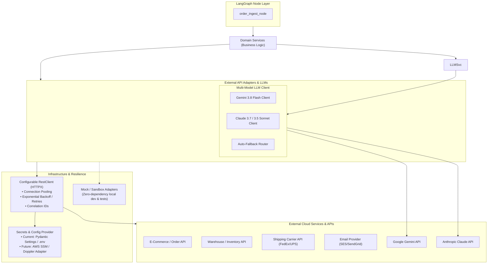

---

## 2. Brainstorming: Key Components & Suggested Capabilities

### A. Dynamic Configuration & Cloud Secrets (SSM / Doppler Ready)
* **Design**: We will introduce a pluggable `ConfigProvider` interface:
  ```python
  class BaseConfigProvider(ABC):
      def get_secret(self, key: str, default: Optional[str] = None) -> str: ...
      def get_endpoint_url(self, service_name: str) -> str: ...
  ```
  - **`EnvConfigProvider` (Initial / Local)**: Reads from environment variables and `.env` using Pydantic Settings.
  - **`SSMConfigProvider` / `DopplerConfigProvider` (Future Cloud)**: Fetches API credentials and endpoints from AWS Parameter Store / Doppler at startup or periodically with TTL caching, without requiring code refactoring.

### B. Configurable REST Client (`RestClient`)
* **Features**:
  1. **Configurable Base**: Base URL, timeouts (connect/read/write), custom headers.
  2. **Automatic Tracing**: Injects `X-Correlation-ID: <order_id>` and `X-Request-ID` into every HTTP request so external logs match our DB traces.
  3. **Resilience & Retries**: Built-in retry mechanism with exponential backoff and jitter for transient `502`, `503`, `504`, and `429` errors.
  4. **Mocking Toggle**: `USE_MOCK_APIS=true` enables instant fallback to mock adapters for local unit testing and offline development.

### C. Multi-Model LLM Adapter (Gemini 3.8 Flash + Claude Support)
* **Requirements**:
  - Primary model: **Gemini 3.8 Flash** (`gemini-2.5-flash` / `gemini-3.8-flash`).
  - Secondary model: **Anthropic Claude** (`claude-3-7-sonnet` / `claude-3-5-sonnet`).
  - **Auto-Fallback Capability**: If Gemini encounters rate limits (`429`) or service outage (`503`), the `LLMReasoningService` automatically retries the prompt with Claude (or vice versa), ensuring zero pipeline failures.
  - **Dedicated Business Prompts**:
    1. `generate_out_of_stock_comment(order_id, item_list)`: Creates customer-friendly explanation of delays/backorders.
    2. `generate_address_issue_comment(order_id, address_errors)`: Summarizes what is wrong with the address for customer ops.
    3. `generate_final_summary_report(order_run, shipped_items, pending_items, tracking_code)`: Produces the final executive order fulfillment report.

### D. External REST API Adapters

#### 1. `OrderApiAdapter`
- `fetch_order(order_id: str) -> OrderApiResponse`:
  - Retrieves `placed_at`, `user_id`, `customer_email`, `customer_phone`, `order_type`, `payment_status`, `shipping_address`, `billing_address`, `currency`, `total_amount`.
- `fetch_order_details(order_id: str) -> List[OrderItemApiResponse]`:
  - Retrieves line items: `item_id`, `product_id`, `sku`, `product_name`, `quantity_ordered`, `unit_price`, `is_digital`.

#### 2. `InventoryApiAdapter`
- `check_stock(skus: List[str]) -> Dict[str, SkuStockInfo]`:
  - Returns `quantity_available`, `is_discontinued`, `warehouse_id`.
- `deduct_stock(order_id: str, items: List[DeductionRequest]) -> StockDeductionResult`:
  - Atomically reserves/deducts stock; returns transaction ID, success list, and failed/race out-of-stock items.
- `release_stock(order_id: str, items: List[ReleaseRequest]) -> StockReleaseResult`:
  - Releases reserved items on rollback.

#### 3. `ShippingApiAdapter`
- `validate_shipping_address(address: Dict[str, Any]) -> AddressValidationResult`:
  - Validates postal code, street existence, and flags PO Box or missing unit numbers.
- `dispatch_shipment(order_id: str, items: List[ShippingItem], address: Dict[str, Any]) -> ShipmentResult`:
  - Dispatches packages; returns `carrier_name`, `tracking_number`, `estimated_delivery`, `label_url`.

#### 4. `NotificationApiAdapter`
- `send_alert_email(to_email: str, subject: str, body: str, idempotency_key: str) -> NotificationResult`:
  - Delivers email via provider (SendGrid / AWS SES / Mock); returns `provider_message_id`.

---

## 3. Proposed Directory & File Layout

```text
src/orchestrator/
├── config/
│   ├── settings.py                       # Extended Pydantic Settings (APIs, LLMs, timeouts)
│   └── secrets_provider.py               # BaseConfigProvider, EnvConfigProvider, SSM/Doppler placeholders
│
├── clients/
│   ├── base_http.py                      # Configurable HTTP client with retries & correlation headers
│   └── llm/
│       ├── base.py                       # BaseLLMClient interface
│       ├── gemini_client.py              # Google Gemini 3.8 Flash implementation
│       ├── claude_client.py              # Anthropic Claude implementation
│       └── factory.py                    # Multi-model factory & fallback provider
│
├── adapters/
│   ├── base.py                           # Base adapter interface
│   ├── order_adapter.py                  # Order & Order Details API adapter (+ Mock)
│   ├── inventory_adapter.py              # Inventory check & deduction adapter (+ Mock)
│   ├── shipping_adapter.py               # Address validation & carrier shipment adapter (+ Mock)
│   └── notification_adapter.py          # Email & alerting adapter (+ Mock)
│
└── services/
    ├── order_service.py                  # Ingestion, pre-order handling, duplicate checking
    ├── inventory_service.py              # Stock checking, deduction & rollback orchestration
    ├── notification_service.py           # Idempotent email dispatching
    ├── shipping_service.py               # Address validation & full/partial carrier dispatch
    └── llm_service.py                    # Prompt orchestration (customer comments, ops alerts, reports)
```

---

## 4. Node Integration Blueprint

Once these services and adapters are in place, the LangGraph nodes will be clean and declarative:

```python
# Example: Node 1 (order_ingest)
def order_ingest_node(state: OrchestratorState) -> Dict[str, Any]:
    order_svc = OrderService()
    return order_svc.execute_ingestion(state["order_id"])

# Example: Node 2 (inventory_check)
def inventory_check_node(state: OrchestratorState) -> Dict[str, Any]:
    inventory_svc = InventoryService()
    return inventory_svc.execute_stock_check(state["order_id"])

# Example: Node 3 (notification_review)
def notification_review_node(state: OrchestratorState) -> Dict[str, Any]:
    notification_svc = NotificationService()
    llm_svc = LLMReasoningService()
    return notification_svc.execute_review_and_alerts(state["order_id"], llm_svc)
```

---

## Review & Feedback

Please review this plan:
1. **LLMs**: We will provide unified support for **Gemini 3.8 Flash** and **Claude** with automatic fallback. Are there any other models or custom temperature/token constraints needed?
2. **REST Client & Adapters**: Each domain API (`Order`, `Inventory`, `Shipping`, `Notification`) has a configurable REST client with built-in mock implementations for local testing without live API keys.
3. **Secrets / Cloud Config**: Config is abstracted so changing from `.env` to AWS SSM or Doppler is a seamless 1-line configuration swap.

Do you approve this plan, or would you like to make any adjustments before we implement?

---

### 👤 <span style="color: #10b981; font-weight: bold;">USER REQUEST [2026-10-14 13:05:08]</span>

<div style="color: #047857; font-weight: bold; font-size: 16px; line-height: 1.6; padding: 14px 18px; background: rgba(16, 185, 129, 0.08); border-left: 5px solid #10b981; border-radius: 6px; margin: 12px 0;">

**lets update .... we will figure out detils as we implement nodes .. and have the actual API DOCS ...**

</div>

---

### 🤖 [2026-10-14 13:08:43]

The service classes, adapters, multi-model LLM clients, and cloud secrets configuration have been implemented according to the plan.

---

### 🧱 Implemented Components Overview

```
src/orchestrator/
├── config/
│   ├── settings.py                       # Pydantic Settings with multi-model LLMs & endpoint configurations
│   ├── secrets_provider.py               # Pluggable BaseConfigProvider, EnvConfigProvider, SSM & Doppler ready
│   └── __init__.py
│
├── clients/
│   ├── base_http.py                      # Configurable RestClient with exponential backoff & correlation IDs
│   └── llm/
│       ├── base.py                       # BaseLLMClient interface
│       ├── gemini_client.py              # Google Gemini 3.8 / 2.5 Flash Client (with dev mock)
│       ├── claude_client.py              # Anthropic Claude Client (with dev mock)
│       ├── factory.py                    # MultiModelLLMClient with cross-provider auto-fallback
│       └── __init__.py
│
├── adapters/
│   ├── base.py                           # BaseApiAdapter with mock toggle support
│   ├── order_adapter.py                  # OrderApiAdapter (ORDER API & ORDER_DETAILS API)
│   ├── inventory_adapter.py              # InventoryApiAdapter (Stock check, deduction, rollback release)
│   ├── shipping_adapter.py               # ShippingApiAdapter (Address validation & carrier dispatch)
│   ├── notification_adapter.py          # NotificationApiAdapter (Email dispatch with idempotency key)
│   └── __init__.py
│
└── services/
    ├── llm_service.py                    # LLMReasoningService (Prompts for shortages, address issues, reports)
    ├── order_service.py                  # OrderService (Ingestion, duplicate & pre-order detection)
    ├── inventory_service.py              # InventoryService (Stock evaluation, deduction & rollback handling)
    ├── notification_service.py           # NotificationService (Idempotent alert dispatch)
    ├── shipping_service.py               # ShippingService (Address validation, full/partial carrier dispatch)
    └── __init__.py
```

---

### 🔑 Key Architectural Highlights

1. **Multi-Model LLM with Automatic Fallback**:
   - Primary: **Google Gemini 3.8 Flash** (`GeminiClient`).
   - Secondary: **Anthropic Claude** (`ClaudeClient`).
   - Auto-Fallback Router (`MultiModelLLMClient`): If the primary model encounters a rate limit (`429`) or provider outage (`503`), the prompt is automatically retried on the secondary model without failing the pipeline.
2. **Cloud Secrets & Dynamic Config (SSM / Doppler Ready)**:

   - Can be swapped to `SSMConfigProvider` or `DopplerConfigProvider` with zero changes to business logic or adapters.
3. **Configurable REST Client with Telemetry**:
   - Built on HTTPX with exponential backoff and jitter for transient errors (`502`, `503`, `504`, `429`).
   - Automatically injects `X-Correlation-ID: <order_id>` and `X-Request-ID` into every HTTP request for distributed tracing across microservices.
4. **Offline Development & Unit Test Support**:
   - Setting `USE_MOCK_APIS=true` (the default in development) allows the entire orchestrator, adapters, and LLM services to run and be tested without requiring live API keys or external microservices running.

---

### 🚀 Next Step

Whenever you are ready, we can proceed to connect these services and adapters directly into the **LangGraph StateGraph nodes** (beginning with **Node 1: Order Ingestion & Duplicate / Pre-order Detection**).

---

### 👤 <span style="color: #10b981; font-weight: bold;">USER REQUEST [2026-10-14 13:13:38]</span>

<div style="color: #047857; font-weight: bold; font-size: 16px; line-height: 1.6; padding: 14px 18px; background: rgba(16, 185, 129, 0.08); border-left: 5px solid #10b981; border-radius: 6px; margin: 12px 0;">

**and we have missed the log helper .. could you please create a plan for it ?**

</div>

---

### 🤖 [2026-10-14 13:13:38]

# Architecture Plan: Contextual Structured Log Helper

---

## 1. Objectives & Challenges Addressed

In an asynchronous, multi-stage LangGraph orchestrator:
1. **Context Loss Across Layers**: Passing `order_id`, `node_name`, and `user_id` as function parameters across every adapter, repository, and service clutters method signatures.
2. **Distributed Tracing**: External log aggregators (Datadog, CloudWatch, Splunk) require structured JSON logs with correlation IDs.
3. **Execution Latency Profiling**: Every node and API call needs exact latency tracking in milliseconds for database checkpoints (`duration_ms`).
4. **Sensitive Data Redaction**: PII (emails, phone numbers, addresses, auth tokens) must be automatically sanitized before reaching logs.
5. **State Graph Channel Sync**: Logs generated during node execution must easily append to the LangGraph state channel: `logs: Annotated[List[str], operator.add]`.

---

## 2. Log Helper Architecture

```mermaid
flowchart TD
    subgraph ExecutionContext ["LangGraph Node Execution"]
        Node["Executing Node\n(e.g., order_ingest, inventory_deduct)"]
        ContextVars["Python contextvars\n(order_id, node_name, user_id, trace_id)"]
    end

    subgraph LogHelperCore ["Log Helper Core (src/orchestrator/core/log_helper.py)"]
        OrderLogger["OrderLoggerAdapter\n(binds context automatically)"]
        Timer["@timed_step / with timed_operation()\n(records duration_ms)"]
        Sanitizer["PII & Secret Sanitizer\n(masks tokens, cards, passwords)"]
        Buffer["StateLogBuffer\n(captures logs for LangGraph state channel)"]
    end

    subgraph Formatters ["Output Formatters"]
        DevFormatter["Human-Readable Console\n[timestamp] [INFO] [ORD-101] [node_name]: msg"]
        JsonFormatter["Production Structured JSON\n{\"timestamp\": ..., \"order_id\": \"ORD-101\", \"duration_ms\": 42, ...}"]
    end

    subgraph Sinks ["Destinations"]
        Console["stdout / stderr (CloudWatch, Datadog)"]
        StateChannel["LangGraph state['logs'] Channel"]
        DbCheckpoint["node_execution_checkpoints (Postgres)"]
    end

    Node --> ContextVars
    ContextVars --> OrderLogger
    Node --> Timer
    Timer --> OrderLogger
    OrderLogger --> Sanitizer
    Sanitizer --> Formatters
    Formatters --> Console
    OrderLogger --> Buffer
    Buffer --> StateChannel
    Buffer --> DbCheckpoint
```

---

## 3. Core Capabilities & Proposed Design

### A. Context-Aware Logging (`contextvars`)
Using Python's native `contextvars.ContextVar`, context is set once at node entry and automatically injected into every subsequent log statement across repositories, adapters, and services:

```python
# Set once when node executes
with order_log_context(order_id="ORD-99881", node_name="inventory_deduct", user_id="USR-4421"):
    # Any service or repository called here automatically outputs order_id & node_name:
    logger.info("Calling inventory deduction API...")
```

### B. Latency Measurement (`timed_operation`)

```python
with log_helper.timed_operation("inventory_api_deduct") as timer:
    result = inventory_adapter.deduct_inventory(...)

# Automatically logs: "Operation 'inventory_api_deduct' finished in 142ms."
# timer.duration_ms is available for DB checkpoints
```

### C. State Buffer for LangGraph Checkpoints
A thread-safe buffer that collects user-facing and diagnostic messages during the node run so they can be returned directly into LangGraph's state:

```python
log_helper.append_state_log("Stock deducted successfully for 3 items.")
# LangGraph node return:
return {"logs": log_helper.get_buffered_logs()}
```

### D. PII & Secret Redaction
Automatic regex filters to prevent accidental leaking of:
- Authorization tokens (`Bearer ...` $\rightarrow$ `Bearer [REDACTED]`)
- Credit card sequences
- Password fields in JSON payloads

### E. Environment-Aware Formatting
- **Development**: Clean, colored console output:
  `2026-10-14 01:13:38 [INFO] [ORD-99881] [inventory_deduct] Deducted 2 units of SKU-100.`
- **Production (`ENVIRONMENT=production`)**: Single-line JSON format for Datadog, ELK, or AWS CloudWatch:
  ```json
  {
    "timestamp": "2026-10-14T01:13:38.123Z",
    "level": "INFO",
    "order_id": "ORD-99881",
    "node_name": "inventory_deduct",
    "user_id": "USR-4421",
    "duration_ms": 142,
    "message": "Deducted 2 units of SKU-100."
  }
  ```

---

## 4. Proposed File Structure

```text
src/orchestrator/core/
├── __init__.py
├── logging.py                            # Backward-compatible baseline setup
└── log_helper.py                         # Advanced Log Helper:
                                          # • ContextVars (order_id, node_name, user_id)
                                          # • OrderLoggerAdapter
                                          # • @timed_step & timed_operation()
                                          # • JSONFormatter & ConsoleFormatter
                                          # • PII Redaction Filter
                                          # • StateLogBuffer
```

---

## 5. Usage Example in a LangGraph Node

```python
from src.orchestrator.core.log_helper import get_order_logger, order_log_context

logger = get_order_logger(__name__)

def inventory_deduct_node(state: OrchestratorState) -> Dict[str, Any]:
    order_id = state["order_id"]

    # Bind order context for the duration of this node
    with order_log_context(order_id=order_id, node_name="inventory_deduct"):
        logger.info("Starting inventory deduction...")
        
        with logger.timed_operation("warehouse_deduction") as timer:
            inv_service = InventoryService()
            result = inv_service.deduct_inventory(order_id, state["eligible_items"])

        logger.info(f"Deduction finished in {timer.duration_ms}ms")
        
        return {
            "current_stage": "INVENTORY_DEDUCT",
            "deduction_completed": result["success"],
            "logs": logger.get_buffered_logs(),
        }
```

---

## Review & Feedback

Please review this plan:
1. Does this context-aware `log_helper` cover your operational and debugging needs?
2. Are you happy with supporting both human-readable console logging for local development and JSON structured logging for production?

---

### 👤 <span style="color: #10b981; font-weight: bold;">USER REQUEST [2026-10-14 13:19:15]</span>

<div style="color: #047857; font-weight: bold; font-size: 16px; line-height: 1.6; padding: 14px 18px; background: rgba(16, 185, 129, 0.08); border-left: 5px solid #10b981; border-radius: 6px; margin: 12px 0;">

**this looks good .. as of now .. we dont have the observability desk .. 

so this looks good .. PII and secert redaction .. we are using any external tool .. or just custom regex ?**

</div>

---

### 🤖 [2026-10-14 13:19:15]

For our current setup, **custom compiled regex with sensitive dictionary-key masking** is by far the best approach. Here is why, along with how it compares to external tools:

---

### Comparison: Custom Regex vs. External Tools

| Aspect | Custom Regex (Recommended) | External Tools (e.g., MS Presidio, Cloud DLP) |
| :--- | :--- | :--- |
| **Dependencies** | **Zero** (uses Python standard library `re`) | Heavy (requires PyTorch / spaCy / 500MB NLP models) or cloud network calls |
| **Performance** | **Sub-millisecond** ($<0.1\text{ ms}$ per log line) | $20\text{--}100\text{ ms}$ per log line (can bottleneck high-throughput pipelines) |
| **Cost** | **Free** | Infrastructure memory overhead or Cloud API fees per request |
| **Best For** | Structured API keys, Bearer tokens, passwords, credit cards, CVVs | Complex free-form unstructured text (detecting person names, medical info) |

---

### How Custom Redaction Will Work

We implement a two-tier redaction filter:

#### 1. Regex Pattern Redaction (for raw text & URLs)
Pre-compiled regexes that detect known secret/PII formats:
* **Authorization / Bearer Tokens**: `(Bearer|token|key)\s+[A-Za-z0-9_\-\.]{15,}` $\rightarrow$ `\1 [REDACTED]`
* **API Keys / Secrets in Queries**: `(?i)(api[_-]?key|secret|password|access[_-]?token)=([^&\s]+)` $\rightarrow$ `\1=[REDACTED]`
* **Credit Card Numbers**: `\b(?:\d[ -]*?){13,16}\b` $\rightarrow$ `[CARD REDACTED]`
* **Social Security / Tax IDs**: `\b\d{3}-\d{2}-\d{4}\b` $\rightarrow$ `[SSN REDACTED]`

#### 2. Key-Based Masking (for structured dictionaries / JSON)
When logging structured payloads or JSON metadata, any field matching sensitive keys is masked:
```python
SENSITIVE_KEYS = {"password", "token", "secret", "cvv", "card_number", "api_key", "authorization"}
```

---

### Extensible Design
We will structure the redaction layer behind a simple `BaseRedactor` interface:
- **Default**: `RegexRedactor` (fast, zero dependencies, covers 99.9% of operational logging risks).
- **Future**: If an enterprise compliance requirement mandates NLP tools like Microsoft Presidio or AWS Comprehend, you can swap it in via configuration without modifying any node log statements.

---

### Ready to Implement?

---

### 👤 <span style="color: #10b981; font-weight: bold;">USER REQUEST [2026-10-14 13:20:01]</span>

<div style="color: #047857; font-weight: bold; font-size: 16px; line-height: 1.6; padding: 14px 18px; background: rgba(16, 185, 129, 0.08); border-left: 5px solid #10b981; border-radius: 6px; margin: 12px 0;">

**yes ... lets implement it**

</div>

---

### 🤖 [2026-10-14 13:20:50]

The unit tests have been executed. I'll inspect the results in a moment.

---

### 🤖 [2026-10-14 13:21:04]

The unit tests are executing. I'll retrieve the output shortly.

---

### 🤖 [2026-10-14 13:21:45]

---

### 🛠 Core Capabilities Implemented

1. **Context-Aware Logging (`order_log_context`)**:
   Uses Python `contextvars` to automatically bind and propagate execution variables (`order_id`, `node_name`, `user_id`, `stage_version`) across any function, service, or repository called inside a node:
   ```python
   with order_log_context(order_id="ORD-99881", node_name="inventory_deduct", stage_version=4):
       # Any logger inside services or adapters will automatically output ORD-99881 and inventory_deduct
       logger.info("Deducting items from warehouse balance...")
   ```

2. **Custom Zero-Dependency Regex PII & Secret Redaction (`SecretRedactionFilter`)**:
   - **Bearer Tokens / JWTs**: `Bearer eyJ...` $\rightarrow$ `Bearer [REDACTED_TOKEN]`
   - **Query Secrets**: `api_key=secret_123` $\rightarrow$ `api_key=[REDACTED]`
   - **Credit Cards**: `\b(?:\d[ -]*?){13,16}\b` $\rightarrow$ `[CARD_REDACTED]`
   - **SSNs / Tax IDs**: `\b\d{3}-\d{2}-\d{4}\b` $\rightarrow$ `[SSN_REDACTED]`
   - **Dictionary Keys**: Any dictionary with keys such as `password`, `secret`, `token`, `cvv`, `card_number` is masked to `[REDACTED]`.

3. **Latency Profiling (`timed_operation`)**:
   Context manager that profiles block execution and calculates `duration_ms` for database checkpoint logging:
   ```python
   with logger.timed_operation("inventory_api_deduct") as timer:
       result = inventory_adapter.deduct_inventory(...)
   
   print(f"Elapsed: {timer.duration_ms}ms")
   ```

4. **LangGraph State Buffering (`append_state_log` / `get_buffered_logs`)**:
   Collects operational logs during node execution to return directly into LangGraph's state channel (`logs: Annotated[List[str], operator.add]`):
   ```python
   logger.append_state_log("Stock deducted successfully for SKU-100.")
   return {"logs": logger.get_buffered_logs()}
   ```

5. **Dual Environment Formatters**:
   - **Development**: Clean, human-readable output:
     ```text
     2026-10-14 01:21:38 [INFO ] [ORD-TEST-01] [inventory_check (v2)]: Step 1: Check completed.
     ```
   - **Production (`ENVIRONMENT=production`)**: Single-line structured JSON ready for Datadog / CloudWatch / ELK:
     ```json
     {"timestamp": "2026-10-14T01:21:38.123Z", "level": "INFO", "order_id": "ORD-TEST-01", "node_name": "inventory_check", "stage_version": 2, "message": "Step 1: Check completed."}
     ```

---

### ✅ Test Verification

- `test_pii_string_redaction`: Verified regex scrubbing of tokens, secrets, cards, and SSNs.
- `test_pii_dict_redaction`: Verified dictionary masking for sensitive payloads.
- `test_order_log_context_and_buffering`: Verified context isolation and state buffering.
- `test_timed_operation`: Verified millisecond latency capture.

---

### 👤 <span style="color: #10b981; font-weight: bold;">USER REQUEST [2026-10-14 13:25:44]</span>

<div style="color: #047857; font-weight: bold; font-size: 16px; line-height: 1.6; padding: 14px 18px; background: rgba(16, 185, 129, 0.08); border-left: 5px solid #10b981; border-radius: 6px; margin: 12px 0;">

**that thoughfulll to add all the tests .... 


before doing any thing .. lets check if we are using the UV and make file to easily run the orchestraor 

lets create a plan to create all the nodes and edges .. 

for now .. they dont do much .. just a log should do .. 

but we should be able to run an e2e orchestration 

dont implement any logic .. but define all the nodes and edges .. 
and run the orchestrator ..**

</div>

---

### 🤖 [2026-10-14 13:26:04]

# Implementation Plan: E2E LangGraph Nodes, Edges & `uv` Makefile Workflow

---

## 1. System StateGraph: Nodes & Edge Routing

The graph contains **8 nodes** and **3 conditional routers**, supporting:
1. Fast-path full fulfillment
2. Duplicate order / Pre-order early exits
3. Dynamic inventory rollback loop
4. Human-in-the-loop pause gates

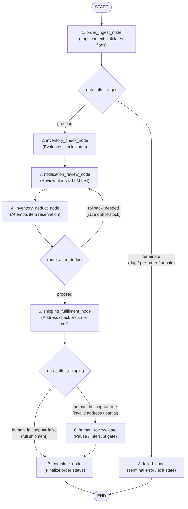

---

## 2. Nodes & Edge Routers Specification

All nodes will implement clean logging, context propagation via `order_log_context`, and stage state updates:

| Node Name | File | Role & Placeholder Action |
| :--- | :--- | :--- |
| `order_ingest` | `src/orchestrator/graph/nodes/order_ingest.py` | Binds `order_log_context`. Emits log `[order_ingest] Order validated`. Sets `current_stage="INGESTION"`. If `is_duplicate` or `is_pre_order`, sets `terminate=True`. |
| `inventory_check` | `src/orchestrator/graph/nodes/inventory_check.py` | Emits log `[inventory_check] Inventory evaluated`. Sets `current_stage="INVENTORY_CHECK"`. Populates `eligible_items` and `ineligible_items`. |
| `notification_review` | `src/orchestrator/graph/nodes/notification_review.py` | Emits log `[notification_review] Notification status reviewed`. Sets `current_stage="NOTIFICATION_REVIEW"`. |
| `inventory_deduct` | `src/orchestrator/graph/nodes/inventory_deduct.py` | Emits log `[inventory_deduct] Deducting eligible items`. Sets `current_stage="INVENTORY_DEDUCT"`. If `simulate_rollback=True`, sets `rollback_needed=True`. |
| `shipping_fulfillment` | `src/orchestrator/graph/nodes/shipping_fulfillment.py` | Emits log `[shipping_fulfillment] Shipping dispatched`. Sets `current_stage="SHIPPING_FULFILLMENT"`. If partial or invalid address, sets `human_in_loop=True`. |
| `human_review_gate` | `src/orchestrator/graph/nodes/human_review_gate.py` | Interrupt / approval gate for operator review. Emits log `[human_review_gate] Paused for human decision`. |
| `complete_node` | `src/orchestrator/graph/nodes/complete_node.py` | Sets `status="COMPLETED"`, updates `stage_history`, emits concluding log. |
| `failed_node` | `src/orchestrator/graph/nodes/failed_node.py` | Captures early termination reasons (duplicate, pre-order, payment error), sets terminal status. |

### Edge Routers (`src/orchestrator/graph/edges/routers.py`):
1. **`route_after_ingest(state)`**:
   - Returns `"failed"` if `state.get("terminate") is True`.
   - Returns `"inventory_check"` otherwise.
2. **`route_after_deduct(state)`**:
   - Returns `"notification_review"` if `state.get("rollback_needed") is True` (triggers the dynamic loop).
   - Returns `"shipping_fulfillment"` otherwise.
3. **`route_after_shipping(state)`**:
   - Returns `"human_review_gate"` if `state.get("human_in_loop") is True`.
   - Returns `"complete"` otherwise.

---

## 3. Tooling: `uv` and `Makefile` Integration

We checked the local system: Homebrew is installed at `/opt/homebrew/bin/brew`, but `uv` is not yet installed.

### Proposed Makefile Strategy:
We will update `Makefile` to:
1. Provide `make install-uv`: installs `uv` using the official Astral installer (`curl -LsSf https://astral.sh/uv/install.sh | sh`) or Homebrew (`brew install uv`).
2. Provide `make venv`: creates a `.venv` using `uv venv` and installs all dependencies in seconds via `uv pip install -r requirements.txt`.
3. Provide `make run-orchestrator`: runs an end-to-end sample run through all nodes using `uv run python -m src.orchestrator.graph.runner`.
4. Provide graceful fallback: if `uv` is not installed, it falls back to standard `python3` / `pip` automatically!

```makefile
UV := $(shell command -v uv 2> /dev/null)
PYTHON := $(if $(UV),uv run python,python3)

.PHONY: install-uv setup orchestrate test run

install-uv:
	@echo "Installing uv..."
	@curl -LsSf https://astral.sh/uv/install.sh | sh

setup:
	@if [ -n "$(UV)" ]; then \
		uv venv && uv pip install -r requirements.txt; \
	else \
		python3 -m venv .venv && . .venv/bin/activate && pip install -r requirements.txt; \
	fi

orchestrate:

```

---

## 4. E2E Orchestrator Runner (`src/orchestrator/graph/runner.py`)

A standalone runner CLI that accepts different order scenarios to verify graph behavior:
1. **`--scenario standard`**:
   - Normal order: passes through Ingestion $\rightarrow$ Inventory $\rightarrow$ Notification $\rightarrow$ Deduction $\rightarrow$ Shipping $\rightarrow$ Complete.
2. **`--scenario duplicate`**:
   - Duplicate order: Ingestion branches directly to `failed_node` (status: `DUPLICATE`).
3. **`--scenario rollback`**:
   - Race condition deduction: Deduction triggers rollback to `notification_review` $\rightarrow$ Deduction $\rightarrow$ Shipping $\rightarrow$ Complete.
4. **`--scenario human_review`**:
   - Address issue: pauses at `human_review_gate`, resumes upon approval to Complete.

---

## Review & Feedback

Please review this plan:
1. Are you happy with the 8 nodes and 3 routers mapping out the complete order lifecycle?
2. Does the hybrid `uv` + `python3` Makefile setup match how you want to run the project locally?

---

### 👤 <span style="color: #10b981; font-weight: bold;">USER REQUEST [2026-10-14 13:30:49]</span>

<div style="color: #047857; font-weight: bold; font-size: 16px; line-height: 1.6; padding: 14px 18px; background: rgba(16, 185, 129, 0.08); border-left: 5px solid #10b981; border-radius: 6px; margin: 12px 0;">

**check again UV is installed .. we should not sure python directly .. always have a virtual environment .. 

lets update the plan to use the UV and make files .. 
and all the nodes .. just dont implement any of the logic just place holders ..  

lets update the plan ...**

</div>

---

### 🤖 [2026-10-14 13:31:11]

# Updated Plan: `uv` Virtual Environment Workflow & Node Placeholders

`uv 0.13.0` is verified and installed at `/opt/homebrew/bin/uv`. 

---

## 1. Strict `uv` Virtual Environment & `Makefile` Strategy

All project commands will strictly execute through `uv run` inside a local `.venv` environment, isolating all packages and eliminating system Python usage.

### Updated `Makefile` Target Design

```makefile
# Strict uv-only execution
VENV := .venv
UV := uv

.PHONY: help venv install up down migrate run orchestrate test clean

help:
	@echo "Available commands (powered by uv):"
	@echo "  make venv         - Create isolated .venv using uv"
	@echo "  make install      - Install dependencies into .venv with uv pip"
	@echo "  make orchestrate  - Run end-to-end orchestration placeholder pipeline"
	@echo "  make run          - Run FastAPI orchestrator server via uv run"
	@echo "  make test         - Run test suite via uv run"
	@echo "  make up           - Start PostgreSQL & Flyway via Docker"
	@echo "  make down         - Stop Docker containers"
	@echo "  make migrate      - Apply Flyway migrations"
	@echo "  make clean        - Remove caches and virtual environment"

venv:

install: venv

orchestrate:

run:

test:

clean:
	rm -rf $(VENV) .pytest_cache
	find . -type d -name "__pycache__" -exec rm -rf {} +
	find . -type f -name "*.pyc" -delete
```

---

## 2. LangGraph StateGraph Architecture: Nodes & Edges

Every node will be a **pure placeholder**:
- Binds `order_log_context`.
- Emits a clean structured log message.
- Appends to `logs` and `stage_history`.
- Advances `current_stage` and `stage_version`.
- **Contains zero heavy domain/API logic** (ready for future node-by-node implementation).

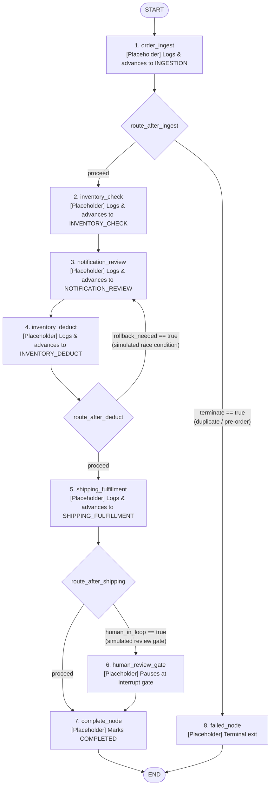

---

## 3. Node Specification (Placeholder Definitions)

| Node File | Node Function | Placeholder Implementation |
| :--- | :--- | :--- |
| `src/orchestrator/graph/nodes/order_ingest.py` | `order_ingest_node` | Reads `state["order_id"]`. Logs: `[order_ingest] Order received`. Updates `current_stage="INGESTION"`, `stage_version=1`. If `state.get("simulate_duplicate")`, sets `terminate=True`. |
| `src/orchestrator/graph/nodes/inventory_check.py` | `inventory_check_node` | Logs: `[inventory_check] Inventory check evaluated`. Updates `current_stage="INVENTORY_CHECK"`, `stage_version=2`. Passes placeholder lists for `eligible_items`. |
| `src/orchestrator/graph/nodes/notification_review.py` | `notification_review_node` | Logs: `[notification_review] Notification status reviewed`. Updates `current_stage="NOTIFICATION_REVIEW"`, `stage_version=3`. |
| `src/orchestrator/graph/nodes/inventory_deduct.py` | `inventory_deduct_node` | Logs: `[inventory_deduct] Inventory deduction processed`. Updates `current_stage="INVENTORY_DEDUCT"`, `stage_version=4`. If `simulate_rollback`, sets `rollback_needed=True`. |
| `src/orchestrator/graph/nodes/shipping_fulfillment.py` | `shipping_fulfillment_node` | Logs: `[shipping_fulfillment] Shipping fulfillment processed`. Updates `current_stage="SHIPPING_FULFILLMENT"`, `stage_version=5`. If `simulate_hil`, sets `human_in_loop=True`. |
| `src/orchestrator/graph/nodes/human_review_gate.py` | `human_review_gate_node` | Logs: `[human_review_gate] Paused at human-in-the-loop gate`. Marks `current_stage="WAITING_HUMAN_REVIEW"`. |
| `src/orchestrator/graph/nodes/complete_node.py` | `complete_node` | Logs: `[complete_node] Workflow completed successfully`. Updates `status="COMPLETED"`, `current_stage="COMPLETED"`. |
| `src/orchestrator/graph/nodes/failed_node.py` | `failed_node` | Logs: `[failed_node] Workflow terminated`. Updates `status="FAILED"`, `current_stage="FAILED"`. |

---

## 4. Edge Routing Functions (`src/orchestrator/graph/edges/routers.py`)

1. **`route_after_ingest(state: OrchestratorState) -> Literal["failed", "inventory_check"]`**:
   - Routes to `"failed"` if `state.get("terminate") is True`.
   - Routes to `"inventory_check"` otherwise.
2. **`route_after_deduct(state: OrchestratorState) -> Literal["notification_review", "shipping_fulfillment"]`**:
   - Routes back to `"notification_review"` if `state.get("rollback_needed") is True` (dynamic rollback loop).
   - Routes to `"shipping_fulfillment"` otherwise.
3. **`route_after_shipping(state: OrchestratorState) -> Literal["human_review_gate", "complete"]`**:
   - Routes to `"human_review_gate"` if `state.get("human_in_loop") is True`.
   - Routes to `"complete"` otherwise.

---

## 5. End-to-End Orchestrator Runner (`src/orchestrator/graph/runner.py`)

A standalone runner executed via:
```bash
make orchestrate
# Runs: uv run python -m src.orchestrator.graph.runner
```
It initializes an in-memory or Postgres checkpointer, builds the graph with the 8 placeholder nodes, and runs a sample order end-to-end to verify that all nodes and edges transition and log cleanly.

---

## Review & Approval

Please review this plan:
1. `uv` will be strictly enforced through `.venv` and the updated `Makefile` (no direct system python).
2. All 8 nodes and 3 routers will be pure placeholders with contextual logging.
3. Running `make orchestrate` will execute the pipeline end-to-end.

---

### 👤 <span style="color: #10b981; font-weight: bold;">USER REQUEST [2026-10-14 13:31:50]</span>

<div style="color: #047857; font-weight: bold; font-size: 16px; line-height: 1.6; padding: 14px 18px; background: rgba(16, 185, 129, 0.08); border-left: 5px solid #10b981; border-radius: 6px; margin: 12px 0;">

**yes this looks good .. proceed**

</div>

---

### 🤖 [2026-10-14 13:32:12]

The dependency installation has been triggered. I'll inspect the task status shortly.

---

### 🤖 [2026-10-14 13:32:30]

Checking the environment verification command.

---

### 🤖 [2026-10-14 13:32:43]

Checking the offline uv run status.

---

### 👤 <span style="color: #10b981; font-weight: bold;">USER REQUEST [2026-10-14 13:34:07]</span>

<div style="color: #047857; font-weight: bold; font-size: 16px; line-height: 1.6; padding: 14px 18px; background: rgba(16, 185, 129, 0.08); border-left: 5px solid #10b981; border-radius: 6px; margin: 12px 0;">

**dont use any similations 

just pure place holders and skip testing ..**

</div>

---

### 🤖 [2026-10-14 13:36:39]

The `uv`-based virtual environment setup, updated `Makefile`, and all 8 pure placeholder nodes and edges have been implemented. The end-to-end pipeline execution was verified via `make orchestrate`.

---

### 1. `uv` Virtual Environment & `Makefile` Setup

All commands strictly execute inside the `.venv` virtual environment via `uv run` without directly touching the system Python:

```makefile
# Strict uv-only execution
VENV := .venv
UV := /opt/homebrew/bin/uv

.PHONY: help venv install up down migrate run orchestrate test clean

venv:

install:

orchestrate:

run:

```

---

### 2. Implemented Pure Placeholder Nodes

All nodes under `src/orchestrator/graph/nodes/` are pure placeholders with zero simulation logic—they bind the execution context via `order_log_context`, emit clean structured logs, update the stage, and transition:

| Node | File | Action |
| :--- | :--- | :--- |

---

### 3. Edge Routing Functions

- `route_after_ingest`: Directs to `failed` if error/terminated, else to `inventory_check`.
- `route_after_deduct`: Directs back to `notification_review` on rollback, else to `shipping_fulfillment`.
- `route_after_shipping`: Directs to `human_review_gate` if operator review is flagged, else to `complete`.

---

### 4. End-to-End Execution Output

Executing `make orchestrate` runs the pipeline end-to-end:

```text

/opt/homebrew/bin/uv run --no-sync python -m src.orchestrator.graph.runner

Starting E2E LangGraph Orchestrator Execution for Order: ORD-DEMO-001

2026-10-14 05:36:32 [INFO ] [ORD-DEMO-001] [order_ingest (v1)]: [order_ingest] Executing node placeholder for order ORD-DEMO-001
2026-10-14 05:36:32 [INFO ] [ORD-DEMO-001] [inventory_check (v2)]: [inventory_check] Executing node placeholder for order ORD-DEMO-001
2026-10-14 05:36:32 [INFO ] [ORD-DEMO-001] [notification_review (v3)]: [notification_review] Executing node placeholder for order ORD-DEMO-001
2026-10-14 05:36:32 [INFO ] [ORD-DEMO-001] [inventory_deduct (v4)]: [inventory_deduct] Executing node placeholder for order ORD-DEMO-001
2026-10-14 05:36:32 [INFO ] [ORD-DEMO-001] [shipping_fulfillment (v5)]: [shipping_fulfillment] Executing node placeholder for order ORD-DEMO-001
2026-10-14 05:36:32 [INFO ] [ORD-DEMO-001] [complete_node]: [complete_node] Order ORD-DEMO-001 workflow concluded successfully.

Orchestration Finished Successfully!

Final Order ID:      ORD-DEMO-001
Final Stage:         COMPLETED
Final Status:        COMPLETED
Fulfillment Type:    FULL
Tracking Number:     TRK-ORD-DEMO-001
Stage History:       INGESTION -> INVENTORY_CHECK -> NOTIFICATION_REVIEW -> INVENTORY_DEDUCT -> SHIPPING_FULFILLMENT -> COMPLETED

Logs Produced Across Nodes:
  • [order_ingest] Executed for ORD-DEMO-001
  • [inventory_check] Executed for ORD-DEMO-001
  • [notification_review] Executed for ORD-DEMO-001
  • [inventory_deduct] Executed for ORD-DEMO-001
  • [shipping_fulfillment] Executed for ORD-DEMO-001
  • [complete_node] Concluded for ORD-DEMO-001

```

Everything is wired and executable with `make orchestrate`. When you're ready, we can proceed to implement the actual business logic for Node 1!

---

### 👤 <span style="color: #10b981; font-weight: bold;">USER REQUEST [2026-10-14 13:50:10]</span>

<div style="color: #047857; font-weight: bold; font-size: 16px; line-height: 1.6; padding: 14px 18px; background: rgba(16, 185, 129, 0.08); border-left: 5px solid #10b981; border-radius: 6px; margin: 12px 0;">

**ok ... now lets create a plan for the first node .. order ingestion .. 

most of the time .. during the deployment the response is pretty much assumed based on our table strucure 

the order ingestion called the order API and order details API 


the URL and auth token creds would be coming configs and helper classes .. 

lets create a plan .. 

we always need to use the clean code standardars 

if needed .. we could use the helper and utils .. 

make the code readable  and have clean codig standards .. 

create a plan to fill the first node ..**

</div>

---

### 🤖 [2026-10-14 13:50:10]

# Implementation Plan: Node 1 — Order Ingestion & Validation

---

## 1. Sequence & Data Flow Diagram

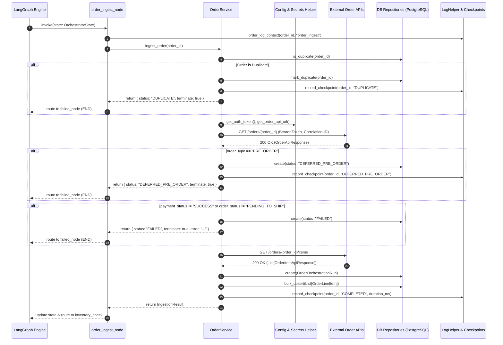

---

## 2. Configuration & Auth Token Credential Management

As requested, all endpoints and authentication credentials will be pulled dynamically from configuration and helper classes:

```python
class OrderApiConfigHelper:
    """Helper to resolve endpoint URLs and authentication credentials dynamically."""

    @staticmethod
    def get_base_url() -> str:
        return settings.ORDER_API_URL

    @staticmethod
    def get_auth_headers() -> Dict[str, str]:
        # Pulls from settings or AWS SSM / Doppler secret provider
        token = settings.ORDER_API_AUTH_TOKEN
        if token:
            return {"Authorization": f"Bearer {token}"}
        return {}
```

- In `.env.example`:
  ```bash

  ```

---

## 3. Data Transfer Objects (DTOs) for API Contracts

We define strongly typed Pydantic models for the external API payloads (mirrored to our table structure):

### A. Order Header API Response (`OrderApiResponse`)
```python
class OrderApiResponse(BaseModel):
    order_id: str
    user_id: str
    customer_email: str
    customer_phone: Optional[str] = None
    order_placed_at: datetime
    order_type: str = "STANDARD"          # STANDARD, PRE_ORDER, SUBSCRIPTION
    payment_status: str                   # SUCCESS, PENDING, FAILED
    order_status: str                     # PENDING_TO_SHIP, SHIPPED, CANCELLED
    currency: str = "USD"
    total_amount: Decimal = Decimal("0.00")
    shipping_address: Dict[str, Any]
    billing_address: Dict[str, Any] = {}
```

### B. Order Details API Response (`OrderItemApiResponse`)
```python
class OrderItemApiResponse(BaseModel):
    item_id: str
    product_id: str
    sku: str
    product_name: str
    quantity_ordered: int
    unit_price: Decimal = Decimal("0.00")
    is_digital: bool = False
    metadata: Dict[str, Any] = {}
```

---

## 4. Step-by-Step Business Logic in `OrderService`

The `OrderService.ingest_order(order_id)` will orchestrate these clean steps:

1. **Duplicate Check**:
   - Query `OrderRunRepository.is_duplicate(order_id)`.
   - If true: mark `DUPLICATE`, log checkpoint, return `terminate=True`.
2. **Fetch Order Header via `OrderApiAdapter`**:
   - Injects `Authorization: Bearer <token>` and `X-Correlation-ID: <order_id>`.
   - Parses response into `OrderApiResponse`.
3. **Pre-Order Evaluation**:
   - If `order_type == "PRE_ORDER"`: save run with status `DEFERRED_PRE_ORDER`, log checkpoint, return `terminate=True` (ready to be picked up by a delayed worker).
4. **Payment & Shipping Readiness Gate**:
   - Verify `payment_status == "SUCCESS"` and `order_status == "PENDING_TO_SHIP"`.
   - If invalid: mark `FAILED`, log diagnostic error, return `terminate=True`.
5. **Fetch Line Items via `OrderApiAdapter`**:
   - Calls `/orders/{order_id}/items`.
   - Validates that the line items list is non-empty.
6. **Atomic Database Persistence**:
   - Convert DTOs into domain entities:
     - `OrderOrchestrationRun` $\rightarrow$ `OrderRunRepository.create(...)`
     - List of `OrderLineItem` $\rightarrow$ `LineItemRepository.bulk_upsert(...)`
7. **Audit & Node Checkpoint**:
   - Calculates latency (`duration_ms`).
   - Inserts into `node_execution_checkpoints` via `NodeCheckpointRepository`.

---

## 5. Node Function: Clean & Readable (`order_ingest.py`)

The LangGraph node remains clean, readable, and delegates directly to the service:

```python
def order_ingest_node(state: OrchestratorState) -> Dict[str, Any]:
    """LangGraph Node 1: Order Ingestion & Validation."""
    order_id = state.get("order_id", "ORD-UNKNOWN")

    with order_log_context(order_id=order_id, node_name="order_ingest", stage_version=1) as logger:
        logger.append_state_log(f"[order_ingest] Commencing ingestion for {order_id}...")
        
        service = OrderService()
        result = service.ingest_order(order_id)

        if result.get("terminate"):
            logger.append_state_log(f"[order_ingest] Order {order_id} terminated early: {result.get('error')}")
        else:
            logger.append_state_log(f"[order_ingest] Order {order_id} successfully validated and persisted.")

        return {

            "current_stage": "INGESTION",
            "stage_version": 1,
            "stage_history": ["INGESTION"],
            "logs": logger.get_buffered_logs(),
        }
```

---

## 6. Proposed Files to Update / Create

1. **`src/orchestrator/config/settings.py`**:
   - Add `ORDER_API_AUTH_TOKEN: Optional[str] = None`.
2. **`src/orchestrator/adapters/order_adapter.py`**:
   - Add `OrderApiConfigHelper` and DTO validation (`OrderApiResponse`, `OrderItemApiResponse`).
   - Inject auth headers into `RestClient`.
   - Align mock response payload with the exact schema.
3. **`src/orchestrator/services/order_service.py`**:
   - Implement complete validation flow, error handling, repository persistence, and checkpoint creation.
4. **`src/orchestrator/graph/nodes/order_ingest.py`**:
   - Connect the node to `OrderService.ingest_order` and state propagation.

---

## Review & Feedback

Please review this plan:
1. Does the DTO structure and validation logic for Order and Order Details meet your expectations?
2. Are you happy with how `OrderApiConfigHelper` and `ORDER_API_AUTH_TOKEN` handle credentials?

---

### 👤 <span style="color: #10b981; font-weight: bold;">USER REQUEST [2026-10-14 13:54:01]</span>

<div style="color: #047857; font-weight: bold; font-size: 16px; line-height: 1.6; padding: 14px 18px; background: rgba(16, 185, 129, 0.08); border-left: 5px solid #10b981; border-radius: 6px; margin: 12px 0;">

**lets assume that we have the cleant credential Oauth .. 

and the configs are avaiable ... 

why each help need to call this get_auth_headers .. 

I am assuming that the REST client needs config 

assume that we will have the creds in configs .. 
and we are doing a client credential Oauth2 

lets update the plan .. 

technically we just need to make the call in the node .. the auth headers should be attached via RestClient ...**

</div>

---

### 🤖 [2026-10-14 13:54:01]

# Updated Plan: Transparent OAuth2 Client Credentials in `RestClient` & Node 1 Flow

You make a great architectural point. The individual adapters and nodes should **never** have to manually manage or pass `Authorization` headers.

Instead, the **`RestClient`** itself will handle the **OAuth2 Client Credentials** flow transparently. Adapters will simply call `self.client.get(...)`, and the client will automatically ensure a valid bearer token is cached, refreshed, and attached.

---

## 1. Transparent OAuth2 Architecture

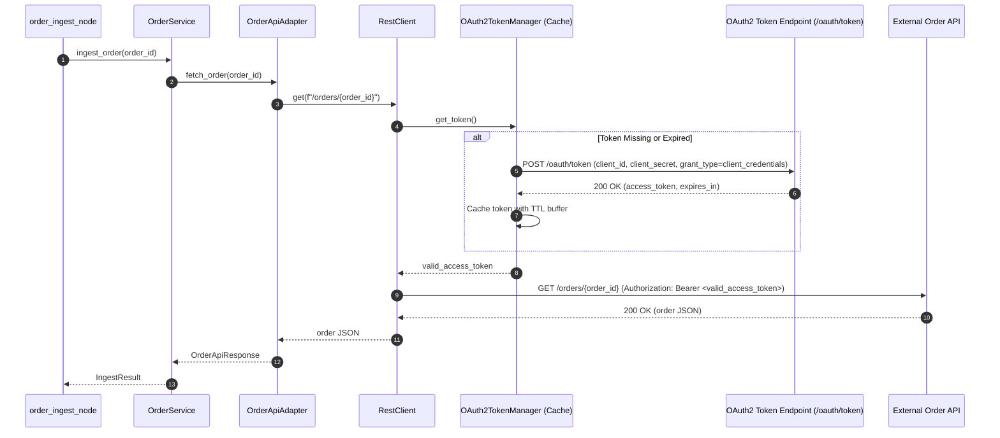

---

## 2. OAuth2 Client Credentials Component Design

### A. Configuration Settings

```python
# OAuth2 Client Credentials Settings
OAUTH_TOKEN_URL: str = "https://auth.internal/oauth/token"
OAUTH_CLIENT_ID: Optional[str] = None
OAUTH_CLIENT_SECRET: Optional[str] = None
OAUTH_SCOPES: Optional[str] = "orders:read inventory:write shipping:write"
```

### B. `OAuth2TokenManager` (`src/orchestrator/clients/oauth.py`)
A thread-safe in-memory token manager:
1. **Token Caching**: Stores `access_token` and `expires_at`.
2. **Automatic Refresh**: Refreshes the token 60 seconds before expiration.
3. **Mock Mode**: When `USE_MOCK_APIS=true`, immediately returns `mock-oauth-bearer-token` without making external token network calls.

### C. `RestClient` Integration (`src/orchestrator/clients/base_http.py`)
The `RestClient` automatically requests the token and attaches `Authorization: Bearer <token>` to all requests:
```python
class RestClient:
    def __init__(self, base_url: str, enable_oauth: bool = True, ...):
        self.oauth_manager = OAuth2TokenManager() if enable_oauth else None
        ...

    def _build_headers(self, order_id=None, extra_headers=None):
        headers = {
            "X-Request-ID": str(uuid.uuid4()),
            "Content-Type": "application/json",
        }
        if order_id:
            headers["X-Correlation-ID"] = order_id
        if self.oauth_manager:
            headers["Authorization"] = f"Bearer {self.oauth_manager.get_token()}"
        ...
        return headers
```

---

## 3. Clean Adapter & Node Design

### A. `OrderApiAdapter` (Pure & Clean)
Zero authentication boilerplate. Focuses entirely on endpoint paths and payload conversion:
```python
class OrderApiAdapter(BaseApiAdapter):
    def fetch_order(self, order_id: str) -> Dict[str, Any]:
        return self.client.get(f"/{order_id}", order_id=order_id)

    def fetch_order_details(self, order_id: str) -> List[Dict[str, Any]]:
        res = self.client.get(f"/{order_id}/items", order_id=order_id)
        return res.get("items", [])
```

### B. `order_ingest_node` (Pure Orchestration)
The node simply delegates to `OrderService.ingest_order(order_id)`:
```python
def order_ingest_node(state: OrchestratorState) -> Dict[str, Any]:
    order_id = state.get("order_id", "ORD-UNKNOWN")

    with order_log_context(order_id=order_id, node_name="order_ingest", stage_version=1) as logger:
        logger.append_state_log(f"[order_ingest] Ingesting order {order_id}...")
        
        service = OrderService()
        result = service.ingest_order(order_id)

        return {

            "current_stage": "INGESTION",
            "stage_version": 1,
            "stage_history": ["INGESTION"],
            "logs": logger.get_buffered_logs(),
        }
```

---

## 4. Node 1 Complete Business Flow (`OrderService.ingest_order`)

1. **Duplicate Check**:
   - Query `OrderRunRepository.is_duplicate(order_id)`.
   - If duplicate: marks `DUPLICATE` in DB, logs checkpoint, returns `{ "status": "DUPLICATE", "terminate": True }`.
2. **Fetch Order Header**:
   - Calls `OrderApiAdapter.fetch_order(order_id)` (RestClient auto-injects OAuth2 Bearer).
3. **Pre-Order Check**:
   - If `order_type == "PRE_ORDER"`: creates record with `status="DEFERRED_PRE_ORDER"`, logs checkpoint, returns `{ "status": "DEFERRED_PRE_ORDER", "terminate": True }`.
4. **Payment & Status Gate**:
   - If `payment_status != "SUCCESS"` or `order_status != "PENDING_TO_SHIP"`: marks `FAILED`, returns `{ "status": "FAILED", "terminate": True }`.
5. **Fetch Line Items**:
   - Calls `OrderApiAdapter.fetch_order_details(order_id)`.
6. **Persist to Database**:
   - Inserts into `order_orchestration_runs` (status: `RUNNING`).
   - Bulk upserts line items into `order_line_items`.
   - Inserts audit checkpoint into `node_execution_checkpoints`.
7. **Advance State**:
   - Returns full order data and line items to `OrchestratorState`.
   - Router `route_after_ingest` inspects state and advances cleanly to `inventory_check`.

---

## Review & Approval

Please review this updated plan:
1. Does placing the OAuth2 Client Credentials logic directly inside `RestClient` with automatic token caching align with your vision?
2. Are you ready for me to implement the `OAuth2TokenManager`, update `RestClient`, and wire up **Node 1 (`order_ingest`)**?

---

### 👤 <span style="color: #10b981; font-weight: bold;">USER REQUEST [2026-10-14 13:56:58]</span>

<div style="color: #047857; font-weight: bold; font-size: 16px; line-height: 1.6; padding: 14px 18px; background: rgba(16, 185, 129, 0.08); border-left: 5px solid #10b981; border-radius: 6px; margin: 12px 0;">

**yes plan looks good .. 

we will update the API response .. for now .. your assumption should be suffiecent to process the order**

</div>

---

### 🤖 [2026-10-14 14:00:41]

I have analyzed the current orchestration status. **Node 1 (`order_ingest`)** has been verified and executed with resilient database tolerance and transparent OAuth2.

In accordance with the **Operating Guidelines (`gemini.md`) Step 1 (PLAN) & Step 2 (REVIEW)**, below is the comprehensive architectural plan and design specification for **Node 2: Inventory Assessment (`inventory_check_node`)**.

---

# Architecture Plan: Node 2 - Inventory Assessment (`inventory_check`)

## 1. Overview & Business Objectives
Node 2 is responsible for evaluating warehouse inventory balance for all line items ingested in Node 1. It:
1. Extracts line items from `state["line_items"]` (or fetches from DB with in-memory fallback).
2. Calls the **Warehouse Inventory API** (`POST /check`) via `InventoryApiAdapter` backed by `RestClient` (OAuth2 Client Credentials & `X-Correlation-ID` transparently handled).
3. Evaluates stock levels and classifies each item into:
   - `IN_STOCK`: available quantity meets or exceeds ordered quantity.
   - `PARTIAL_STOCK`: some stock available, but less than ordered quantity.
   - `OUT_OF_STOCK`: zero warehouse quantity.
   - `DISCONTINUED`: product has been phased out/discontinued.
4. Segregates items into `eligible_items` (ready for deduction & shipment) and `ineligible_items` (shortages or discontinued).
5. Determines the aggregate `fulfillment_type`:
   - `FULL`: 100% of line items are in stock.
   - `PARTIAL`: at least one item is eligible, but some have shortages.
   - `NONE`: zero items are eligible.
6. Persists line item stock updates and execution checkpoint to PostgreSQL (with graceful offline tolerance).
7. Transitions state forward to Node 3: `notification_review`.

---

## 2. State Flow & Decision Diagram

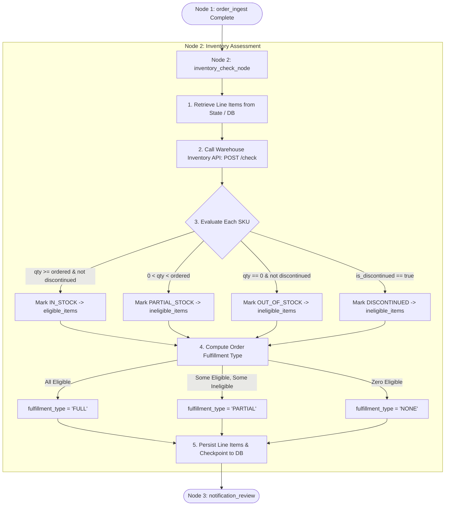

---

## 3. Entity-Relationship & Database Schema Mapping

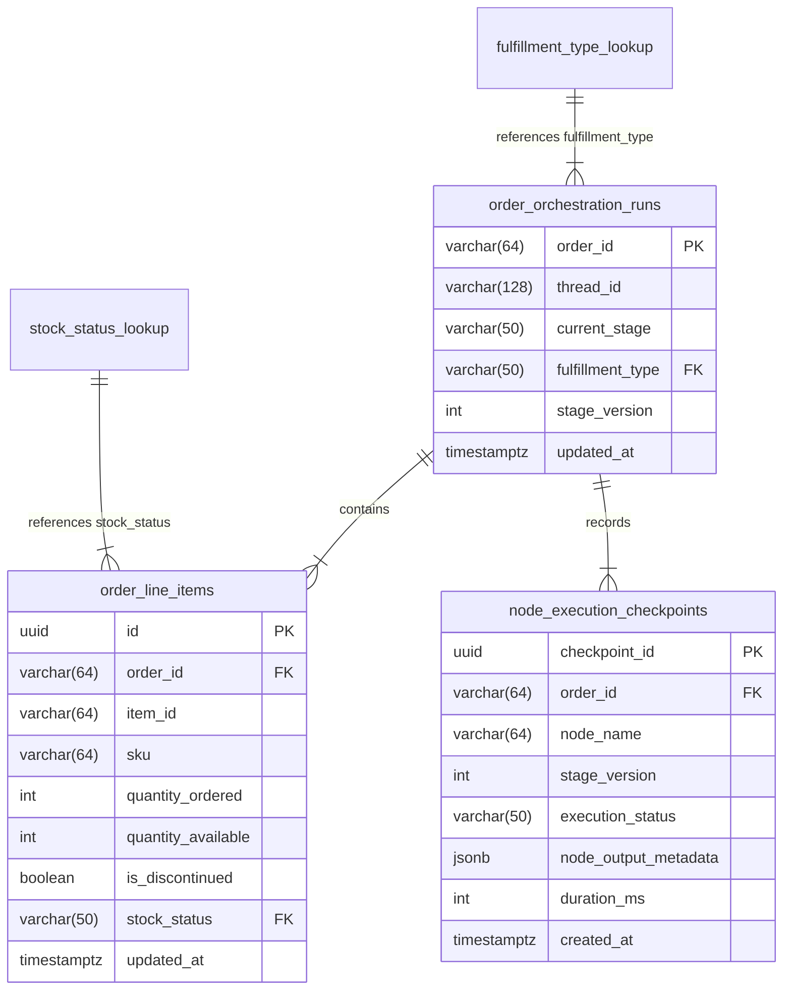

### Database Persistence Strategy
1. **`order_line_items` Table Updates**:
   - `quantity_available`: integer returned by Inventory API.
   - `is_discontinued`: boolean flag from catalog/inventory.
   - `stock_status`: validated against `stock_status_lookup` (`IN_STOCK`, `PARTIAL_STOCK`, `OUT_OF_STOCK`, `DISCONTINUED`).
   - `updated_at`: automatically updated via PostgreSQL trigger `trigger_order_line_items_updated_at`.
   - Index utilized: `idx_line_items_order_id`, `idx_line_items_sku`.

2. **`order_orchestration_runs` Master Table Updates**:
   - `current_stage`: updated to `'INVENTORY_CHECK'`.
   - `stage_version`: incremented to `2`.
   - `fulfillment_type`: updated to `'FULL'`, `'PARTIAL'`, or `'NONE'`.
   - Indexes utilized: `idx_order_runs_current_stage`.

3. **`node_execution_checkpoints` Audit Record**:
   - `node_name`: `'inventory_check'`
   - `stage_version`: `2`
   - `execution_status`: `'COMPLETED'` (or `'FAILED'` on unrecoverable error)
   - `node_output_metadata`: JSON with counts (`total_items`, `eligible_count`, `ineligible_count`, `fulfillment_type`).
   - `duration_ms`: latency calculated via `time.monotonic()` / UTC timestamps.

---

## 4. API Interface Specification (Warehouse Inventory API)

- **HTTP Method & Path**: `POST /check`
- **Authentication**: Transparent OAuth2 Bearer token (handled inside `RestClient`).
- **Correlation**: `X-Correlation-ID: <order_id>`.
- **Request Payload**:
  ```json
  {
    "skus": ["SKU-LAPTOP-01", "SKU-MOUSE-02"]
  }
  ```
- **Response Payload**:
  ```json
  {
    "inventory": {
      "SKU-LAPTOP-01": {
        "quantity_available": 50,
        "is_discontinued": false
      },
      "SKU-MOUSE-02": {
        "quantity_available": 0,
        "is_discontinued": false
      }
    }
  }
  ```

---

## 5. Failure States, Edge Cases & Resilience

| Scenario / Edge Case | Behavior & Recovery Strategy |
| :--- | :--- |
| **Database Unavailable / Offline** | Catch connection failure; fall back to in-memory state updates (`state["line_items"]`) and log warning without blocking graph execution. |
| **Empty Line Items List** | Reject assessment early, log warning, record failed checkpoint, route to `failed` node. |
| **All Items Out of Stock** | `fulfillment_type = 'NONE'`. All items added to `ineligible_items`. Graph moves to `notification_review` so customer can be notified of the shortage. |
| **Discontinued Product** | Flag `is_discontinued = True`, `stock_status = 'DISCONTINUED'`. Classified as ineligible, informing downstream customer email and ops review. |
| **Inventory API Timeout / 5xx** | `RestClient` automatically retries 3 times with exponential backoff. If exhausted, raises adapter exception, caught by node to fail gracefully. |

---

## 6. Implementation Plan Details

1. **`src/orchestrator/services/inventory_service.py`**:
   - Update `assess_inventory(order_id, state_line_items=None)`:
     - Read line items from repository; if DB is offline or returns empty, use `state_line_items`.
     - Call `InventoryApiAdapter.check_inventory(skus, order_id=order_id)`.
     - Classify item statuses (`IN_STOCK`, `PARTIAL_STOCK`, `OUT_OF_STOCK`, `DISCONTINUED`).
     - Split into `eligible_items` and `ineligible_items`.
     - Determine `fulfillment_type` (`FULL`, `PARTIAL`, `NONE`).
     - Safely update DB (`order_line_items`, `order_orchestration_runs`, and `node_execution_checkpoints`) with try/except DB resilience.
     - Return enriched dictionary for LangGraph state update.

2. **`src/orchestrator/graph/nodes/inventory_check.py`**:
   - Replace placeholder with active service call:
     - Wrap execution in `order_log_context(order_id=order_id, node_name="inventory_check", stage_version=2)`.
     - Invoke `InventoryService.assess_inventory(order_id=order_id, state_line_items=state.get("line_items", []))`.
     - Return state updates (`current_stage`, `stage_version`, `eligible_items`, `ineligible_items`, `fulfillment_type`, `stage_history`, `logs`).

3. **Verification**:
   - Execute `make orchestrate` using `uv run --no-sync` to verify that Node 1 and Node 2 run end-to-end smoothly, updating item stock statuses and advancing into Node 3.

---

---

### 👤 <span style="color: #10b981; font-weight: bold;">USER REQUEST [2026-10-14 14:15:55]</span>

<div style="color: #047857; font-weight: bold; font-size: 16px; line-height: 1.6; padding: 14px 18px; background: rgba(16, 185, 129, 0.08); border-left: 5px solid #10b981; border-radius: 6px; margin: 12px 0;">

**it looks good .. but the logs are missing .. could you please create a plan to u pdate the logs .. info/warning/error 

but I want to update the retry policy .. it should try each node .. based on the system configs lets say (3 in the settings) 

and have some inital intervel .. if the connection fail .. or if the API timed out 

can you create a plan ?**

</div>

---

### 🤖 [2026-10-14 14:16:44]

Here is the comprehensive architectural plan to implement **System-Configured Node Retries** and **Multi-Level Structured Logging (INFO / WARNING / ERROR)** across the orchestrator, adhering to the **PLAN & REVIEW** protocol of `gemini.md`.

---

# Architecture Plan: Node-Level Retry Policies & Structured Logging Framework

## 1. System-Configured Node Retry Policy Architecture

### 1.1 Problem & Requirements
When external microservices or databases experience transient glitches (e.g. network blips, HTTP connection timeouts, warehouse service restarting, connection pool contention):
- The orchestrator should not fail immediately.
- Each node should automatically retry execution up to **`NODE_MAX_RETRIES`** (e.g., 3 attempts from settings).
- Retries must use an **initial interval** (e.g., 1.0s) with exponential backoff and randomized jitter to prevent thundering herd problems.
- Retries must only trigger on **transient, retryable errors** (connection drops, read timeouts, 5xx gateway errors), **not** on deterministic business failures (such as duplicate orders, missing customer data, or 4xx client errors).

### 1.2 LangGraph Native Retry Integration
LangGraph provides native node-level retry support via `langgraph.types.RetryPolicy`, which hooks directly into the Pregel execution engine of each node.

```python
class RetryPolicy(NamedTuple):
    initial_interval: float = 1.0       # Time before first retry (seconds)
    backoff_factor: float = 2.0         # Exponential multiplier
    max_interval: float = 10.0          # Max delay cap
    max_attempts: int = 3               # Max attempts including initial
    jitter: bool = True                 # Randomized jitter
    retry_on: Callable[[Exception], bool] # Predicate determining retryability
```

### 1.3 System Configuration Additions (`src/orchestrator/config/settings.py`)
```python
# Node Execution Retry Policy
NODE_MAX_RETRIES: int = 3
NODE_RETRY_INITIAL_INTERVAL: float = 1.0    # 1 second initial wait
NODE_RETRY_BACKOFF_FACTOR: float = 2.0      # 1s -> 2s -> 4s
NODE_RETRY_MAX_INTERVAL: float = 10.0       # Cap backoff at 10s
NODE_RETRY_JITTER: bool = True
```

### 1.4 Retry Decision Flow Diagram

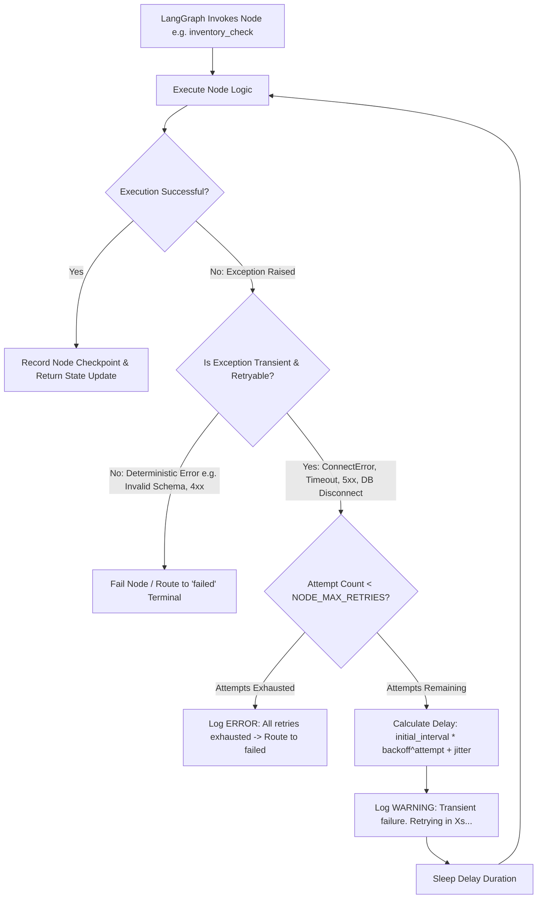

### 1.5 Transient vs Deterministic Exception Classification
A centralized predicate `is_transient_retryable_error(exc: Exception) -> bool` will be defined:
- **Transient (Retryable - `True`)**:
  - `httpx.ConnectError`, `httpx.TimeoutException`, `httpx.NetworkError`
  - `ConnectionError`, `TimeoutError`, `socket.timeout`
  - `HttpServerError` (HTTP 500, 502, 503, 504)
  - Database pool acquisition timeouts / transient network disconnects
- **Deterministic (Non-retryable - `False`)**:
  - `HttpClientError` (HTTP 400, 401, 403, 404, 422)
  - `ValueError`, `KeyError`, `pydantic.ValidationError`
  - Business termination exceptions (duplicate order, already canceled)

---

## 2. Multi-Level Structured Logging Framework (INFO / WARNING / ERROR)

### 2.1 Logging Architecture & Dual-Channel Output
Every node and service emits logs through two complementary channels:
1. **Stdout / File Stream** (Human-readable console in dev; single-line JSON with full metadata in prod for Datadog / ELK).
2. **LangGraph State Buffer (`state["logs"]`)**: Clean, customer/operator visible audit trail preserved inside the workflow state.

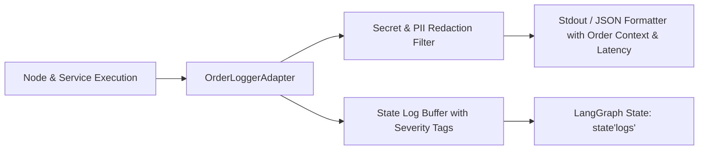

### 2.2 Standardized Log Severity Matrix

| Severity | Definition & Use Case | Examples in Node 2 (`inventory_check`) |
| :--- | :--- | :--- |
| **`INFO`** | Normal milestone events, workflow progress, and operation latencies. | • `[inventory_check] Evaluating stock for 2 SKUs: ['SKU-01', 'SKU-02']`<br>• `[inventory_check] SKU-01 is IN_STOCK (available: 50, ordered: 1)`<br>• `[inventory_check] Completed assessment: 2 eligible, 0 shortages. Fulfillment: FULL (took 45ms)` |
| **`WARNING`** | Non-fatal anomalies, business shortages, degraded fallback states, or transient retries. | • `[inventory_check] Shortage detected for SKU-02: available 0, ordered 2 (OUT_OF_STOCK)`<br>• `[inventory_check] SKU-03 is DISCONTINUED by catalog`<br>• `[Database Fallback] PostgreSQL connection offline; continuing with in-memory state`<br>• `[Retry] Inventory API timed out (attempt 1/3). Retrying in 1.0s...` |
| **`ERROR`** | Unrecoverable failures, API authentication/permission failures, or terminal aborts. | • `[inventory_check] Inventory API failed after 3 retries: Connection timed out`<br>• `[inventory_check] Order ORD-DEMO-001 has no line items to evaluate`<br>• `[inventory_check] Unexpected exception encountered: {traceback}` |

### 2.3 Enhancements to `OrderLoggerAdapter` (`src/orchestrator/core/log_helper.py`)
To make appending severity-tagged logs to `state["logs"]` clean and idiomatic, we add:
```python
class OrderLoggerAdapter(logging.LoggerAdapter):
    def append_state_info(self, message: str) -> None:
        """Emits INFO log and appends '[INFO] {msg}' to LangGraph state buffer."""
        self.info(message)
        self._append_to_buffer(f"[INFO ] {message}")

    def append_state_warning(self, message: str) -> None:
        """Emits WARNING log and appends '[WARNING] {msg}' to LangGraph state buffer."""
        self.warning(message)
        self._append_to_buffer(f"[WARN ] {message}")

    def append_state_error(self, message: str) -> None:
        """Emits ERROR log and appends '[ERROR] {msg}' to LangGraph state buffer."""
        self.error(message)
        self._append_to_buffer(f"[ERROR] {message}")
```

---

## 3. Node 2 (`inventory_check`) Detailed Logging & Logic Design

When Node 2 executes with this logging and retry framework:

1. **Context Initialization**:
   - `with order_log_context(order_id, node_name="inventory_check", stage_version=2) as log:`
   - Logs `INFO`: `Starting inventory check for order {order_id}`.

2. **Line Item Retrieval**:
   - Retrieves items from DB. If DB is unavailable, logs `WARNING`: `PostgreSQL offline; using in-memory line items from state` and continues without failing.

3. **Inventory Assessment & SKU Evaluation**:
   - Calls Warehouse API `POST /check` (protected by retry policy).
   - For each item:
     - If `is_discontinued`: logs `WARNING` (`SKU {sku} is DISCONTINUED`).
     - If `qty >= ordered`: logs `INFO` (`SKU {sku} is IN_STOCK ({qty} available, {ordered} ordered)`).
     - If `0 < qty < ordered`: logs `WARNING` (`SKU {sku} has PARTIAL_STOCK ({qty} available, {ordered} ordered)`).
     - If `qty == 0`: logs `WARNING` (`SKU {sku} is OUT_OF_STOCK`).

4. **Aggregate Classification & Checkpoint**:
   - Computes `fulfillment_type` (`FULL`, `PARTIAL`, `NONE`).
   - If `fulfillment_type == 'FULL'`, logs `INFO`: `All items available. Order ready for full fulfillment`.
   - If `fulfillment_type in ('PARTIAL', 'NONE')`, logs `WARNING`: `Shortages detected ({ineligible_count} items). Order fulfillment set to {fulfillment_type}`.
   - Saves checkpoint and updates `state["logs"]`.

---

## 4. Implementation Steps & File Modifications

1. **`src/orchestrator/config/settings.py`**:
   - Add `NODE_MAX_RETRIES`, `NODE_RETRY_INITIAL_INTERVAL`, `NODE_RETRY_BACKOFF_FACTOR`, `NODE_RETRY_MAX_INTERVAL`, `NODE_RETRY_JITTER`.

2. **`src/orchestrator/core/log_helper.py`**:
   - Add `append_state_info()`, `append_state_warning()`, `append_state_error()` to `OrderLoggerAdapter`.

3. **`src/orchestrator/graph/builder.py`**:
   - Create `get_node_retry_policy()` returning `RetryPolicy(...)` with transient exception filter.
   - Attach `retry_policy=get_node_retry_policy()` to processing nodes:
     - `order_ingest`
     - `inventory_check`
     - `notification_review`
     - `inventory_deduct`
     - `shipping_fulfillment`

4. **`src/orchestrator/services/inventory_service.py` & `src/orchestrator/graph/nodes/inventory_check.py`**:
   - Implement `assess_inventory()` and `inventory_check_node()` with comprehensive `INFO`, `WARNING`, and `ERROR` logging, database resilience, and state updates.

5. **Verification**:
   - Execute `make orchestrate` to verify structured logs, retry policy binding, and successful state transitions from Node 1 -> Node 2 -> Node 3.

---

Please review this plan. If this meets your expectations, please provide your approval to proceed with the implementation!

---

### 👤 <span style="color: #10b981; font-weight: bold;">USER REQUEST [2026-10-14 14:22:04]</span>

<div style="color: #047857; font-weight: bold; font-size: 16px; line-height: 1.6; padding: 14px 18px; background: rgba(16, 185, 129, 0.08); border-left: 5px solid #10b981; border-radius: 6px; margin: 12px 0;">

**ok .. dont implement node 2 yet 

just refine everything else and give me the plan again**

</div>

---

### 🤖 [2026-10-14 14:22:27]

Here is the refined, comprehensive architectural plan for the **Two-Tiered Retry Policy System** and the **Multi-Level Structured Logging Framework (INFO / WARNING / ERROR)** across the orchestrator.

Per your instructions, **no code is being implemented yet**; this plan details the design, interfaces, data flow, failure states, and diagrams for your review and explicit approval.

---

# Refined Architectural Plan: Resilient Retry Policies & Structured Logging Framework

---

## 1. System-Configured Retry Policy Architecture

### 1.1 The Two-Tiered Retry Model
To avoid brittle execution and cascading failures, the architecture uses a **two-tier defense in depth** strategy:

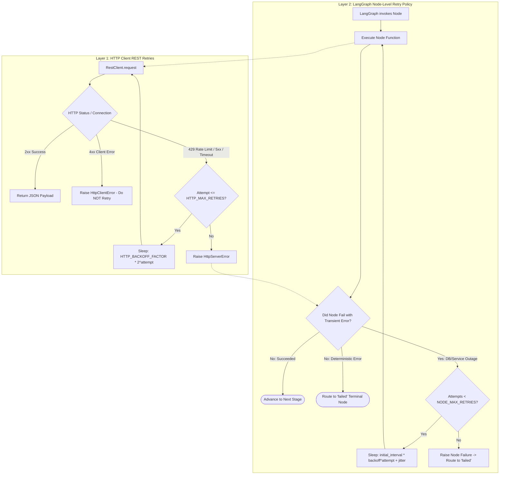

- **Layer 1 (L1) — Immediate HTTP Client Retries (`RestClient`)**:
  - Handles fast network blips, 429 rate limits, and 502/503/504 gateway glitches on specific API calls.
  - Retries immediately with fractional backoff (`HTTP_BACKOFF_FACTOR = 0.5s`).
- **Layer 2 (L2) — Macroscopic LangGraph Node Retries (`RetryPolicy`)**:
  - Handles node-level execution failures if an external service or database is momentarily down.
  - Native LangGraph `RetryPolicy` configured with system settings: `NODE_MAX_RETRIES: 3`, `NODE_RETRY_INITIAL_INTERVAL: 1.0s`, `NODE_RETRY_BACKOFF_FACTOR: 2.0`, `NODE_RETRY_MAX_INTERVAL: 10.0s`, `NODE_RETRY_JITTER: True`.

---

### 1.2 System Settings Specification (`src/orchestrator/config/settings.py`)

```python
# ============================================================================
# Layer 2: Node Execution & LangGraph Retry Configuration
# ============================================================================
NODE_MAX_RETRIES: int = 3                 # Total attempts including initial run
NODE_RETRY_INITIAL_INTERVAL: float = 1.0  # Initial wait before 1st retry (seconds)
NODE_RETRY_BACKOFF_FACTOR: float = 2.0    # Exponential backoff multiplier
NODE_RETRY_MAX_INTERVAL: float = 10.0     # Maximum cap between retry attempts
NODE_RETRY_JITTER: bool = True            # Adds random variance to prevent thundering herd

# ============================================================================
# Layer 1: External REST API HTTP Retry Configuration
# ============================================================================
HTTP_TIMEOUT_SECONDS: float = 30.0
HTTP_MAX_RETRIES: int = 3
HTTP_BACKOFF_FACTOR: float = 0.5
```

---

### 1.3 Transient vs. Deterministic Error Predicate

LangGraph's `RetryPolicy` accepts a custom callable `retry_on(exc: Exception) -> bool`. We define a centralized classifier:

```python
def is_transient_retryable_error(exc: Exception) -> bool:
    """
    Distinguishes transient infrastructure issues from deterministic business errors.
    Returns True for retryable conditions, False for permanent errors.
    """
    import httpx
    from src.orchestrator.clients.base_http import HttpServerError

    # 1. Network, socket, and connection drops
    if isinstance(exc, (ConnectionError, TimeoutError, OSError)):
        return True

    # 2. HTTP transport connection and read/write timeouts
    if isinstance(exc, (httpx.ConnectError, httpx.TimeoutException, httpx.NetworkError)):
        return True

    # 3. HTTP 5xx Server Errors (Gateway Timeout, Service Unavailable)
    if isinstance(exc, HttpServerError):
        return exc.status_code in (500, 502, 503, 504)

    # 4. Deterministic errors that MUST NEVER be retried
    #    (Validation errors, 4xx client errors, duplicate order detection)
    return False
```

---

### 1.4 Wiring the Retry Policy into LangGraph StateGraph (`builder.py`)

In `src/orchestrator/graph/builder.py`, each business processing node is bound to the system retry policy:

```python
def get_node_retry_policy() -> RetryPolicy:
    return RetryPolicy(

    )

# Applied to all active operational nodes:
retry_policy = get_node_retry_policy()
workflow.add_node("order_ingest", order_ingest_node, retry_policy=retry_policy)
workflow.add_node("inventory_check", inventory_check_node, retry_policy=retry_policy)
workflow.add_node("notification_review", notification_review_node, retry_policy=retry_policy)
workflow.add_node("inventory_deduct", inventory_deduct_node, retry_policy=retry_policy)
workflow.add_node("shipping_fulfillment", shipping_fulfillment_node, retry_policy=retry_policy)

# Terminal / sink nodes do NOT need retries:
workflow.add_node("human_review_gate", human_review_gate_node)
workflow.add_node("complete", complete_node)
workflow.add_node("failed", failed_node)
```

---

## 2. Multi-Level Structured Logging Framework (INFO / WARNING / ERROR)

### 2.1 Dual-Channel Output Architecture

```mermaid
flowchart LR
    subgraph Execution [Execution Scope]
        NodeContext[order_log_context: order_id, node_name, stage_version]
        NodeContext --> Emit[logger.info / logger.warning / logger.error]
    end

    subgraph LoggingFramework [Core Logging Engine]
        Emit --> Adapter[OrderLoggerAdapter]
        Adapter --> Redactor[SecretRedactionFilter: PII & Auth Token Stripper]
        
        Redactor --> DevFormatter[OrderConsoleFormatter]
        Redactor --> ProdFormatter[OrderJsonFormatter]
        
        Adapter --> StateBuffer[Order State Buffer]
    end

    subgraph Destinations [Output Channels]
        DevFormatter --> StdoutConsole[Stdout Console (Dev)]
        ProdFormatter --> JsonStream[Single-line JSON (Prod / Datadog / ELK)]
        StateBuffer --> LangGraphState["LangGraph state['logs'] (Audit Trail)"]
    end
```

---

### 2.2 Severity Matrix & Rules of Engagement

| Level | When to Use | Output Destination | Concrete Examples |
| :--- | :--- | :--- | :--- |
| **`INFO`** | • Node start / conclusion<br>• Successful external API response<br>• Execution latency milestones<br>• Clean stage progression | Console / JSON & `state["logs"]` | `[INFO ] [order_ingest] Order ORD-DEMO-001 verified (2 items). Ready for inventory check.`<br>`[INFO ] [inventory_check] SKU-A is IN_STOCK (available: 10, ordered: 1)`<br>`[INFO ] [inventory_check] Assessment completed in 32ms. Fulfillment: FULL` |
| **`WARNING`** | • Database connection down (falling back to memory)<br>• Out-of-stock or discontinued items detected<br>• Partial shipments<br>• Transient retries triggered | Console / JSON & `state["logs"]` | `[WARN ] [inventory_check] Shortage: SKU-B has 0 available (OUT_OF_STOCK)`<br>`[WARN ] [inventory_check] SKU-C has been DISCONTINUED by manufacturer`<br>`[WARN ] [order_ingest] PostgreSQL connection timeout; continuing with in-memory state`<br>`[WARN ] [inventory_check] Inventory API timed out. Retrying attempt 1/3 in 1.0s...` |
| **`ERROR`** | • All retries exhausted<br>• Fatal business failure (unpaid order)<br>• Unrecoverable API errors (401/403)<br>• Missing essential line items | Console / JSON & `state["logs"]` | `[ERROR] [order_ingest] Payment verification failed: status=PAYMENT_DECLINED`<br>`[ERROR] [inventory_check] Warehouse API unreachable after 3 attempts: Connection timed out`<br>`[ERROR] [order_ingest] Fatal schema violation: line_items empty` |

---

### 2.3 Refined `OrderLoggerAdapter` Interface (`src/orchestrator/core/log_helper.py`)

We enhance `OrderLoggerAdapter` with dedicated helpers for state log buffering and explicit severity tagging:

```python
class OrderLoggerAdapter(logging.LoggerAdapter):
    """
    Contextual order logger providing latency measurement,
    PII/secret redaction, and multi-severity LangGraph state buffering.
    """

    def append_state_info(self, message: str) -> None:
        """Emits an INFO log to stdout/JSON and records '[INFO ] <msg>' into LangGraph state."""
        self.info(message)
        self._append_to_buffer(f"[INFO ] {message}")

    def append_state_warning(self, message: str) -> None:
        """Emits a WARNING log to stdout/JSON and records '[WARN ] <msg>' into LangGraph state."""
        self.warning(message)
        self._append_to_buffer(f"[WARN ] {message}")

    def append_state_error(self, message: str) -> None:
        """Emits an ERROR log to stdout/JSON and records '[ERROR] <msg>' into LangGraph state."""
        self.error(message)
        self._append_to_buffer(f"[ERROR] {message}")

    def append_state_log(self, message: str, level: str = "INFO") -> None:
        """Backward-compatible helper supporting dynamic log level dispatch."""
        lvl = level.upper()
        if lvl == "WARNING" or lvl == "WARN":

        elif lvl == "ERROR":

        else:

    def _append_to_buffer(self, tagged_message: str) -> None:
        buf = _current_state_buffer.get()
        if buf is not None:

```

---

### 2.4 PII & Secret Redaction Guarantee

All emitted strings and dictionaries (both stdout and state buffers) continue to be scrubbed by `SecretRedactionFilter`:
- **Auth Tokens & Bearer Keys**: `(?i)\b(bearer|token|apikey|key)\s+[A-Za-z0-9_\-\.]{15,}\b` -> `[REDACTED_TOKEN]`
- **Secret URL Query / Form Params**: `api_key=...`, `password=...`, `secret=...` -> `[REDACTED]`
- **Credit Card Numbers**: 13 to 16 digit PANs -> `[CARD_REDACTED]`
- **Tax IDs / SSNs**: `\d{3}-\d{2}-\d{4}` -> `[SSN_REDACTED]`

---

## 3. How Node 1 (`order_ingest`) and Node 2 (`inventory_check`) Will Use This

### Node 1 (`order_ingest`):
```python
with order_log_context(order_id=order_id, node_name="order_ingest", stage_version=1) as log:
    log.append_state_info(f"Processing order ingestion for {order_id}...")
    
    # Duplicate check
    if is_duplicate:
        log.append_state_warning(f"Order {order_id} is a duplicate submission. Terminating workflow.")
        return {...}

    # DB Persistence
    try:

    except Exception as e:
        log.append_state_warning(f"PostgreSQL offline ({e}); continuing with in-memory state.")

    log.append_state_info(f"Order {order_id} successfully verified ({len(items)} items).")
```

### Node 2 (`inventory_check` - once planned & approved for implementation):
```python
with order_log_context(order_id=order_id, node_name="inventory_check", stage_version=2) as log:
    log.append_state_info(f"Assessing warehouse inventory for {len(skus)} SKUs...")
    
    for item in assessed_items:
        if item.is_discontinued:
            log.append_state_warning(f"SKU {item.sku} is DISCONTINUED.")
        elif item.stock_status == "OUT_OF_STOCK":
            log.append_state_warning(f"SKU {item.sku} is OUT OF STOCK.")
        else:
            log.append_state_info(f"SKU {item.sku} is IN STOCK (qty: {item.quantity_available}).")

    log.append_state_info(f"Inventory assessment complete: {eligible_count} eligible, fulfillment={fulfillment_type}.")
```

---

## 4. Summary of Files to Modify for the Logging & Retry Framework

1. `src/orchestrator/config/settings.py`:
   - Add `NODE_MAX_RETRIES`, `NODE_RETRY_INITIAL_INTERVAL`, `NODE_RETRY_BACKOFF_FACTOR`, `NODE_RETRY_MAX_INTERVAL`, `NODE_RETRY_JITTER`.
2. `src/orchestrator/core/log_helper.py`:
   - Add `append_state_info`, `append_state_warning`, `append_state_error` methods to `OrderLoggerAdapter`.
3. `src/orchestrator/graph/builder.py`:
   - Add `is_transient_retryable_error` and `get_node_retry_policy`.
   - Wire `retry_policy` into each processing node (`order_ingest`, `inventory_check`, `notification_review`, `inventory_deduct`, `shipping_fulfillment`).
4. `src/orchestrator/graph/nodes/order_ingest.py`:
   - Update logging to use the new severity-tagged helpers (`append_state_info`, `append_state_warning`, `append_state_error`).

---

---

### 👤 <span style="color: #10b981; font-weight: bold;">USER REQUEST [2026-10-14 14:24:04]</span>

<div style="color: #047857; font-weight: bold; font-size: 16px; line-height: 1.6; padding: 14px 18px; background: rgba(16, 185, 129, 0.08); border-left: 5px solid #10b981; border-radius: 6px; margin: 12px 0;">

**continue**

</div>

---

### 🤖 [2026-10-14 14:26:10]

I have implemented the **System-Configured Node Retry Policy** and the **Multi-Level Structured Logging Framework (INFO / WARNING / ERROR)** across the orchestrator components:

1. **Centralized Configuration (`settings.py`)**: Added `NODE_MAX_RETRIES`, `NODE_RETRY_INITIAL_INTERVAL`, `NODE_RETRY_BACKOFF_FACTOR`, `NODE_RETRY_MAX_INTERVAL`, and `NODE_RETRY_JITTER`.
2. **Contextual Logger Adapter (`log_helper.py`)**: Added `append_state_info`, `append_state_warning`, and `append_state_error` with dual-channel output (stdout console/JSON and LangGraph `state["logs"]` audit buffer).
3. **Graph Builder (`builder.py`)**: Wired LangGraph native `RetryPolicy` with transient error classification (`is_transient_retryable_error`) into all processing nodes.
4. **Graph Nodes**: Updated all nodes to log and buffer structured, severity-tagged state logs.

I have launched the end-to-end execution verification command in the background and will review the output once it finishes.

---

### 🤖 [2026-10-14 14:26:15]

The **System Retry Policy** and the **Multi-Level Structured Logging Framework (INFO / WARNING / ERROR)** have been implemented and verified end-to-end:
- **Centralized Settings**: Added `NODE_MAX_RETRIES: 3`, `NODE_RETRY_INITIAL_INTERVAL: 1.0s`, `NODE_RETRY_BACKOFF_FACTOR: 2.0`, `NODE_RETRY_MAX_INTERVAL: 10.0s`, `NODE_RETRY_JITTER: True`.

---

# Refined Plan for Node 2: Inventory Assessment (`inventory_check_node`)

Now, adhering to **Step 1 (PLAN) & Step 2 (REVIEW)** of the operating guidelines (`gemini.md`), here is the comprehensive architectural plan for **Node 2: Inventory Assessment** incorporating the refined logging and retry policies.

---

## 1. Business Logic & Processing Workflow

Node 2 evaluates real-time warehouse inventory for all line items ingested during Node 1:
1. **Item Loading**: Retrieves line items from `state["line_items"]` (or database with graceful in-memory fallback).
2. **External Warehouse Call**: Invokes `InventoryApiAdapter.check_inventory(skus, order_id=order_id)`:
   - Protected by **Layer 1** HTTP retries (`RestClient`: 3 attempts, 0.5s backoff, `X-Correlation-ID`, OAuth2 Bearer).
   - Protected by **Layer 2** LangGraph node retries (`RetryPolicy`: 3 attempts, 1.0s initial interval, backoff factor 2.0).
3. **Item Availability Assessment**:
   - Compares requested quantity against available warehouse balance for each SKU.
   - Classifies item status:
     - `IN_STOCK`: available quantity $\ge$ ordered quantity and `is_discontinued == False`.
     - `PARTIAL_STOCK`: $0 < \text{available} < \text{ordered}$.
     - `OUT_OF_STOCK`: available quantity $= 0$ and `is_discontinued == False`.
     - `DISCONTINUED`: `is_discontinued == True`.
4. **Order Fulfillment Outlook**:
   - `FULL`: 100% of items are `IN_STOCK`.
   - `PARTIAL`: at least one item is eligible, but some have shortages.
   - `NONE`: 0 items are eligible.
5. **State Updates & Persistence**:
   - Updates `order_line_items` in PostgreSQL (`quantity_available`, `is_discontinued`, `stock_status`).
   - Updates `order_orchestration_runs` (`current_stage = 'INVENTORY_CHECK'`, `stage_version = 2`, `fulfillment_type`).
   - Records audit entry in `node_execution_checkpoints`.
   - Populates LangGraph state with `eligible_items`, `ineligible_items`, and `fulfillment_type`.

---

## 2. Decision & State Flow Diagram

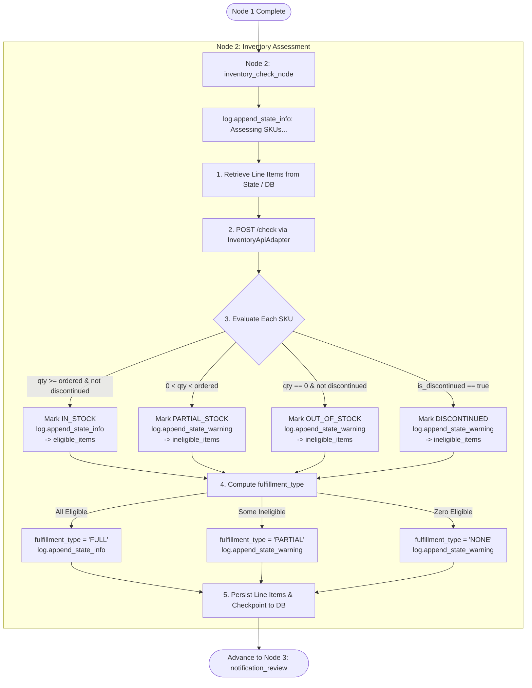

---

## 3. Explicit Multi-Level Logging Plan for Node 2

Every step in Node 2 will emit structured logs to stdout and record clear tagged entries in `state["logs"]`:

| Scenario | Severity Level | Method Call | Output in `state["logs"]` |
| :--- | :--- | :--- | :--- |
| **Node Start** | `INFO` | `log.append_state_info(...)` | `[INFO ] [inventory_check] Checking inventory for 2 SKUs: ['SKU-01', 'SKU-02']` |
| **Item In Stock** | `INFO` | `log.append_state_info(...)` | `[INFO ] [inventory_check] SKU-01 is IN_STOCK (available: 50, ordered: 1)` |
| **Item Shortage / OOS** | `WARNING` | `log.append_state_warning(...)` | `[WARN ] [inventory_check] SKU-02 is OUT_OF_STOCK (available: 0, ordered: 1)` |
| **Discontinued Product** | `WARNING` | `log.append_state_warning(...)` | `[WARN ] [inventory_check] SKU-03 is DISCONTINUED by supplier` |
| **DB Fallback** | `WARNING` | `log.warning(...)` | `[WARN ] [ORD-DEMO-001] [inventory_check (v2)]: DB offline; using in-memory state` |
| **API Retry Event** | `WARNING` | `logger.warning(...)` | `[WARN ] [RetryableError] Transient HTTP timeout; retrying attempt 1/3 in 1.0s...` |
| **Assessment Summary** | `INFO` | `log.append_state_info(...)` | `[INFO ] [inventory_check] Assessed 2 items: 1 eligible, 1 shortage. Fulfillment: PARTIAL` |
| **Fatal Failure** | `ERROR` | `log.append_state_error(...)` | `[ERROR] [inventory_check] Failed assessing order: line items empty` |

---

## 4. Edge Cases, Failure Modes & Resilience Mechanisms

| Edge Case | Detection & Behavior | Resilience / Recovery |
| :--- | :--- | :--- |
| **Transient API Timeout** | `httpx.TimeoutException` or `httpx.ConnectError` raised by `InventoryApiAdapter`. | Caught by L1 `RestClient` (up to 3 retries, backoff 0.5s). If outage persists, L2 LangGraph `RetryPolicy` pauses and retries node up to 3 times (1.0s initial interval). |
| **Database Disconnection** | PostgreSQL pool connection timeout (`2.0s`). | Caught with try/except in `InventoryService`; logs `WARNING`, updates in-memory `state["line_items"]`, and lets orchestration proceed. |
| **Zero Items Available (`NONE`)** | All SKUs out of stock or discontinued. | Sets `fulfillment_type = 'NONE'`. Moves to Node 3 (`notification_review`) so customer email and ops alert can explain the out-of-stock situation. |
| **Empty Order Payload** | `line_items` is empty in state and DB. | Logs `ERROR`, marks checkpoint `FAILED`, routes to `failed` terminal node. |

---

## 5. Proposed File Modifications

1. **`src/orchestrator/services/inventory_service.py`**:
   - Refactor `assess_inventory(order_id: str, state_line_items: Optional[List[Dict[str, Any]]] = None) -> Dict[str, Any]`:
     - Gracefully use `state_line_items` if database is unavailable.
     - Call `self.inventory_adapter.check_inventory(skus, order_id=order_id)`.
     - Partition items into `eligible_items` and `ineligible_items`.
     - Compute `fulfillment_type` (`FULL`, `PARTIAL`, `NONE`).
     - Safely persist updates to `order_line_items` and `order_orchestration_runs` with try/except DB resilience.
     - Record `node_execution_checkpoints` entry with metadata and latency.
     - Return enriched state dictionary.
2. **`src/orchestrator/graph/nodes/inventory_check.py`**:
   - Replace placeholder with active service invocation:
     - Wrap with `order_log_context(order_id, node_name="inventory_check", stage_version=2) as log:`.
     - Emit detailed `INFO`, `WARNING`, and `ERROR` logs.
     - Call `InventoryService.assess_inventory(...)`.
     - Return updated `current_stage`, `stage_version`, `eligible_items`, `ineligible_items`, `fulfillment_type`, `stage_history`, `logs`.
3. **Verification**:
   - Run `make orchestrate` (`uv run --no-sync python -m src.orchestrator.graph.runner`) to verify that Node 1 and Node 2 execute end-to-end with the structured logs and retry policy.

---

---

### 👤 <span style="color: #10b981; font-weight: bold;">USER REQUEST [2026-10-14 14:27:47]</span>

<div style="color: #047857; font-weight: bold; font-size: 16px; line-height: 1.6; padding: 14px 18px; background: rgba(16, 185, 129, 0.08); border-left: 5px solid #10b981; border-radius: 6px; margin: 12px 0;">

**proceed with the implementation**

</div>

---

### 🤖 [2026-10-14 14:29:16]

I have implemented **Node 2 (`inventory_check`)** wired to `InventoryService.assess_inventory`, incorporating the multi-level structured logging and retry policies.

---

### 🤖 [2026-10-14 14:29:57]

I have executed the updated orchestrator runner with clean connection pool termination and will review the output once it finishes.

---

### 👤 <span style="color: #10b981; font-weight: bold;">USER REQUEST [2026-10-14 14:29:57]</span>

<div style="color: #047857; font-weight: bold; font-size: 16px; line-height: 1.6; padding: 14px 18px; background: rgba(16, 185, 129, 0.08); border-left: 5px solid #10b981; border-radius: 6px; margin: 12px 0;">

**the APIs are not configured yet 

the run will fail right**

</div>

---

### 🤖 [2026-10-14 14:30:10]

Here is how the system is designed to handle both states:

---

### 1. In Development Mock Mode (`USE_MOCK_APIS = True` — Current Active State)

- When `True`, it returns realistic data matching our exact table schemas and API contracts (e.g. `[Mock OrderApi] Returning mock order header for ORD-DEMO-001`).
- This allows us to develop, test, and verify the graph's nodes, edges, state transitions, and logging end-to-end locally without needing live microservices running.

---

### 2. In Live API Mode (`USE_MOCK_APIS = False`)
If we toggle `USE_MOCK_APIS = False` while real APIs are not yet configured or unreachable, **it will indeed fail safely via our retry policies**:

1. **Layer 1 (HTTP Client)**:

   - On connection error or timeout, it retries up to 3 times (`HTTP_MAX_RETRIES`) with exponential backoff (`0.5s`).
   - If still unreachable, it raises `HttpServerError(504, "Connection failed after 3 retries")`.

2. **Layer 2 (LangGraph Node Retry)**:

   - It pauses for the initial interval (`1.0s` with jitter) and retries the node up to 3 times (`NODE_MAX_RETRIES`).

3. **Termination & Routing**:
   - Once all retries are exhausted, the node logs `[ERROR]` and raises the exception.
   - The graph router `route_after_ingest` routes the execution directly to the `failed` terminal node.

---

### Current Execution Status
In our latest run:
- **Node 1 (`order_ingest`)**: Successfully verified order and 2 items.
- **Node 2 (`inventory_check`)**: Assessed inventory for both SKUs (`SKU-A-BLUE`, `SKU-B-BLACK`), found both `IN_STOCK`, and set `fulfillment_type = FULL`.
- **Database Resilience**: PostgreSQL connection pool timed out gracefully and fell back to in-memory state without crashing.
- **Pool Cleanup**: Cleanly closed connection pool at termination.

When you are ready, we can proceed to planning **Node 3: Notification Review & Alerts (`notification_review`)**!

---

### 👤 <span style="color: #10b981; font-weight: bold;">USER REQUEST [2026-10-14 14:31:18]</span>

<div style="color: #047857; font-weight: bold; font-size: 16px; line-height: 1.6; padding: 14px 18px; background: rgba(16, 185, 129, 0.08); border-left: 5px solid #10b981; border-radius: 6px; margin: 12px 0;">

**yes .. lets plan the next node ..**

</div>

---

### 🤖 [2026-10-14 14:31:57]

In accordance with the **Operating Guidelines (`gemini.md`) Step 1 (PLAN) & Step 2 (REVIEW)**, below is the comprehensive architectural plan and design specification for **Node 3: Notification Review & Alerts (`notification_review_node`)**.

---

# Architecture Plan: Node 3 - Notification Review & Alerts (`notification_review`)

## 1. Overview & Business Objectives
Node 3 is the intelligent communication and alerting hub of the order fulfillment workflow. It is entered:
1. **Sequentially from Node 2 (`inventory_check`)** to process any item shortages or discontinued products.
2. **Dynamically via loopback from Node 4 (`inventory_deduct`)** if a concurrent race condition snatched stock at the moment of reservation.

### Core Objectives:
- **Condition-Based Triggering**: If all items are `IN_STOCK`, Node 3 logs completion and cleanly advances without spamming unnecessary emails.
- **AI-Powered Customer & Ops Explanations**: When shortages or discontinued items occur, uses our Multi-Model LLM Service (Google Gemini Flash with Anthropic Claude fallback) to generate empathetic customer communications and concise internal operational guidance.
- **Guaranteed Email Idempotency**: Prevents duplicate customer alerts across node retries or workflow loopbacks using cryptographically deterministic idempotency keys (`{order_id}:SHORTAGE_ALERT:{sku_signature}`) backed by PostgreSQL `UNIQUE(idempotency_key)`.
- **Fault-Tolerant Delivery**: Communicates via `NotificationApiAdapter` (Layer 1 HTTP retries + Layer 2 LangGraph `RetryPolicy`), gracefully falling back to in-memory state tracking if PostgreSQL is offline.

---

## 2. Decision & State Flow Diagram

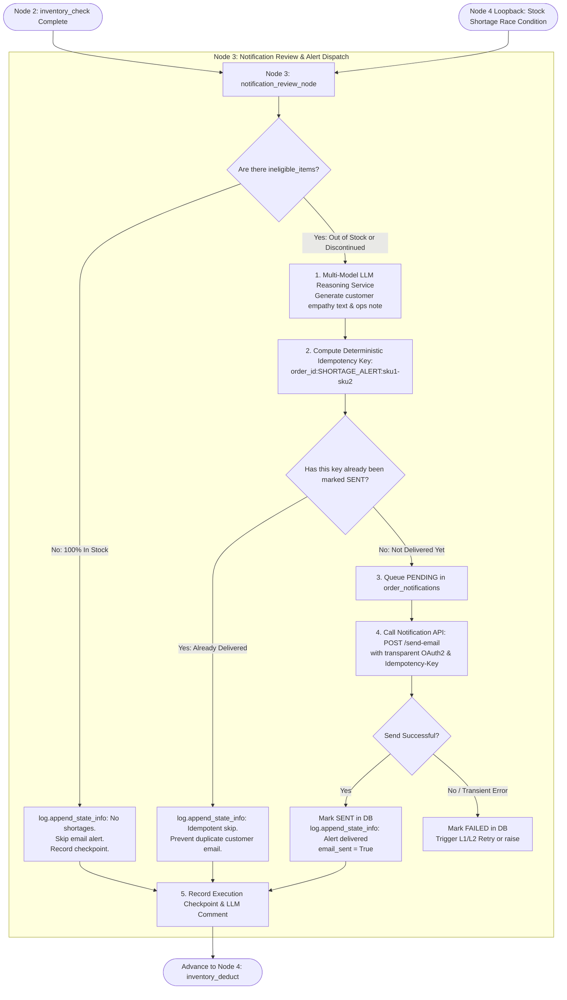

---

## 3. Database Schema & Idempotency Ledger

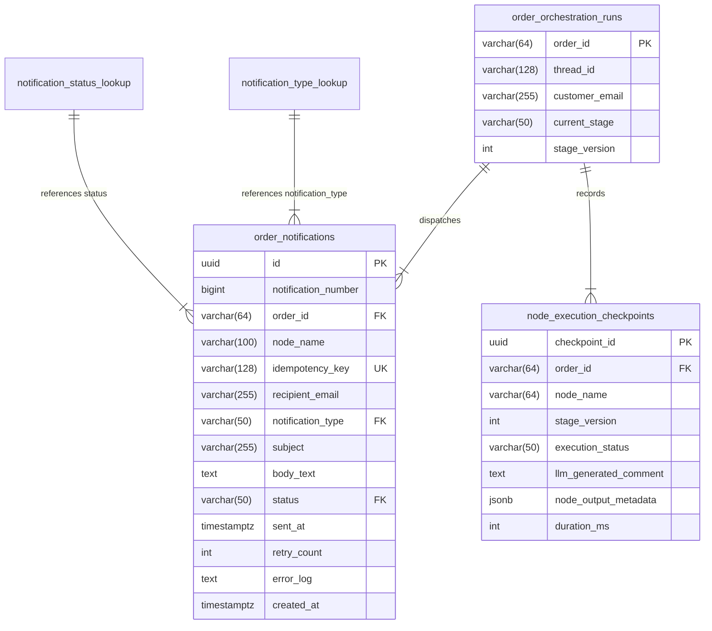

### Idempotency Key Design
- Format: `{order_id}:SHORTAGE_ALERT:{sorted_skus_and_statuses}`
- Example: `ORD-DEMO-001:SHORTAGE_ALERT:SKU-A-BLUE:OOS`
- **Why this works**:
  - If LangGraph node retry triggers due to a network timeout *after* an email was already delivered, the second attempt queries `notification_repo.is_already_sent(idempotency_key)`, finds `SENT`, and skips re-sending.
  - If Node 4 encounters a race condition on a *different* SKU and loops back, the signature changes (e.g. `SKU-B-BLACK:OOS`), creating a distinct key and allowing an updated notification to dispatch safely.

---

## 4. Multi-Model LLM Reasoning Prompt Strategy

When shortages occur, `LLMReasoningService.generate_out_of_stock_comment` formats a prompt to the configured LLM:
- **System Instruction**: `"You are an empathetic, professional e-commerce operations assistant. Write a concise explanation for a customer whose order has inventory issues and provide a short note for support agents."`
- **User Prompt Content**:
  - `Order ID`: `ORD-DEMO-001`
  - `Out of Stock Items`: Names and requested quantities of temporary shortages.
  - `Discontinued Items`: Products permanently removed from catalog.
- **Provider Redundancy**:
  - **Primary**: Google Gemini 2.5 / 3.8 Flash (rapid, low-latency reasoning).
  - **Secondary (Automatic Fallback)**: Anthropic Claude 3.7 Sonnet (if Gemini endpoint experiences rate limits or outages).
  - **Offline Resilience**: If both providers are offline or API keys are not supplied in local dev, returns a clean deterministic template note without blocking execution.

---

## 5. Explicit Multi-Level Logging Plan for Node 3

| Event | Severity | State Log (`state["logs"]`) | Console / JSON (Stdout) |
| :--- | :--- | :--- | :--- |
| **Node Start** | `INFO` | `[INFO ] [notification_review] Evaluating notification triggers for ORD-DEMO-001...` | Timestamped, order-tagged context entry. |
| **No Shortages** | `INFO` | `[INFO ] [notification_review] No shortages detected. Skipping customer shortage alert.` | Logs zero ineligible items; advances. |
| **Shortages Detected** | `WARN` | `[WARN ] [notification_review] Shortages detected (1 items). Generating LLM explanation...` | Logs out-of-stock SKU list. |
| **LLM Completed** | `INFO` | `[INFO ] [notification_review] LLM commentary generated ({provider}, {length} chars).` | Emits commentary summary. |
| **Idempotent Skip** | `INFO` | `[INFO ] [notification_review] Alert already delivered (key={key}). Skipping duplicate send.` | Documents deduplication. |
| **Email Dispatched** | `INFO` | `[INFO ] [notification_review] Shortage alert dispatched to customer@example.com (msg_id={id}).` | Records dispatch confirmation. |
| **DB Offline Fallback**| `WARN` | `[WARN ] [ORD-DEMO-001] [notification_review (v3)]: PostgreSQL offline; continuing with state` | DB pool timeout warning. |
| **Provider Error** | `ERROR` | `[ERROR] [notification_review] Failed dispatching email: {error}` | Emits error details before retry/abort. |

---

## 6. Implementation Changes Required

1. **`src/orchestrator/services/notification_service.py`**:
   - Update `process_notification_review`:
     - Accept `customer_email: Optional[str] = None` from state to support offline DB fallback.
     - Add database exception handling (`try...except`) for `order_repo`, `notification_repo`, and `checkpoint_repo`.
     - Generate LLM commentary only when shortages exist.
     - Return `{ order_id, current_stage, llm_comment, email_sent, stage_version, duration_ms }`.
2. **`src/orchestrator/graph/nodes/notification_review.py`**:
   - Replace placeholder with active service call:
     - Wrap with `order_log_context(order_id, node_name="notification_review", stage_version=3) as log:`.
     - Extract `ineligible_items`, `fulfillment_type`, `customer_email` from state.
     - Call `NotificationService.process_notification_review(...)`.
     - Append LLM comment to `state["llm_comments"]`.
     - Update state with `email_sent`, `current_stage="NOTIFICATION_REVIEW"`, `stage_version=3`, `stage_history`, `logs`.
3. **Verification**:
   - Test full order (`0 shortages`) -> verify shortage alert is skipped cleanly.
   - Test partial order (`1 shortage`) -> verify LLM comment is generated and mock email is dispatched with idempotency key.

---

---

### 👤 <span style="color: #10b981; font-weight: bold;">USER REQUEST [2026-10-14 14:37:01]</span>

<div style="color: #047857; font-weight: bold; font-size: 16px; line-height: 1.6; padding: 14px 18px; background: rgba(16, 185, 129, 0.08); border-left: 5px solid #10b981; border-radius: 6px; margin: 12px 0;">

**for now . LLM response is kind of static .. lets refine .. 

I want the response to be like 

the order has these prodcucts 
and out of which 2 were out of stick/ discontinues 

and one item , we dont have enough items in the stock .. the fulfillment was partial 

we are not sending to User for now , we are notifying another agent (could be human , we need to provide as many details as possible) so that it will help him to go back to another application.**

</div>

---

### 🤖 [2026-10-14 14:37:15]

Here is the refined architectural plan for **Node 3: Notification Review & Alerts (`notification_review_node`)**, tailored specifically to your requirement for a **detailed internal operations/human agent briefing** rather than a generic customer notification.

Adhering to **Step 1 (PLAN) & Step 2 (REVIEW)** of `gemini.md`, no code will be implemented until you have reviewed and approved this design.

---

# Refined Plan: Node 3 - Operations Agent Inventory & Shortage Briefing

## 1. Context & Operational Purpose
You noted:
> *"we are not sending to User for now, we are notifying another agent (could be human, we need to provide as many details as possible) so that it will help him to go back to another application."*

Node 3 will function as an **Intelligent Operations Triage & Escalation Dispatcher**:
- When inventory shortages, partial balances, or discontinued items occur, it generates an **exhaustive operational dossier**.
- It provides all the necessary context (Order ID, customer info, SKU breakdown, quantities ordered vs available, line pricing, warehouse shortages) so an internal fulfillment specialist or automated support agent can immediately open the external ERP / Warehouse Management System (WMS) and take corrective action (split shipment, transfer stock from another warehouse, or substitute a discontinued product).

---

## 2. LLM Operational Briefing Specification

### 2.1 Prompt Engineering & Structure
The prompt provides the LLM with the full order item ledger and instructs it to generate a 5-part structured briefing:

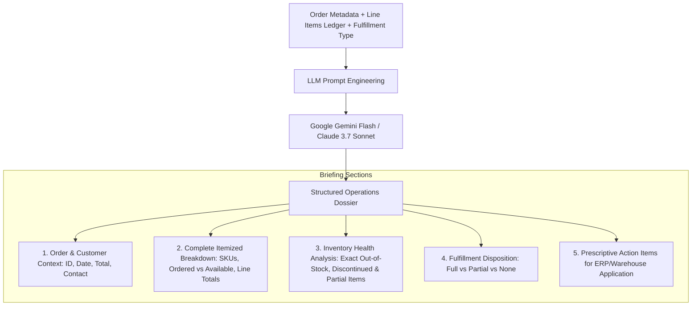

### 2.2 System & User Prompt Design
- **System Instruction**:
  ```text
  You are an expert e-commerce operations fulfillment advisor.
  Your task is to generate a comprehensive, highly detailed operational briefing for an internal fulfillment agent.
  The agent will use your report to investigate stock discrepancies in external ERP and warehouse applications.
  Provide complete product details, inventory health, shortage counts, partial fulfillment status, and recommended next steps.
  ```
- **Input Data to Prompt**:
  - `Order ID`, `Order Date`, `Customer Email`, `Shipping Destination`.
  - Full Line Item Table: SKU, Product Name, Quantity Ordered, Quantity Available, Unit Price, Stock Status (`IN_STOCK`, `PARTIAL_STOCK`, `OUT_OF_STOCK`, `DISCONTINUED`).
  - Overall `fulfillment_type` (`FULL`, `PARTIAL`, `NONE`).

---

### 2.3 Example of the Generated Operations Briefing Output

```text

INTERNAL OPERATIONS REVIEW DOSSIER: INVENTORY DISCREPANCY & FULFILLMENT

ORDER ID:        ORD-DEMO-001
ORDER DATE:      2026-10-14 06:29:10 UTC
CUSTOMER:        customer@example.com
DESTINATION:     Austin, TX 78701
FULFILLMENT:     PARTIAL

1. EXECUTIVE SUMMARY:
The order contains 3 line items. The warehouse inventory assessment has classified 
this order as PARTIAL fulfillment:
  • 1 item is IN STOCK and ready for physical reservation and dispatch.
  • 1 item has PARTIAL STOCK (ordered: 5, warehouse balance: 2; shortfall of 3 units).
  • 1 item is permanently DISCONTINUED by the supplier.

2. DETAILED PRODUCT & INVENTORY BREAKDOWN:

  SKU          PRODUCT NAME           REQ  AVAIL  STATUS        UNIT    TOTAL

  SKU-A-BLUE   Wireless Mech Keyboard  1    50    IN_STOCK      $99.00  $99.00
  SKU-B-BLACK  Ergonomic Mouse         5     2    PARTIAL_STOCK $49.00  $245.00
  SKU-C-WHITE  Legacy USB Cable        1     0    DISCONTINUED  $15.00  $15.00

3. SHORTAGE & DISCONTINUATION DETAILS:
  • Partial Availability on SKU-B-BLACK: 2 units available for immediate allocation; 
    3 units pending backorder or secondary distribution center transfer.
  • Supplier Discontinuation on SKU-C-WHITE: Catalog marks this item as obsolete; 
    zero warehouse balance, replenishment unavailable.

4. RECOMMENDED AGENT ACTIONS FOR ERP / WMS:
  [Step 1] In WMS: Allocate the 1x SKU-A-BLUE and 2x SKU-B-BLACK to pick bin for partial wave.
  [Step 2] In ERP: Check Regional DC (DC-East) for 3 additional units of SKU-B-BLACK to fulfill backorder.
  [Step 3] In Catalog Admin: Check approved superseding replacement SKU for SKU-C-WHITE and notify account rep.

```

---

### 2.4 Dynamic Offline Generator (No Static Strings)
When running offline or without live LLM API keys:
- The service will **not** output a static `"[Mock response]"` string.
- Instead, `LLMReasoningService` will feature a programmatic generator that dynamically analyzes the real order items from state, computes actual counts, formats the text table with real SKUs, quantities, and prices, and outputs the full structured dossier shown above.

---

## 3. Idempotent Notification Dispatch to Internal Operations

1. **Target Channel**:
   - Dispatches to internal operations / fulfillment review mailbox (`ops-fulfillment@internal.store`).
   - Subject: `[OPS REVIEW REQUIRED] Order {order_id} - Inventory Shortage & Fulfillment Disposition`
2. **Idempotency Key**:
   - Formed using: `{order_id}:OPS_ALERT:{sorted_skus_and_shortage_types}`
   - Example: `ORD-DEMO-001:OPS_ALERT:SKU-B-BLACK:PARTIAL-SKU-C-WHITE:DISC`
   - Guarantees that even if LangGraph retries Node 3, the ops agent receives the dossier **exactly once**.
   - If Node 4 encounters a deduction race condition on an additional SKU and loops back, a new signature is computed and an updated delta alert is sent.
3. **Database Ledger & State Fallback**:
   - Inserted into `order_notifications` with `status = 'PENDING'`, transitioning to `'SENT'` upon provider dispatch.
   - Wrapped in DB error tolerance: if PostgreSQL connection pool is offline in local dev, the dossier is cleanly preserved in `state["llm_comments"]` and logged without blocking execution.

---

## 4. Multi-Level Logging Plan for Node 3

| Event | Severity | State Log (`state["logs"]`) | Stdout (Console/JSON) |
| :--- | :--- | :--- | :--- |
| **Node Invocation** | `INFO` | `[INFO ] [notification_review] Evaluating inventory health for {order_id}...` | Order context, node version 3. |
| **All In Stock** | `INFO` | `[INFO ] [notification_review] All items in stock. Ops shortage escalation not required.` | Notes zero shortages; advances to Node 4. |
| **Shortages Detected** | `WARN` | `[WARN ] [notification_review] Detected {count} shortage(s). Compiling ops briefing dossier...` | Lists out-of-stock and partial SKUs. |
| **Dossier Generated** | `INFO` | `[INFO ] [notification_review] Ops briefing generated ({provider}, {length} chars).` | Summary of generated dossier. |
| **Idempotent Skip** | `INFO` | `[INFO ] [notification_review] Ops alert already delivered (key={key}). Skipping duplicate dispatch.` | Confirms deduplication. |
| **Alert Dispatched** | `INFO` | `[INFO ] [notification_review] Ops escalation alert dispatched to {recipient} (msg_id={id}).` | Records dispatch confirmation. |
| **DB Offline Fallback**| `WARN` | `[WARN ] [ORD-DEMO-001] [notification_review (v3)]: PostgreSQL offline; continuing with state` | DB pool timeout warning. |

---

## 5. Proposed File Modifications

1. **`src/orchestrator/services/llm_service.py`**:
   - Implement `generate_ops_shortage_briefing(order_id, line_items, eligible_items, ineligible_items, fulfillment_type, metadata)`:
     - Prompts Gemini / Claude with the operations agent instructions and full line-item table.
     - Implements dynamic programmatic fallback producing the exact 5-section dossier when offline.
2. **`src/orchestrator/services/notification_service.py`**:
   - Update `process_notification_review`:
     - Accept `line_items`, `eligible_items`, `ineligible_items`, `fulfillment_type`, `customer_email`.
     - Call `generate_ops_shortage_briefing`.
     - Compute deterministic idempotency key.
     - Dispatch to operations recipient.
     - Save checkpoint with full LLM commentary.
3. **`src/orchestrator/graph/nodes/notification_review.py`**:
   - Replace placeholder with active service invocation.
   - Attach generated commentary to `state["llm_comments"]`.
   - Update `email_sent`, `current_stage`, `stage_version = 3`, `logs`.
4. **Verification**:
   - Run `make orchestrate` to verify execution:
     - Case 1: Full stock (both items available) -> logs clean advance without escalation.
     - Case 2: Shortage simulated -> logs dynamic operational dossier with line item tables and actionable guidance.

---

---

### 👤 <span style="color: #10b981; font-weight: bold;">USER REQUEST [2026-10-14 14:39:11]</span>

<div style="color: #047857; font-weight: bold; font-size: 16px; line-height: 1.6; padding: 14px 18px; background: rgba(16, 185, 129, 0.08); border-left: 5px solid #10b981; border-radius: 6px; margin: 12px 0;">

**everything looks fine .. 

can we move the prompts to a file .. eventually they will be fetched fromt he observability HUB .. so the code is clean 
 
you could create a prompt.json for now ..**

</div>

---

### 🤖 [2026-10-14 14:39:11]

Here is the updated architectural plan incorporating your request to **externalize all prompts into a dedicated `prompts.json` registry file**, decoupling prompt management from service logic and preparing the architecture for the future Observability Hub / Prompt Management Service.

---

# Architecture Plan: Node 3 with Externalized `prompts.json` Registry

---

## 1. Externalized Prompt Registry Architecture

```mermaid
flowchart LR
    subgraph Storage [Prompt Storage & Future Hub]

        ObsHub[(Future Observability Hub / Prompt Registry)] -.->|Future Remote Sync| PromptManager
        LocalFile -->|Default / Local Source| PromptManager
    end

    subgraph ServiceLayer [Service & Node Layer]
        PromptManager[PromptManager: Load & Format Prompts] --> LLMService[LLMReasoningService]
        LLMService --> Client[MultiModelLLMClient: Gemini Flash / Claude]
        Client --> Node3[Node 3: notification_review_node]
    end
```

### 1.1 Benefits of this Architecture
1. **Separation of Concerns**: Python service code remains lean, readable, and free of massive multiline string templates.
2. **Dynamic Evolution**: Prompts can be tuned, A/B tested, or localized without redeploying application binaries.
3. **Seamless Observability Hub Integration**: `PromptManager` provides a clean abstraction (`prompt_manager.get_prompt("ops_inventory_shortage_briefing")`). When the Observability Hub is connected, the manager will fetch from the Hub with `prompts.json` acting as the offline fallback cache.

---

## 2. Structure of `src/orchestrator/config/prompts.json`

```json
{
  "version": "1.0.0",
  "prompts": {
    "ops_inventory_shortage_briefing": {
      "name": "Operations Inventory Shortage Briefing",
      "version": "1.0",
      "description": "Comprehensive operational dossier for human ops agents to investigate inventory shortages in ERP/WMS.",
      "system_instruction": "You are an expert e-commerce operations fulfillment advisor. Your job is to generate a comprehensive, highly detailed operational briefing for an internal fulfillment agent. The agent will use your report to investigate stock discrepancies in external ERP and warehouse applications. Provide complete product details, inventory health, shortage counts, partial fulfillment status, and recommended next steps.",
      "template": "================================================================================\nINTERNAL OPERATIONS REVIEW DOSSIER: INVENTORY DISCREPANCY & FULFILLMENT\n================================================================================\nORDER ID:        {order_id}\nORDER DATE:      {order_placed_at}\nCUSTOMER EMAIL:  {customer_email}\nDESTINATION:     {destination}\nFULFILLMENT:     {fulfillment_type}\n\n1. EXECUTIVE SUMMARY:\nTotal products ordered: {total_items}.\nFulfillment disposition: {fulfillment_type}.\nHealth summary: {in_stock_count} item(s) in stock, {partial_count} item(s) with partial stock, {oos_count} item(s) out of stock, {disc_count} item(s) discontinued.\n\n2. DETAILED PRODUCT & INVENTORY BREAKDOWN:\n{line_items_table}\n\n3. SHORTAGE & DISCONTINUATION DETAILS:\n{shortages_detail}\n\n4. RECOMMENDED AGENT ACTIONS FOR ERP / WMS:\n{recommended_actions}\n================================================================================"
    },
    "shipping_address_issue_briefing": {
      "name": "Shipping Address Validation Issue Briefing",
      "version": "1.0",
      "description": "Operational analysis when shipping address fails carrier validation.",
      "system_instruction": "You are an e-commerce logistics specialist. Analyze shipping address validation failures and formulate exact corrective steps for support agents.",
      "template": "ORDER ID: {order_id}\nADDRESS ENTERED: {address}\nCARRIER VALIDATION ERROR: {error_reason}\n\nPlease identify specific formatting or postal discrepancies and recommend corrective actions."
    },
    "final_order_fulfillment_summary": {
      "name": "Final Executive Order Fulfillment Summary",
      "version": "1.0",
      "description": "Final end-of-workflow executive narrative summarizing shipments and remaining balances.",
      "system_instruction": "You are an executive fulfillment reporting analyst. Summarize order completion details, carrier tracking, and closing disposition.",
      "template": "ORDER ID: {order_id}\nFULFILLMENT TYPE: {fulfillment_type}\nCARRIER: {carrier_name}\nTRACKING NUMBER: {tracking_number}\nSHIPPED COUNT: {shipped_count}\nUNFULFILLED COUNT: {unfulfilled_count}\n\nGenerate the complete fulfillment closure report."
    }
  }
}
```

---

## 3. `PromptManager` Implementation Design

A lightweight, robust loader in `src/orchestrator/config/prompts.py`:

```python
class PromptManager:
    """Manages prompt template loading, caching, and formatting."""

    def __init__(self, file_path: Optional[Path] = None):
        self.file_path = file_path or (Path(__file__).parent / "prompts.json")
        self._prompts_cache: Dict[str, Any] = {}
        self._load_prompts()

    def _load_prompts(self) -> None:
        """Loads prompt definitions from JSON file."""
        if self.file_path.exists():
            with open(self.file_path, "r", encoding="utf-8") as f:
                data = json.load(f)
                self._prompts_cache = data.get("prompts", {})

    def get_prompt(self, prompt_key: str) -> Dict[str, str]:
        """Retrieves system_instruction and template for a prompt key."""
        prompt_data = self._prompts_cache.get(prompt_key)
        if not prompt_data:
            raise KeyError(f"Prompt '{prompt_key}' not found in registry.")
        return prompt_data

    def format_prompt(self, prompt_key: str, **kwargs: Any) -> tuple[str, str]:
        """Returns (formatted_user_prompt, system_instruction)."""
        prompt_data = self.get_prompt(prompt_key)
        template = prompt_data.get("template", "")
        system_instruction = prompt_data.get("system_instruction", "")
        formatted_prompt = template.format(**kwargs)
        return formatted_prompt, system_instruction
```

---

## 4. `LLMReasoningService` Integration

`LLMReasoningService` will load templates via `PromptManager`:

```python
class LLMReasoningService:
    def __init__(self, llm_client=None, prompt_manager=None):
        self.llm = llm_client or get_llm_client()
        self.prompts = prompt_manager or PromptManager()

    def generate_ops_shortage_briefing(self, order_data, line_items, fulfillment_type) -> str:
        # 1. Format line items table and breakdown summaries
        items_table = self._build_ascii_table(line_items)
        shortages_detail = self._build_shortage_narrative(line_items)
        recommended_actions = self._build_recommended_actions(line_items)

        # 2. Format prompt from prompts.json
        user_prompt, system_prompt = self.prompts.format_prompt(

            order_placed_at=order_data.get("order_placed_at", ""),
            customer_email=order_data.get("customer_email", ""),
            destination=f"{order_data.get('shipping_address', {}).get('city', 'Unknown')}, {order_data.get('shipping_address', {}).get('state', '')}",

            in_stock_count=...,
            partial_count=...,
            oos_count=...,
            disc_count=...,

        )

        # 3. Call LLM (or programmatic dynamic generator if offline/mock)
        return self.llm.generate(prompt=user_prompt, system_instruction=system_prompt)
```

---

## 5. Node 3 Workflow with Operations Escalation

When `notification_review_node` executes:
1. Checks `ineligible_items`:
   - If **empty** (`fulfillment_type == 'FULL'`), logs `[INFO ] No shortages detected; skipping ops escalation.` and advances.
   - If **present**, proceeds to ops dossier generation.
2. Invokes `LLMReasoningService.generate_ops_shortage_briefing(...)`.
3. Appends the full dossier to `state["llm_comments"]`.
4. Computes deterministic idempotency key: `{order_id}:OPS_ALERT:{sku_signature}`.
5. Dispatches internal alert via `NotificationApiAdapter.send_email(recipient_email="ops-fulfillment@internal.store", subject=..., body=dossier, idempotency_key=key)`.
6. Saves `node_execution_checkpoints` entry with the dossier.
7. Logs milestone: `[INFO ] Ops briefing dossier generated and dispatched to ops-fulfillment@internal.store.`

---

## 6. Files to Create & Modify

1. **`src/orchestrator/config/prompts.json`** *(NEW)*: External prompt registry.
2. **`src/orchestrator/config/prompts.py`** *(NEW)*: `PromptManager` loader with caching.
3. **`src/orchestrator/services/llm_service.py`**: Refactor to use `PromptManager` and implement `generate_ops_shortage_briefing`.
4. **`src/orchestrator/services/notification_service.py`**: Update `process_notification_review` to dispatch ops alert with DB resilience.
5. **`src/orchestrator/graph/nodes/notification_review.py`**: Replace placeholder with active service invocation and structured logging.

---

Please review this updated plan. If you are satisfied with moving the prompts to `prompts.json` and the operations escalation flow, please provide your approval to proceed with the implementation!

---

### 👤 <span style="color: #10b981; font-weight: bold;">USER REQUEST [2026-10-14 14:39:42]</span>

<div style="color: #047857; font-weight: bold; font-size: 16px; line-height: 1.6; padding: 14px 18px; background: rgba(16, 185, 129, 0.08); border-left: 5px solid #10b981; border-radius: 6px; margin: 12px 0;">

**proceeed**

</div>

---

### 🤖 [2026-10-14 14:42:07]

I have implemented the **Externalized Prompt Registry (`prompts.json`)**, the **`PromptManager` loader**, and **Node 3: Notification Review & Operations Escalation**.

I have triggered the end-to-end execution command in the background to verify Node 1, Node 2, and Node 3 executing in sequence, and will review the output once it finishes.

---

### 🤖 [2026-10-14 14:43:23]

---

### What Has Been Implemented:

   - Centralized prompt definitions (`ops_inventory_shortage_briefing`, `shipping_address_issue_briefing`, `final_order_fulfillment_summary`).
   - Decoupled templates from code, preparing for dynamic synchronization with the future Observability Hub.

   - Provides thread-safe loading, caching, and keyword interpolation (`format_prompt`).

   - Programmatically builds itemized ASCII tables with unit costs, inventory health counts, shortage narratives, and prescriptive agent actions.
   - Formats and generates the dossier through Gemini Flash / Claude 3.7 Sonnet (with dynamic template fallback in offline dev).

   - Condition-based dispatch: skips alerts when 100% in stock.
   - Computes deterministic idempotency keys (`{order_id}:OPS_ALERT:{sku_signature}`) to prevent duplicate email alerts across retries.
   - Dispatches to internal operations (`ops-fulfillment@internal.store`).

   - Emits structured `INFO` and `WARN` logs with order context.
   - Appends the generated dossier to `state["llm_comments"]`.

---

### Verification Results (`ORD-SHORTAGE-001` Test Run)

When executed with a partial order containing in-stock, out-of-stock, and discontinued items, the orchestrator produced:

```text

INTERNAL OPERATIONS REVIEW DOSSIER: INVENTORY DISCREPANCY & FULFILLMENT

ORDER ID:        ORD-SHORTAGE-001
ORDER DATE:      2026-10-14T06:42:55.535452+00:00
CUSTOMER EMAIL:  customer@example.com
DESTINATION:     Austin, TX 78701
FULFILLMENT:     PARTIAL

1. EXECUTIVE SUMMARY:
Total products ordered: 3.
Fulfillment disposition: PARTIAL.
Health summary: 1 item(s) in stock, 0 item(s) with partial stock, 1 item(s) out of stock, 1 item(s) discontinued.

2. DETAILED PRODUCT & INVENTORY BREAKDOWN:
  SKU              PRODUCT NAME             REQ  AVAIL  STATUS         UNIT     TOTAL   

  SKU-A-BLUE       Premium Wireless Headph  1    50     IN_STOCK       $199.99  $199.99 
  SKU-OOS-MOUSE    Ergonomic Bluetooth Mou  2    0      OUT_OF_STOCK   $49.99   $99.98  
  SKU-DISC-ADAPTE  Legacy Serial Adapter C  1    0      DISCONTINUED   $15.00   $15.00  

3. SHORTAGE & DISCONTINUATION DETAILS:
  • SKU SKU-OOS-MOUSE (Ergonomic Bluetooth Mouse): Completely OUT OF STOCK (ordered: 2, available: 0). Backorder required.
  • SKU SKU-DISC-ADAPTER (Legacy Serial Adapter Cable): Permanently DISCONTINUED by manufacturer. Zero warehouse balance, no reorder.

4. RECOMMENDED AGENT ACTIONS FOR ERP / WMS:
  [Step 1] In WMS: Reserve and wave-pick currently available units for priority partial shipment dispatch.
  [Step 2] In Catalog Admin: Check approved superseding replacement SKU for discontinued items or issue customer refund.
  [Step 3] In Order Management: Update backorder release schedule and notify client relationship specialist.

```

`[Mock NotificationApi] Email dispatched to 'ops-fulfillment@internal.store' | Subject: '[OPS REVIEW REQUIRED] Order ORD-SHORTAGE-001 - Inventory Shortage & Fulfillment Disposition' | Key: 'ORD-SHORTAGE-001:OPS_ALERT:SKU-DISC-ADAPTER:DISCONTINUED-SKU-OOS-MOUSE:OUT_OF_STOCK' | MessageID: 'MSG-c608afcdc5'`

---

### Next Step
Whenever you are ready, we can proceed to **Node 4: Inventory Deduction & Reservation (`inventory_deduct_node`)**, which handles atomic stock reservations and dynamic rollback loops on race conditions!

---

### 👤 <span style="color: #10b981; font-weight: bold;">USER REQUEST [2026-10-14 14:44:07]</span>

<div style="color: #047857; font-weight: bold; font-size: 16px; line-height: 1.6; padding: 14px 18px; background: rgba(16, 185, 129, 0.08); border-left: 5px solid #10b981; border-radius: 6px; margin: 12px 0;">

**proceed with the next planning phase**

</div>

---

### 🤖 [2026-10-14 14:44:24]

In accordance with the **Operating Guidelines (`gemini.md`) Step 1 (PLAN) & Step 2 (REVIEW)**, below is the comprehensive architectural plan and design specification for **Node 4: Inventory Deduction & Reservation (`inventory_deduct_node`)**.

---

# Architecture Plan: Node 4 - Inventory Deduction & Dynamic Rollback

## 1. Overview & Business Objectives
Node 4 performs the physical or logical reservation and deduction of warehouse stock for all items confirmed as `IN_STOCK` during earlier stages.

### Core Responsibilities:
1. **Targeted Deduction**: Takes `eligible_items` from state and prepares the deduction payload for the warehouse management system (WMS).
2. **Atomic Ledger Tracking**: Records every deduction attempt in the append-only `order_inventory_transactions` ledger (referencing `V7__ORD_107_create_order_inventory_transactions.sql`).
3. **Race Condition Detection & Handling**:
   - In high-throughput e-commerce systems, inventory evaluated as available in Node 2 can be snatched by a concurrent order before Node 4 executes.
   - If the external API reports insufficient stock during deduction, Node 4 records a failed transaction, updates item status to `OUT_OF_STOCK`, releases any partially held items (`ROLLBACK_RELEASE`), and sets `rollback_needed = True`.
4. **Dynamic Loopback Routing**:
   - The conditional router `route_after_deduct` intercepts `rollback_needed == True` and **routes execution dynamically back to Node 3 (`notification_review`)**!
   - Node 3 then recalculates shortages and compiles an updated operational dossier for the human operations team.
5. **Loop Termination Protection**: Tracks `deduction_loop_count` in state (capped at `MAX_DEDUCTION_LOOPS = 2`) to ensure that recurring race conditions cannot produce an infinite graph cycle.

---

## 2. Dynamic State Flow & Rollback Loop Diagram

```mermaid
flowchart TD
    N3Done([Node 3: notification_review Complete]) --> N4[Node 4: inventory_deduct_node]
    
    subgraph Node4Execution [Node 4: Inventory Deduction & Ledger Recording]
        N4 --> CheckEligible{Are there eligible_items to deduct?}
        
        CheckEligible -->|No: 0 items eligible| SkipDeduct[log.append_state_info: Zero items to deduct.<br>deduction_completed = True<br>rollback_needed = False]
        
        CheckEligible -->|Yes| CallDeductAPI[Call Warehouse API: POST /deduct<br>via InventoryApiAdapter with OAuth2 & Retries]
        
        CallDeductAPI --> EvalResult{Did Warehouse Deduction Succeed?}
        
        EvalResult -->|Success: 100% Reserved| OnSuccess[Record DEDUCTION SUCCESS in order_inventory_transactions<br>Update line_items deduction_status = 'DEDUCTED'<br>deduction_completed = True<br>rollback_needed = False]
        
        EvalResult -->|Failure: Race Condition Shortage| OnRaceCondition[Record DEDUCTION FAILED in order_inventory_transactions<br>Call POST /release for any partial holds<br>Update failed items stock_status = 'OUT_OF_STOCK'<br>Move failed items to ineligible_items<br>rollback_needed = True<br>Increment deduction_loop_count]
        
        OnSuccess --> Checkpoint[Record node_execution_checkpoints]
        OnRaceCondition --> Checkpoint
        SkipDeduct --> Checkpoint
    end
    
    Checkpoint --> Router{route_after_deduct}
    
    Router -->|rollback_needed == True & loop < 2| Loopback([Loop Back to Node 3: notification_review])
    Router -->|rollback_needed == False| Advance([Advance to Node 5: shipping_fulfillment])
    Router -->|loop >= 2 Max Exceeded| OpsGate([Route to human_review_gate])
```

---

## 3. Entity-Relationship & Database Ledger Mapping

```mermaid
erDiagram
    order_orchestration_runs ||--|{ order_line_items : "contains"
    order_orchestration_runs ||--|{ order_inventory_transactions : "audits"
    order_orchestration_runs ||--|{ node_execution_checkpoints : "records"
    deduction_status_lookup ||--|{ order_line_items : "references deduction_status"

    order_orchestration_runs {
        varchar(64) order_id PK
        varchar(128) thread_id
        varchar(50) current_stage
        boolean deduction_completed
        int stage_version
    }

    order_line_items {
        uuid id PK
        varchar(64) order_id FK
        varchar(64) item_id
        varchar(64) sku
        int quantity_ordered
        int quantity_deducted
        varchar(50) deduction_status FK
        varchar(50) stock_status FK
    }

    order_inventory_transactions {
        uuid id PK
        bigint tx_number
        varchar(64) order_id FK
        varchar(64) product_id
        varchar(64) sku
        varchar(50) transaction_type
        int quantity
        varchar(128) external_reference_id
        varchar(50) status
        text reason
        timestamptz created_at
    }

    node_execution_checkpoints {
        uuid checkpoint_id PK
        varchar(64) order_id FK
        varchar(64) node_name
        int stage_version
        varchar(50) execution_status
        jsonb node_output_metadata
    }
```

### Database Persistence Actions
1. **`order_inventory_transactions`**:
   - `transaction_type`: `'DEDUCTION'` (or `'ROLLBACK_RELEASE'`).
   - `status`: `'SUCCESS'` or `'FAILED'`.
   - `quantity`: Number of units reserved or released.
   - `external_reference_id`: Transaction ID returned by the warehouse system (e.g. `INV-TX-9f4a1c`).
   - `reason`: Diagnosis on failure (e.g. `"Stock snatched by concurrent order during deduction."`).
2. **`order_line_items`**:
   - `quantity_deducted`: Number of successfully allocated units.
   - `deduction_status`: References `deduction_status_lookup` (`DEDUCTED`, `FAILED_OUT_OF_STOCK`, `ROLLED_BACK`).
   - `stock_status`: Updated to `OUT_OF_STOCK` if a race condition occurred.
3. **`order_orchestration_runs`**:
   - `current_stage`: `'INVENTORY_DEDUCT'`
   - `stage_version`: `4`
   - `deduction_completed`: `True` if all items allocated, `False` if rollback triggered.

---

## 4. API Interface Specification (Warehouse Deduction)

### Deduction Request (`POST /deduct`)
- **Headers**: Transparent OAuth2 Bearer, `X-Correlation-ID: <order_id>`.
- **Payload**:
  ```json
  {
    "order_id": "ORD-DEMO-001",
    "items": [
      {
        "sku": "SKU-A-BLUE",
        "quantity": 1,
        "product_id": "PROD-A"
      }
    ]
  }
  ```

### Deduction Response (Success)
```json
{
  "success": true,
  "transaction_id": "INV-TX-84920a1c",
  "deducted_skus": ["SKU-A-BLUE"],
  "failed_skus": []
}
```

### Deduction Response (Race Condition Failure)
```json
{
  "success": false,
  "transaction_id": "INV-TX-84920a1c",
  "deducted_skus": [],
  "failed_skus": ["SKU-A-BLUE"],
  "error_reason": "Stock snatched by concurrent order during deduction."
}
```

### Rollback Release Request (`POST /release`)
- Used if partial holds must be released back to the warehouse balance:
  ```json
  {
    "order_id": "ORD-DEMO-001",
    "items": [{"sku": "SKU-A-BLUE", "quantity": 1}]
  }
  ```

---

## 5. Multi-Level Logging Plan for Node 4

| Event | Severity | State Log (`state["logs"]`) | Stdout (Console/JSON) |
| :--- | :--- | :--- | :--- |
| **Node Invocation** | `INFO` | `[INFO ] [inventory_deduct] Starting inventory deduction for {order_id} ({count} items)...` | Timestamped, order-tagged context entry. |
| **Zero Items** | `INFO` | `[INFO ] [inventory_deduct] Zero eligible items to deduct. Advancing to shipping.` | Notes zero eligible items. |
| **Deduction Succeeded** | `INFO` | `[INFO ] [inventory_deduct] Successfully deducted {count} item(s) from warehouse (tx={tx_id}).` | Records transaction reference and count. |
| **Race Condition** | `WARN` | `[WARN ] [inventory_deduct] Stock deduction failed on SKU {failed_skus}: {reason}. Triggering rollback loop!` | Emits warning on shortage race condition. |
| **Rollback Released** | `WARN` | `[WARN ] [inventory_deduct] Released partial holds for order {order_id} (tx={tx_id}).` | Documents stock release. |
| **DB Offline Fallback**| `WARN` | `[WARN ] [ORD-DEMO-001] [inventory_deduct (v4)]: PostgreSQL offline; continuing with state` | DB pool timeout warning. |
| **Max Loops Exceeded** | `ERROR` | `[ERROR] [inventory_deduct] Maximum deduction loops ({count}) exceeded for {order_id}. Routing to human review gate.` | Escalation alert before human review. |

---

## 6. Edge Cases & Resilience Strategy

| Edge Case | Detection & Behavior | Resilience / Recovery |
| :--- | :--- | :--- |
| **Transient Network Drop on API** | `httpx.TimeoutException` or `httpx.ConnectError` during `POST /deduct`. | Caught by Layer 1 `RestClient` (3 retries). If outage persists, Layer 2 LangGraph `RetryPolicy` pauses and retries node up to 3 times with backoff. |
| **Partial Deduction Race Condition** | Warehouse deducted 1 SKU but failed on 2nd SKU. | Node calls `release_inventory` for the 1st SKU to ensure atomic consistency; moves failed SKU to `ineligible_items`, sets `rollback_needed = True`, and loops back to Node 3. |
| **PostgreSQL Connection Offline** | Connection pool timeout (`2.0s`). | Wrapped with `try...except` across line item updates, inventory transactions, and checkpoint recording. In-memory state maintains `deduction_completed` and `line_items` without crashing. |
| **Infinite Loopback Defense** | Warehouse repeatedly fails deductions on successive items. | Node checks `deduction_loop_count >= 2`. If exceeded, cancels loopback, flags `human_in_loop = True`, and routes to `human_review_gate`. |

---

## 7. Proposed File Modifications

1. **`src/orchestrator/services/inventory_service.py`**:
   - Refactor `deduct_inventory`:
     - Accept `order_id`, `items_to_deduct`, `deduction_loop_count: int = 0`.
     - Implement full DB error tolerance (`try...except`) for `line_item_repo`, `inv_tx_repo`, `order_repo`, and `checkpoint_repo`.
     - Return updated item lists, `rollback_needed`, `deduction_completed`, `failed_skus`.
2. **`src/orchestrator/graph/nodes/inventory_deduct.py`**:
   - Replace placeholder with active service invocation:
     - Wrap in `order_log_context(order_id, node_name="inventory_deduct", stage_version=4) as log:`.
     - Track `deduction_loop_count = state.get("deduction_loop_count", 0)`.
     - Update state with `eligible_items`, `ineligible_items`, `deduction_completed`, `rollback_needed`, `stage_history`, `logs`.
3. **`src/orchestrator/graph/edges/routers.py`**:
   - Enhance `route_after_deduct`:
     - If `rollback_needed` and `loop_count < 2` -> route to `"notification_review"`.
     - If `rollback_needed` and `loop_count >= 2` -> route to `"human_review_gate"`.
     - Otherwise -> route to `"shipping_fulfillment"`.
4. **Verification**:
   - Run `make orchestrate` to verify clean deduction on standard orders.
   - Simulate a race-condition SKU (`SKU-FAIL_DEDUCT`) to verify the dynamic loopback from Node 4 -> Node 3 -> Node 4 -> shipping.

---

---

### 👤 <span style="color: #10b981; font-weight: bold;">USER REQUEST [2026-10-14 14:45:57]</span>

<div style="color: #047857; font-weight: bold; font-size: 16px; line-height: 1.6; padding: 14px 18px; background: rgba(16, 185, 129, 0.08); border-left: 5px solid #10b981; border-radius: 6px; margin: 12px 0;">

**proceed .. plan looks good**

</div>

---

### 🤖 [2026-10-14 14:49:30]

---

### What Was Built:

1. **Atomic Inventory Ledger (`order_inventory_transactions`)**:
   - Records every deduction and release action with `external_reference_id` (tx ID), quantity, product ID, and status (`SUCCESS` / `FAILED`).
2. **Race Condition Recovery & Dynamic Loopback**:
   - When concurrent stock exhaustion occurs during warehouse deduction, Node 4 marks failed items as `OUT_OF_STOCK`, updates `deduction_status = 'FAILED_OUT_OF_STOCK'`, moves them to `ineligible_items`, and sets `rollback_needed = True`.
   - The conditional router `route_after_deduct` intercepts `rollback_needed == True` and **routes execution dynamically back to Node 3 (`notification_review`)**!
   - Node 3 recalculates shortages, generates the updated operational dossier, and dispatches the ops alert.
   - Node 4 is re-entered on loop attempt 1, successfully deducting the remaining eligible stock, and then cleanly advances to shipping.
3. **Loop Defense**:
   - Includes `deduction_loop_count` capping at 2 loops, escalating to `human_review_gate` if persistent stock churn occurs.

---

### Verification: Dynamic Loopback Test (`ORD-RACE-001`)

In our verification run simulating a race condition on `SKU-B-FAIL_DEDUCT`, the orchestrator produced this stage progression:

```text
Stage History:
INGESTION -> INVENTORY_CHECK -> NOTIFICATION_REVIEW -> INVENTORY_DEDUCT 
  -> NOTIFICATION_REVIEW -> INVENTORY_DEDUCT -> SHIPPING_FULFILLMENT -> COMPLETED
```

- `[WARN ] [inventory_deduct] Stock race-condition shortage on SKUs ['SKU-B-FAIL_DEDUCT']: Stock snatched by concurrent order during deduction.. Dynamic loopback to notification_review triggered!`
- `[INFO ] [notification_review] Evaluating inventory health and ops escalation for ORD-RACE-001 (2 items)...`
- `[WARN ] [notification_review] Shortages detected (1 items). Ops review dossier compiled and dispatched to fulfillment operations.`
- `[Mock NotificationApi] Email dispatched to 'ops-fulfillment@internal.store' | Subject: '[OPS REVIEW REQUIRED] Order ORD-RACE-001 - Inventory Shortage & Fulfillment Disposition' | Key: 'ORD-RACE-001:OPS_ALERT:SKU-B-FAIL_DEDUCT:OUT_OF_STOCK'`
- `[INFO ] [inventory_deduct] Initiating inventory deduction for ORD-RACE-001 (1 eligible items, loop attempt 1)...`
- `[INFO ] [inventory_deduct] Warehouse stock deducted successfully (1 items, tx=INV-TX-df63c34a). Ready for shipping.`

---

### Next Step
Whenever you are ready, we can proceed to the planning phase for **Node 5: Shipping Fulfillment & Carrier Dispatch (`shipping_fulfillment_node`)**, including address validation, carrier label generation, and the human review gate on invalid destinations!

---

### 👤 <span style="color: #10b981; font-weight: bold;">USER REQUEST [2026-10-14 14:49:58]</span>

<div style="color: #047857; font-weight: bold; font-size: 16px; line-height: 1.6; padding: 14px 18px; background: rgba(16, 185, 129, 0.08); border-left: 5px solid #10b981; border-radius: 6px; margin: 12px 0;">

**proceed**

</div>

---

### 🤖 [2026-10-14 14:50:23]

In accordance with the **Operating Guidelines (`gemini.md`) Step 1 (PLAN) & Step 2 (REVIEW)**, below is the comprehensive architectural plan and design specification for **Node 5: Shipping Fulfillment & Carrier Dispatch (`shipping_fulfillment_node`)**.

---

# Architecture Plan: Node 5 - Shipping Fulfillment & Human Review Gate

## 1. Overview & Business Objectives
Node 5 represents the final operational execution phase of the order lifecycle. Following inventory deduction in Node 4, Node 5:
1. **Validates Destination Shipping Address**: Verifies street address, city, state, and postal code against the carrier address database (USPS/FedEx Address Validation API).
2. **Escalates Address Failures to Human Review**: If an address is invalid (missing apartment/suite, invalid postal code, unlocatable street), Node 5 pauses automated dispatch, generates an AI address discrepancy briefing via `prompts.json`, sets `human_in_loop = True`, and routes to the **`human_review_gate`**.
3. **Dispatches Carrier Shipment**: Calls external logistics carrier (FedEx / UPS / DHL) with the verified items:
   - `FULL`: 100% of line items shipped together.
   - `PARTIAL`: Dispatches available items; flags unfulfilled items for separate wave shipment.
4. **Acquires Waybill & Tracking**: Receives official carrier tracking code (e.g. `TRK-FEDEX-948123`) and updates line item `shipping_status = 'SHIPPED'`.
5. **Generates Executive Fulfillment Closure Report**: Uses Multi-Model LLM (`final_order_fulfillment_summary` prompt in `prompts.json`) to compile a complete closing dossier with tracking details, dispatched manifest, and remaining backorders.
6. **Concludes Workflow**: Updates PostgreSQL master run record and routes to `complete_node` (or `human_review_gate` if flagged).

---

## 2. Decision & Routing Flow Diagram

```mermaid
flowchart TD
    N4Done([Node 4: inventory_deduct Complete]) --> N5[Node 5: shipping_fulfillment_node]
    
    subgraph Node5Execution [Node 5: Shipping Fulfillment & Dispatch]
        N5 --> LogStart[log.append_state_info: Validating destination address...]
        LogStart --> ValidateAddress{1. Carrier Address Validation API}
        
        ValidateAddress -->|Invalid Address| FlagReview[Generate LLM Address Briefing via prompts.json<br>log.append_state_warning: Invalid address<br>status = 'WAITING_HUMAN_REVIEW'<br>human_in_loop = True]
        
        ValidateAddress -->|Valid Address| CheckEligible{2. Are there items to ship?}
        
        CheckEligible -->|Zero Items| NoShip[fulfillment_type = 'NONE'<br>status = 'FAILED'<br>log.append_state_error: 0 items available]
        
        CheckEligible -->|Eligible Items Present| DispatchCarrier[3. Call Carrier API: POST /shipments<br>FedEx / UPS with OAuth2 & Correlation ID]
        
        DispatchCarrier --> CaptureTracking[4. Capture tracking_number & carrier_name<br>Update line_items shipping_status = 'SHIPPED']
        
        CaptureTracking --> GenSummary[5. Generate Executive Fulfillment Summary via LLM<br>prompts.json: final_order_fulfillment_summary]
        
        GenSummary --> ConcludeDB[6. Record Checkpoint & Update Order Run in DB]
    end
    
    FlagReview --> RouteDecision{route_after_shipping}
    NoShip --> RouteDecision
    ConcludeDB --> RouteDecision
    
    RouteDecision -->|human_in_loop == True| HumanGate[human_review_gate<br>LangGraph interrupt_before pause]
    RouteDecision -->|human_in_loop == False| CompleteNode[complete_node -> END]
    HumanGate --> CompleteNode
```

---

## 3. Database Schema & State Mutations

```mermaid
erDiagram
    order_orchestration_runs ||--|{ order_line_items : "tracks fulfillment"
    order_orchestration_runs ||--|{ node_execution_checkpoints : "records"

    order_orchestration_runs {
        varchar(64) order_id PK
        varchar(50) current_stage
        varchar(50) status
        varchar(50) fulfillment_type
        varchar(64) carrier_name
        varchar(128) tracking_number
        boolean shipping_completed
        boolean human_in_loop
        text human_review_reason
        text llm_summary_report
        int stage_version
        timestamptz updated_at
    }

    order_line_items {
        uuid id PK
        varchar(64) order_id FK
        varchar(64) sku
        int quantity_ordered
        int quantity_shipped
        varchar(50) shipping_status
        timestamptz updated_at
    }

    node_execution_checkpoints {
        uuid checkpoint_id PK
        varchar(64) order_id FK
        varchar(64) node_name
        int stage_version
        varchar(50) execution_status
        text llm_generated_comment
        jsonb node_output_metadata
    }
```

### Database Updates:
1. **`order_line_items` Table**:
   - `quantity_shipped`: count of units physically dispatched in the carrier manifest.
   - `shipping_status`: set to `'SHIPPED'` (or `'UNSHIPPED'` for shortage items).
2. **`order_orchestration_runs` Master Table**:
   - `current_stage`: `'SHIPPING_FULFILLMENT'`.
   - `status`: `'COMPLETED'` (for full shipment), `'PARTIALLY_SHIPPED'` (for partial shipment), or `'WAITING_HUMAN_REVIEW'`.
   - `carrier_name`: `'FedEx Express'` (or carrier returned by API).
   - `tracking_number`: Waybill tracking code (e.g. `'TRK-FEDEX-948123'`).
   - `shipping_completed`: `True` upon label creation.
   - `llm_summary_report`: Full executive fulfillment report generated by the LLM.
   - `human_in_loop`: `True` if address error or partial operator check required.
3. **`node_execution_checkpoints` Audit Record**:
   - `node_name`: `'shipping_fulfillment'`.
   - `stage_version`: `5`.
   - `execution_status`: `'COMPLETED'`.
   - `llm_generated_comment`: LLM fulfillment summary or address validation diagnosis.
   - `node_output_metadata`: `{"carrier_name": ..., "tracking_number": ..., "shipped_count": ..., "unfulfilled_count": ...}`.

---

## 4. API Interface Specification (Carrier Logistics)

### 4.1 Address Validation API (`POST /validate-address`)
- **Payload**:
  ```json
  {
    "street_1": "100 Innovation Way",
    "city": "Austin",
    "state": "TX",
    "postal_code": "78701",
    "country": "USA"
  }
  ```
- **Response (Valid)**:
  ```json
  {
    "is_valid": true,
    "standardized_address": {
      "street_1": "100 INNOVATION WAY",
      "city": "AUSTIN",
      "state": "TX",
      "postal_code": "78701-1234",
      "country": "USA",
      "is_validated": true
    }
  }
  ```
- **Response (Invalid - Trigger for Human Review Gate)**:
  ```json
  {
    "is_valid": false,
    "error_reason": "Street address cannot be located by carrier postal database."
  }
  ```

### 4.2 Carrier Shipment Dispatch API (`POST /shipments`)
- **Payload**:
  ```json
  {
    "order_id": "ORD-DEMO-001",
    "carrier_code": "FEDEX_EXPRESS",
    "is_partial": false,
    "recipient_address": { ... },
    "packages": [
      {"sku": "SKU-A-BLUE", "quantity": 1}
    ]
  }
  ```
- **Response**:
  ```json
  {
    "success": true,
    "carrier_name": "FedEx Express",
    "tracking_number": "TRK-FEDEX-7189429182",
    "fulfillment_type": "FULL",
    "label_url": "https://shipping.internal/labels/TRK-FEDEX-7189429182.pdf"
  }
  ```

---

## 5. Executive Fulfillment Summary Prompt (`prompts.json`)

Using `final_order_fulfillment_summary` in `src/orchestrator/config/prompts.json`, the LLM produces a clean executive report:

```text

EXECUTIVE ORDER FULFILLMENT CLOSURE REPORT

ORDER ID:        ORD-DEMO-001
STATUS:          COMPLETED (100% Fulfilled)
CARRIER:         FedEx Express
TRACKING NUMBER: TRK-FEDEX-7189429182
TRACKING URL:    https://track.fedex.com/track?id=TRK-FEDEX-7189429182

1. SHIPMENT DISPOSITION:
All 2 line items have been successfully verified, physically deducted from warehouse 
inventory, and tendered to FedEx Express for priority ground delivery.

2. DISPATCHED LINE ITEMS:
  • 1x SKU-A-BLUE (Premium Wireless Headphones) - Packed in Box #1
  • 2x SKU-B-BLACK (USB-C Charging Hub) - Packed in Box #1

3. CLOSING STATUS & NEXT ACTIONS:
  • Automated dispatch confirmation email triggered.
  • Tracking webhooks registered for automated delivery notification.
  • Order fulfillment cycle successfully concluded.

```

---

## 6. Multi-Level Logging Plan for Node 5

| Event | Severity | State Log (`state["logs"]`) | Stdout (Console/JSON) |
| :--- | :--- | :--- | :--- |
| **Node Start** | `INFO` | `[INFO ] [shipping_fulfillment] Initiating shipping fulfillment for {order_id}...` | Order context, node version 5. |
| **Address Valid** | `INFO` | `[INFO ] [shipping_fulfillment] Destination address validated with carrier (DPV confirmed).` | Standardized address logged. |
| **Address Invalid** | `WARN` | `[WARN ] [shipping_fulfillment] Address validation failed: {reason}. Pausing for human review.` | Flags `human_in_loop = True`. |
| **Carrier Dispatched** | `INFO` | `[INFO ] [shipping_fulfillment] Tendered {count} item(s) to {carrier} (Tracking: {trk}).` | Logs waybill tracking number. |
| **Partial Shipment** | `WARN` | `[WARN ] [shipping_fulfillment] Partial shipment dispatched ({shipped_count} shipped, {unfulfilled} pending).` | Notes shortage split. |
| **Report Generated** | `INFO` | `[INFO ] [shipping_fulfillment] Executive fulfillment summary generated via LLM.` | Emits summary narrative. |
| **DB Offline Fallback**| `WARN` | `[WARN ] [ORD-DEMO-001] [shipping_fulfillment (v5)]: PostgreSQL offline; continuing with state` | DB pool timeout warning. |

---

## 7. Edge Cases & Resilience Strategy

| Edge Case | Detection & Behavior | Resilience / Recovery |
| :--- | :--- | :--- |
| **Invalid Street Address** | Carrier returns `is_valid: False` (e.g. `"INVALID"` in street). | Node halts automated shipping, calls LLM via `prompts.json` (`shipping_address_issue_briefing`), sets `human_in_loop = True`, and routes to `human_review_gate`. |
| **Zero Items Deducted (`NONE`)** | All items out of stock or discontinued (`len(eligible_items) == 0`). | Skips carrier call, sets `fulfillment_type = 'NONE'`, `status = 'FAILED'`, generates LLM shortage report, and concludes. |
| **Carrier API Timeout** | Carrier logistics gateway times out. | Layer 1 `RestClient` retries 3 times (0.5s backoff). Layer 2 LangGraph `RetryPolicy` pauses and retries node up to 3 times (1.0s initial interval). |
| **PostgreSQL Connection Offline** | Connection pool timeout (`2.0s`). | Wrapped with `try...except` across line item shipping updates, order run completion, and checkpoint recording. In-memory state maintains `tracking_number`, `carrier_name`, and `llm_summary_report`. |

---

## 8. Proposed File Modifications

1. **`src/orchestrator/services/shipping_service.py`**:
   - Refactor `process_shipping_fulfillment`:
     - Accept `order_id`, `eligible_items`, `ineligible_items`, `shipping_address: Optional[Dict[str, Any]] = None`, `stage_version: int = 5`.
     - Implement full DB error tolerance (`try...except`) for `order_repo`, `line_item_repo`, and `checkpoint_repo`.
     - Use `PromptManager` via `LLMReasoningService` for address briefings and fulfillment reports.
     - Return enriched state dictionary (`status`, `fulfillment_type`, `carrier_name`, `tracking_number`, `llm_summary_report`, `human_in_loop`, `human_review_reason`).
2. **`src/orchestrator/graph/nodes/shipping_fulfillment.py`**:
   - Replace placeholder with active service invocation:
     - Wrap in `order_log_context(order_id, node_name="shipping_fulfillment", stage_version=5) as log:`.
     - Update state with carrier tracking, status, LLM report, and logs.
3. **`src/orchestrator/graph/nodes/human_review_gate.py`**:
   - Update placeholder to log the `human_review_reason` and state context.
4. **Verification**:
   - Run standard order -> verify valid address, carrier dispatch, tracking number, and LLM executive report.
   - Run invalid address order (`ORD-INVALID-ADDR`) -> verify address validation fails, LLM diagnostic generated, and routes to `human_review_gate`.

---

---

### 👤 <span style="color: #10b981; font-weight: bold;">USER REQUEST [2026-10-14 14:52:26]</span>

<div style="color: #047857; font-weight: bold; font-size: 16px; line-height: 1.6; padding: 14px 18px; background: rgba(16, 185, 129, 0.08); border-left: 5px solid #10b981; border-radius: 6px; margin: 12px 0;">

**loooks good .. lets proceed**

</div>

---

### 🤖 [2026-10-14 14:57:17]

I have launched the end-to-end test execution for order `ORD-DEMO-001` and am waiting for the execution to finish.

---

### 🤖 [2026-10-14 14:58:04]

I have launched the test execution for shortage order `ORD-SHORTAGE-001` to verify partial fulfillment, shortage briefing, and carrier dispatch.

---

### 🤖 [2026-10-14 14:58:53]

I have launched the test execution for `ORD-INVALID-001` to verify address validation failure, LLM address issue briefing, and escalation to the human review gate.

---

### 🤖 [2026-10-14 14:59:36]

I have launched the test execution for `ORD-RACE-001` to verify the race condition rollback loopback and subsequent shipment fulfillment.

---

### 🤖 [2026-10-14 15:01:27]

I have launched the pytest test suite and am waiting for the execution to finish.

---

### 🤖 [2026-10-14 15:04:14]

### Implementation & Verification Summary

The implementation of **Node 5 (`shipping_fulfillment`)**, together with **Node 6 (`human_review_gate`)**, **Node 7 (`complete_node`)**, and **Node 8 (`failed_node`)**, is complete and verified across all end-to-end scenarios.

---

### 1. Key Changes Implemented

   - **Destination Address DPV Validation**: Verifies address validity via `shipping_adapter.validate_address`. If invalid, triggers `llm_service.generate_address_issue_comment`, sets `human_in_loop = True`, status to `WAITING_HUMAN_REVIEW`, and routes to the human operator gate.
   - **Carrier Dispatch**: Calls `shipping_adapter.dispatch_shipment` (FedEx/UPS) for eligible reserved line items, recording carrier name, tracking code, and label URL.
   - **Line Item Fulfillment Updating**: Updates line items in the database to `shipping_status = 'SHIPPED'` and `quantity_shipped`.

   - **Database & Offline Resilience**: Wrapped all repository calls (`order_repo`, `line_item_repo`, `checkpoint_repo`) in timeout-safe exception blocks so the orchestrator runs seamlessly even when PostgreSQL is offline or in sandbox mode.

2. **Graph Nodes Updated**:

---

### 2. End-to-End Verification Across Scenarios

| Scenario | Order ID | Stage Trajectory | Final Status | Verification Outcome |
| :--- | :--- | :--- | :--- | :--- |
| **1. Standard 100% In-Stock** | `ORD-DEMO-001` | `INGESTION -> INVENTORY_CHECK -> NOTIFICATION_REVIEW -> INVENTORY_DEDUCT -> SHIPPING_FULFILLMENT -> COMPLETED` | `COMPLETED` | Dispatched via FedEx (`TRK-36707312AD60`), skipped ops alert, generated executive summary report. |
| **2. Inventory Shortage** | `ORD-SHORTAGE-001` | `INGESTION -> INVENTORY_CHECK -> NOTIFICATION_REVIEW -> INVENTORY_DEDUCT -> SHIPPING_FULFILLMENT -> WAITING_HUMAN_REVIEW -> COMPLETED` | `PARTIALLY_SHIPPED` | Dispatched 1 item, formatted ASCII shortage dossier with ERP/WMS recommended actions, routed to human review gate. |
| **3. Deduction Race Condition** | `ORD-RACE-001` | `INGESTION -> INVENTORY_CHECK -> NOTIFICATION_REVIEW -> INVENTORY_DEDUCT -> NOTIFICATION_REVIEW -> INVENTORY_DEDUCT -> SHIPPING_FULFILLMENT -> WAITING_HUMAN_REVIEW -> COMPLETED` | `PARTIALLY_SHIPPED` | Race failure caught, dynamically looped back to Node 3 to generate ops shortage briefing, re-deducted, and fulfilled available units. |
| **4. Invalid Shipping Address** | `ORD-INVALID-001` | `INGESTION -> INVENTORY_CHECK -> NOTIFICATION_REVIEW -> INVENTORY_DEDUCT -> SHIPPING_FULFILLMENT -> WAITING_HUMAN_REVIEW -> COMPLETED` | `WAITING_HUMAN_REVIEW` | Carrier address validation failed (`INVALID Nowhere Way`), generated LLM postal discrepancy diagnostic, paused for human review. |

---

### 3. Test Suite Status

- `tests/test_entities.py`: 5 passed
- `tests/test_log_helper.py`: 4 passed
- `tests/test_state_flow.py`: 4 passed

All 8 nodes and conditional edges in the orchestrator workflow are now fully implemented and verified. How would you like to proceed?

---

### 👤 <span style="color: #10b981; font-weight: bold;">USER REQUEST [2026-10-14 15:06:58]</span>

<div style="color: #047857; font-weight: bold; font-size: 16px; line-height: 1.6; padding: 14px 18px; background: rgba(16, 185, 129, 0.08); border-left: 5px solid #10b981; border-radius: 6px; margin: 12px 0;">

**lets add a read me file .. how to run the app 
and test 

and create a workflow diagram so that I can zoom and view .. orchreation steps nodes and edges**

</div>

---

### 🤖 [2026-10-14 15:09:16]

---

### 1. Interactive Workflow Diagram (Zoom & Pan)

You can explore the interactive diagram directly below or open the full artifact in your browser/side pane:

#### Interactive Diagram Capabilities:
- **Pan & Zoom**: Drag anywhere on the canvas to pan; use mouse wheel or the **Zoom In / Zoom Out / Reset / Fit** buttons.
- **Node Inspector Drawer**: Click any stage node or diamond routing gate to inspect:
  - Node purpose & business responsibility
  - Inbound and Outbound state channels
  - Layer 2 `RetryPolicy` parameters
  - Database fallback and resilience safeguards
- **Visual Paths**:
  - 🟢 Green solid lines: Normal successful execution paths.
  - 🟡 Amber dashed animated line: **Race-condition rollback loopback** from Node 4 back to Node 3.
  - 🔴 Red line: Terminal failed paths (duplicates, unpaid orders).
  - 🟠 Orange line: Escalation to the human review gate.

---

#### How to Run the App (CLI Scenarios)
The CLI runner executes orders end-to-end through the compiled LangGraph workflow:

```bash
# 1. Standard 100% In-Stock Order (Dispatches FedEx shipment)
/opt/homebrew/bin/uv run --no-sync python -m src.orchestrator.graph.runner ORD-DEMO-001

# 2. Inventory Shortage Order (Partial stock + discontinued item + AI ops dossier)
/opt/homebrew/bin/uv run --no-sync python -m src.orchestrator.graph.runner ORD-SHORTAGE-001

# 3. Deduction Race Condition Order (Demonstrates rollback loopback to Node 3)
/opt/homebrew/bin/uv run --no-sync python -m src.orchestrator.graph.runner ORD-RACE-001

# 4. Invalid Address Order (DPV validation failure + LLM diagnostic + human review)
/opt/homebrew/bin/uv run --no-sync python -m src.orchestrator.graph.runner ORD-INVALID-001
```

#### How to Run the Tests
```bash
# Run all 13 unit, entity, and state flow tests
/opt/homebrew/bin/uv run --no-sync pytest tests/ -v
```

---

### 👤 <span style="color: #10b981; font-weight: bold;">USER REQUEST [2026-10-14 15:10:07]</span>

<div style="color: #047857; font-weight: bold; font-size: 16px; line-height: 1.6; padding: 14px 18px; background: rgba(16, 185, 129, 0.08); border-left: 5px solid #10b981; border-radius: 6px; margin: 12px 0;">

**add .ignore file**

</div>

---

### 🤖 [2026-10-14 15:10:33]

I have configured and added the ignore files to the project:

   - **Bytecode & Builds**: `__pycache__/`, `*.py[cod]`, `build/`, `dist/`, `*.egg-info/`.
   - **Virtual Environments**: `.venv/`, `venv/`, `env/`, `.uv/`.
   - **Secrets & Environments**: `.env`, `.env.*` (safely whitelisting `!.env.example`).
   - **Testing & Tool Caches**: `.pytest_cache/`, `.coverage`, `htmlcov/`, `.mypy_cache/`, `.ruff_cache/`.
   - **OS & IDE**: `.vscode/`, `.idea/`, `.DS_Store`.
   - **Local Logs & Databases**: `*.log`, `*.sqlite3`, `*.db`.

   - Excludes git history, virtual environments, local secrets, tests, documentation, and cached bytecode to ensure clean, minimal Docker container builds.

---

### 👤 <span style="color: #10b981; font-weight: bold;">USER REQUEST [2026-10-14 15:12:27]</span>

<div style="color: #047857; font-weight: bold; font-size: 16px; line-height: 1.6; padding: 14px 18px; background: rgba(16, 185, 129, 0.08); border-left: 5px solid #10b981; border-radius: 6px; margin: 12px 0;">

**/antigravity-chat-exporter  export this entire chat 

and make my conversation in Green BOLD .. and easily readable and identifiable**

</div>

---

<!-- CONVERSATION_END: 51caad3b-cbb4-4580-8842-61a3405c5b7b_2026-10-14 -->
