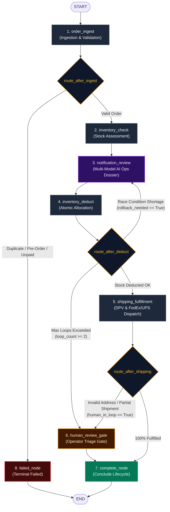

# Enterprise Order Fulfillment Orchestrator

An enterprise-grade, multi-model agentic order fulfillment orchestrator built with **LangGraph**, **Python 3.12+**, **PostgreSQL state persistence**, and **Flyway database migrations**.

Features automated inventory assessments, multi-model AI operational dossiers, atomic warehouse allocation, dynamic race-condition rollback loopbacks, carrier waybill dispatch (FedEx/UPS), and human-in-the-loop review gates.

---

## 🏗 System Architecture & Workflow Diagram



> [!TIP]
> **Interactive Zoom & Pan Diagram**:
> An interactive HTML diagram with zoom controls, panning, and a real-time node inspector drawer is available in the artifacts directory at `workflow_diagram.html`.

---

## 🧩 Orchestration Stages & Core Nodes

| Node | Name | Type | Key Responsibilities |
| :--- | :--- | :--- | :--- |
| **Node 1** | `order_ingest` | Operational | Fetches order & line items, validates payment, checks duplicate order ID signatures, suppresses pre-orders. |
| **Node 2** | `inventory_check` | Operational | Queries warehouse inventory API, classifies items (`IN_STOCK`, `PARTIAL_STOCK`, `OUT_OF_STOCK`, `DISCONTINUED`), computes fulfillment outlook (`FULL`, `PARTIAL`, `NONE`). |
| **Node 3** | `notification_review` | Multi-Model AI | Evaluates stock health. Skips alert if 100% in stock. If shortages exist, compiles comprehensive internal ops briefing dossier with ASCII item table and ERP/WMS recommended actions via centralized `prompts.json`. Dispatches idempotent alerts to operations. |
| **Node 4** | `inventory_deduct` | Operational | Communicates with Warehouse API to deduct reserved stock. Records atomic audit logs in `order_inventory_transactions`. Detects concurrent stock race conditions. |
| **Router** | `route_after_deduct` | Dynamic Router | If race condition occurs (`rollback_needed == True`), initiates a dynamic **reverse loopback** to Node 3 to refresh ops dossier. Escalates to human gate if loop threshold exceeded. |
| **Node 5** | `shipping_fulfillment` | Operational / AI | Validates destination address via DPV verification. Dispatches shipment to FedEx/UPS, generates tracking code and label URL, and prompts Multi-Model LLM for final executive closure report. |
| **Router** | `route_after_shipping` | Edge Router | Routes to `human_review_gate` if address is invalid or order is partially shipped; otherwise advances to completion. |
| **Node 6** | `human_review_gate` | Operator Gate | LangGraph `interrupt_before` pause gate allowing manual operator review and resumption for address issues or unfulfilled lines. |
| **Node 7** | `complete_node` | Terminal Success | Concludes order lifecycle, preserving status (`COMPLETED`, `PARTIALLY_SHIPPED`, `WAITING_HUMAN_REVIEW`) and closing database connections. |
| **Node 8** | `failed_node` | Terminal Failure | Concludes terminated orders (`DUPLICATE`, `DEFERRED_PRE_ORDER`, `FAILED`). |

---

## 🛡 Resiliency & High-Availability Architecture

The orchestrator enforces a 3-layer defense against transient errors, concurrent race conditions, and infrastructure drops:

1. **Layer 1: REST Client Resilient Backoff** (`src/orchestrator/clients/base_http.py`)
   - Transparent OAuth2 client credentials token caching and refresh.
   - Built-in exponential backoff and retries on 429 and transient transport drops.
2. **Layer 2: LangGraph Node-Level RetryPolicy** (`src/orchestrator/graph/builder.py`)
   - Centralized `RetryPolicy` configured across operational nodes (`NODE_MAX_RETRIES=3`, `initial_interval=1.0s`, `backoff_factor=2.0`, `jitter=True`).
   - Domain error classifier (`is_transient_retryable_error`) filters retryable network drops and 5xx errors while allowing deterministic business errors to fail fast.
3. **Layer 3: Database & Sandbox Offline Resilience** (`src/orchestrator/repositories/`)
   - Repositories (`order_repo`, `line_item_repo`, `inv_tx_repo`, `checkpoint_repo`, `notification_repo`) catch connection pool timeouts in `try...except`, logging warnings while allowing in-memory state transitions to execute without crashing the graph.

---

## 🤖 Multi-Model LLM & Prompt Architecture

- **Prompt Manager** (`src/orchestrator/config/prompts.py`):
  - Decoupled prompt templates stored in `src/orchestrator/config/prompts.json` (prepared for live sync with internal Observability Hub).
  - Versioned templates: `ops_inventory_shortage_briefing`, `shipping_address_issue_briefing`, `final_order_fulfillment_summary`.
- **Dual-Model Fallback** (`src/orchestrator/clients/llm/factory.py`):
  - Primary provider defaults to **Google Gemini Flash** for high-throughput, low-latency reasoning.
  - Automatically falls back to **Anthropic Claude** if Gemini returns transient errors or rate limits.
  - Transparent simulated mock mode when running in local development without API keys.

---

## 🚀 How to Run the Application

### 1. Prerequisites
- Python 3.12+ (or Python 3.14)
- [`uv`](https://github.com/astral-sh/uv) (recommended) or standard virtualenv
- PostgreSQL 16 (optional for local mock execution; required for live persistence)

### 2. Environment Setup
```bash
# Clone and enter workspace
git clone <repo-url>
cd focused-chandrasekhar

# Create .env from template
cp .env.example .env
```

### 3. Run Orders with the CLI Runner
The orchestrator includes an end-to-end CLI runner (`src/orchestrator/graph/runner.py`) that executes the compiled StateGraph across any scenario:

```bash
# 1. Run a Standard 100% In-Stock Order (dispatches FedEx shipment)
/opt/homebrew/bin/uv run --no-sync python -m src.orchestrator.graph.runner ORD-DEMO-001

# 2. Run an Inventory Shortage Order (partial stock + discontinued item + AI ops dossier)
/opt/homebrew/bin/uv run --no-sync python -m src.orchestrator.graph.runner ORD-SHORTAGE-001

# 3. Run a Deduction Race Condition Order (demonstrates rollback loopback to Node 3)
/opt/homebrew/bin/uv run --no-sync python -m src.orchestrator.graph.runner ORD-RACE-001

# 4. Run an Invalid Destination Address Order (DPV failure + LLM diagnostic + human review)
/opt/homebrew/bin/uv run --no-sync python -m src.orchestrator.graph.runner ORD-INVALID-001
```

---

## 🧪 How to Run Tests

The test suite covers domain entities, PII-sanitized contextual logging, and end-to-end LangGraph state flow execution:

```bash
# Run all tests using pytest and uv
/opt/homebrew/bin/uv run --no-sync pytest tests/ -v
```

### Test Suite Structure
- `tests/test_state_flow.py`:
  - `test_standard_order_orchestration_flow`: Verifies full uninterrupted flow to `COMPLETED`.
  - `test_shortage_order_orchestration_flow`: Verifies shortage detection, LLM dossier, and routing to `human_review_gate`.
  - `test_race_condition_loopback_flow`: Verifies dynamic loopback from Node 4 back to Node 3.
  - `test_invalid_address_routing_flow`: Verifies carrier address validation failure and triage escalation.
- `tests/test_log_helper.py`: Verifies PII redaction (bearer tokens, credit cards, SSNs) and state log buffering.
- `tests/test_entities.py`: Verifies Pydantic domain models and immutability constraints.

---

## 🗄 Database Schema & Flyway Migrations

When running with PostgreSQL, database tables are managed via Flyway migrations located in `db/migrations/`:

| Version | Migration Script | Description |
| :--- | :--- | :--- |
| **V1** | `V1__init_langgraph_checkpoints.sql` | Native LangGraph checkpointer tables (`checkpoints`, `checkpoint_blobs`, `checkpoint_writes`). |
| **V2** | `V2__create_order_orchestration_schema.sql` | Primary `order_orchestration_runs` table, state lookup tables, and index strategy. |
| **V3** | `V3__create_order_line_items.sql` | Granular `order_line_items` table with stock statuses, deduction quantities, and pricing. |
| **V4** | `V4__create_node_checkpoints_and_audit.sql` | `node_execution_checkpoints` capturing stage latency, LLM comments, and metadata. |
| **V5** | `V5__create_notifications_and_inventory_transactions.sql` | `order_notifications` (idempotent dispatches) and `order_inventory_transactions` (physical stock reservations & rollbacks). |

### Applying Migrations
```bash
# Apply with standalone script
./scripts/migrate.sh

# Or apply via Docker Compose
docker compose up flyway
```

---

## 📁 Repository Directory Structure

```text
.
├── db/
│   ├── flyway.conf                                # Flyway engine configuration
│   └── migrations/                                # Sequential Flyway SQL migrations (V1 to V5)
│
├── src/
│   └── orchestrator/
│       ├── adapters/                              # External API Adapters
│       │   ├── base.py                            # Base HTTP adapter with mock fallback
│       │   ├── order_adapter.py                   # Order & Order Details API
│       │   ├── inventory_adapter.py               # Warehouse Inventory API
│       │   └── shipping_adapter.py                # Carrier Address DPV & Dispatch API
│       │
│       ├── clients/                               # HTTP & LLM Clients
│       │   ├── base_http.py                       # RestClient with OAuth2 and backoff
│       │   └── llm/                               # Multi-Model LLM Clients
│       │       ├── factory.py                     # Primary/fallback orchestrator
│       │       ├── gemini_client.py               # Google Gemini Flash client
│       │       └── claude_client.py               # Anthropic Claude client
│       │
│       ├── config/                                # Centralized Configurations
│       │   ├── settings.py                        # Pydantic Settings & retry policies
│       │   ├── prompts.json                       # Centralized prompt templates
│       │   └── prompts.py                         # Thread-safe PromptManager
│       │
│       ├── core/                                  # Cross-Cutting Infrastructure
│       │   ├── log_helper.py                      # PII redaction, latency profiling, state logs
│       │   └── logging.py                         # Application logger
│       │
│       ├── db/                                    # Database & Session Management
│       │   └── session.py                         # Connection pool & query helpers
│       │
│       ├── entities/                              # Pydantic Domain Entities
│       │   ├── order_run.py                       # OrderOrchestrationRun
│       │   ├── line_item.py                       # OrderLineItem
│       │   ├── node_checkpoint.py                 # NodeExecutionCheckpoint
│       │   └── inventory_transaction.py           # OrderInventoryTransaction
│       │
│       ├── repositories/                          # Data Access Layer
│       │   ├── order_run_repository.py
│       │   ├── line_item_repository.py
│       │   ├── node_checkpoint_repository.py
│       │   ├── notification_repository.py
│       │   └── inventory_transaction_repository.py
│       │
│       ├── services/                              # Business Logic Layer
│       │   ├── order_service.py                   # Ingestion & validation
│       │   ├── inventory_service.py               # Stock assessment & deduction
│       │   ├── notification_service.py            # Ops briefing & alerting
│       │   ├── shipping_service.py                # Carrier fulfillment & closure
│       │   └── llm_service.py                     # Multi-Model LLM reasoning
│       │
│       └── graph/                                 # LangGraph StateGraph Architecture
│           ├── builder.py                         # Graph compilation with RetryPolicy
│           ├── runner.py                          # E2E CLI execution script
│           ├── edges/
│           │   └── routers.py                     # Edge routing pure functions
│           └── nodes/                             # Node execution functions
│               ├── order_ingest.py                # Node 1
│               ├── inventory_check.py             # Node 2
│               ├── notification_review.py         # Node 3
│               ├── inventory_deduct.py            # Node 4
│               ├── shipping_fulfillment.py        # Node 5
│               ├── human_review_gate.py           # Node 6
│               ├── complete_node.py               # Node 7
│               └── failed_node.py                 # Node 8
│
└── tests/                                         # Test Suite
    ├── test_entities.py                           # Domain entity validation
    ├── test_log_helper.py                         # Redaction & state log buffering
    └── test_state_flow.py                         # E2E state transition tests
```
